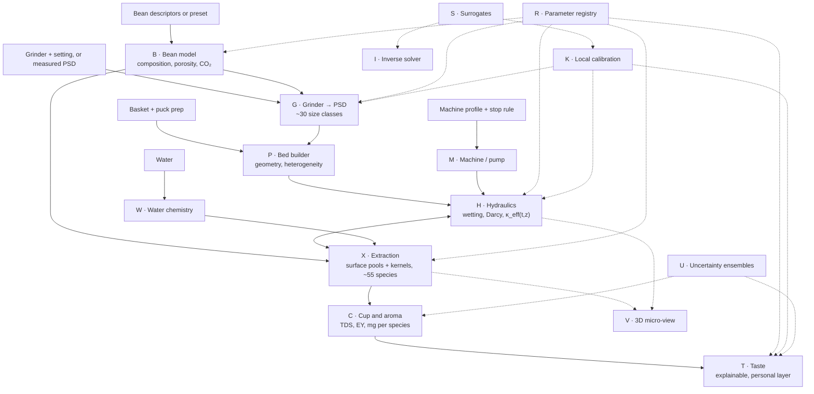

# Puckworks: consolidated plan and goals

*Version 0.9.1 · Last updated 2026-10-19 · Status: M2 integrated; M3 uncertainty/taste, M4 experimental Dial-in and M5 experimental Explore implemented. Scientific validation and target laptop/phone G5 performance gates remain open (see §12 and §15).*

Puckworks is an open-source espresso simulator that runs entirely in the browser. It follows a shot from bean to cup:

- the particle-size distribution (PSD) leaving the grinder;
- the structure and hydraulics of the puck;
- the dissolution and diffusion of about 55 individual compounds;
- what reaches the cup: strength (TDS), extraction yield (EY), per-compound amounts, caffeine, and an explainable taste estimate.

Every number carries its provenance and an uncertainty band.

This plan consolidates the planning Q&A of 2026-10-13 and three research notes. The notes hold the equations, parameter tables and full references.

| Note | Covers |
|---|---|
| [01 Extraction and flow physics](research/01-extraction-and-flow-physics.md) | multiscale extraction models; permeability, compaction, swelling, channeling; parameter table; validation datasets; browser numerics |
| [02 Chemistry and sensory](research/02-chemistry-and-sensory.md) | roasted-coffee composition; key odorants; per-compound extraction kinetics; bean properties → composition; water; taste modelling |
| [03 Grinding, PSD and data](research/03-grinding-psd-and-data.md) | PSDs; grinder and bean effects; puck-prep evidence; public datasets and their licences; prior ML work |

---

## 0. TL;DR

- **What:** a physics-first simulator, with machine learning where physics is weak. It is a static website licensed GPL-2.0-or-later, and it never collects user data.
- **Four roles, all in scope:** dial-in assistant, experimentation sandbox, visual explainer, public website.
- **Core model:** a 1D-in-depth multiscale bed of spherical particles. Each particle has a fast broken-cell surface pool and a slow intact-cell kernel. The model adds parallel columns for channeling, a wetting front, calibrated permeability and poroelastic flow saturation. Individual compounds ride on the computed flow as "passenger" species.
- **What the research forced:**
  1. In-shot permeability is 10–1000× below what particle size predicts, so permeability is *calibrated*, not predicted.
  2. Measured espresso extraction rates exist for only four species. Other species are estimated by kinetic class and tagged as estimates.
  3. No espresso taste dataset exists. Taste is therefore explainable, labelled uncertain, and learns from your own ratings.
  4. No physics maps burr geometry to particle sizes, so the grinder model starts empirical.
- **First milestone ([M1](#m1-validated-core-and-lab-view)):** a validated core plus a lab view, checked against Schmieder 2023, Cameron 2020 and Waszkiewicz 2026.

---

## 1. Vision

### 1.1 Four roles

| Role | What it does | Judged by |
|---|---|---|
| **Dial-in assistant** | Describe your beans, grinder, puck and machine, or pick presets. Get predicted time, yield, TDS, EY and taste. Log real shots locally, calibrate the model to your setup, and ask the inverse solver what to change. | prospective error on your next shots |
| **Sandbox** | Exposes every parameter with its source and uncertainty. Run sweeps, comparisons and sensitivity analyses. Try new methods (profiles, puck prep, temperatures, ratios, bean treatments) and counterfactuals ("no fines", "perfectly even puck"). | agreement with published experiments; mechanistic sense |
| **Visual explainer** | A 3D micro-view of real-size particles, puck cross-sections, compound flows over time, and guided "why" scenarios. | clarity, and consistency with the numbers |
| **Public website** | A free static site that works offline, with presets for common gear and shareable links. No accounts, no tracking. | usefulness and trust |

### 1.2 Design principles

1. **One state, many views.** The dial-in, lab and 3D views all render the same simulation state, so a visual can never contradict the numbers.
2. **Physics first, ML for the gaps.** Learned components never replace conservation laws. Surrogates fall back to physics outside their training domain.
3. **Provenance everywhere.** Every parameter carries:
   - a source;
   - an evidence grade (A–D, as defined in the research notes);
   - a tag: measured, derived, estimated or fitted.

   The UI shows all three.
4. **Honest uncertainty.** Every output has an uncertainty band, and the least certain layers (taste, aroma) say so.
5. **Private by construction.** Nothing about the user leaves the browser unless they export a file.
6. **Progressive disclosure.** Simple by default, with every parameter reachable.
7. **General by design.** The owner's gear is only the first set of presets. Every input can be described from scratch:
   - any basket diameter and wall profile (straight, tapered or stepped), with plain holes or a pressurised (dual-wall) outlet;
   - any grinder, through a burr family or a measured particle-size distribution;
   - any machine, through a pressure/flow program and a pump curve.

---

## 2. Locked decisions (2026-10-13)

| # | Topic | Decision |
|---|---|---|
| D1 | Purpose | All four roles: help with dialing in, a sandbox for experimenting with new methods by changing parameters, a visualizer, and a public website |
| D2 | Particle fidelity | **Hybrid.** A whole-puck continuum model with ~30 particle-size classes computes all numbers. A 3D micro-view of a small region, with thousands of explicit particles, shows flow, channeling and per-particle extraction |
| D3 | Prediction engine | **Physics + ML.** A mechanistic backbone, with ML for closures (grinder → PSD, puck prep, channeling), taste, calibration and fast surrogates |
| D4 | Control model | **Forward + inverse.** A machine-like forward simulation with a stop rule (time or weight), plus an inverse solver ("18 g → 36 g in 28 s: which grind?") |
| D5 | Grinder model | **Empirical first.** A grinder database, a 3-mode log-normal PSD model, per-user calibration and a manual PSD override. A geometry-driven grinding model comes later, as research |
| D6 | Beans | **Descriptors + presets.** Species, variety group, altitude, process, roast level and days off roast → inferred composition and physical properties, all overridable. No roasting simulation |
| D7 | Compounds | **~30 non-volatiles + ~25 key odorants.** Each parameter is tagged measured / derived / estimated / fitted |
| D8 | Taste | **Explainable + learnable.** A chemistry-based estimate with uncertainty that learns from the user's own ratings, locally |
| D9 | User data | **Never collected.** A static site forever: no accounts, uploads, analytics or telemetry. Models improve only through new releases |
| D10 | Owner's gear | Machine: **AMZCHEF Ultra**, with a **58 mm single-wall basket** and a pressure gauge. Grinder: **AMZCHEF single-dose grinder**. A scale; no refractometer. These describe presets, not a calibration rig: the owner considers the setup insufficiently accurate and repeatable for simulator calibration. Use online measurements (D15). *(Basket, gauge and scale confirmed 2026-10-14; single-wall basket and calibration preference confirmed 2026-10-15.)* |
| D11 | First milestone | **Validated core + lab view** |
| D12 | Licence | **GPL-2.0-or-later.** Combined builds that include Apache-2.0 or GPL-3.0 code are distributed under GPLv3 |
| D13 | Name | **Puckworks** |
| D14 | Hosting | **GitHub Pages.** It cannot set custom HTTP headers, so the app must not rely on cross-origin isolation or SharedArrayBuffer (§7.5) |
| D15 | Calibration data | **Use online data, including community and hobbyist measurements.** Academic publication is not an admission requirement. Core development must not depend on the owner's shots or new equipment. Select data by measurement provenance, useful metadata, repeatability, uncertainty and reuse terms; see the [community-source audit](research/04-community-shot-data.md). *(Owner direction, 2026-10-15.)* |

Implementation choices (stack, numerics) are not locked. §7 proposes them, and each is recorded as an ADR (architecture decision record) in `docs/decisions/` when made.

---

## 3. Goals and success criteria

| ID | Goal | Measurable criterion |
|---|---|---|
| G1 | Scientifically valid core | Passes the verification suite and the validation targets in [§10](#10-verification-and-validation), on both calibration and held-out datasets |
| G2 | Useful for dialing in | After a calibration session ([§13](#13-calibration-experiments-you-can-run), E1): next-shot time within ±3 s on ≥10 prospective shots. Once a refractometer is available, also EY within ±1 point |
| G3 | Transparent | Every parameter in the registry has a source, grade and tag. Every displayed output has an uncertainty band |
| G4 | Insightful visuals | 3D micro-view and cross-sections reproduce the continuum averages: local EY within ±0.5 point of the continuum cell they represent |
| G5 | Fast | Tier 0 ≤ 10 ms; Tier 1 ≤ 1 s per 30 s shot. 3D view ≥ 60 fps with ~30k particles on a mid-range laptop, and ≥ 30 fps with 5–10k on a recent phone |
| G6 | Public and private | Static and offline-capable (PWA). Zero runtime requests to third parties. No stored data outside the browser |
| G7 | Maintainable | One physics implementation shared by the browser and the offline tools. Docs, version and changelog current with every change |

---

## 4. Scope

**In scope**
- Espresso and its variants on pump and lever machines:
  - flat, declining and lever pressure profiles; flow profiles;
  - pre-infusion and blooming;
  - turbo shots and ristretto-to-allongé ratios;
  - temperature set points and profiles.
- Baskets of 49–58.5 mm, stock or precision, including hole pattern and open area; doses of ~7–25 g.
- Puck prep: distribution, WDT (needle stirring), tamp, puck screen, top and bottom paper, headspace.
- Beans by descriptors or presets, including bean temperature at grinding, water spritzing (RDT) and age since roast.
- Grinders by named model or by generic family (flat/conical, burr diameter, burr style, RPM). Import of a measured PSD.
- Water chemistry: alkalinity, hardness, TDS.
- Cup outputs: TDS, EY, per-compound amounts, caffeine, pH and titratable acidity, a body proxy, aroma over time after brewing, a crema index, and a taste profile.

**Out of scope for now.** The engine stays general enough to add these later.
- Other brew methods: moka, pour-over, immersion, cold brew.
- Roasting simulation (green bean + roast curve → roasted composition).
- Milk drinks, and crema foam physics beyond an index.
- Mechanistic burr-geometry grinding, until the research track (M7).
- Health claims beyond reporting caffeine and diterpene amounts.

**Permanently out (D9):** anything that collects or transmits user data.

---

## 5. What you set and what the simulator predicts

| Domain | You set (presets available) | Puckworks predicts |
|---|---|---|
| Beans | species or blend, variety group, altitude, process, roast level, days off roast, storage, bean temperature, RDT water dose | composition (~55 species), density, intraparticle porosity, brittleness, moisture, remaining CO₂ |
| Grinder | model or family (flat/conical, burr diameter, burr style, RPM) and setting; or a measured PSD | full PSD (volume- and number-weighted), fines fraction, Sauter diameter, in-puck clumping state |
| Puck | basket, dose, distribution, tamp, screen, papers | bed height, porosity split, initial permeability field, heterogeneity, headspace |
| Machine | pressure or flow program, pre-infusion, temperature, stop rule (time, weight or volume) | whichever of pressure or flow is not controlled; shot time or yield; puck temperature; post-stop drip |
| Water | alkalinity, hardness, TDS | buffering of acids, pH, CO₂ from bicarbonate, cup minerals |
| Extraction | nothing: it is emergent | EY(t); TDS(t), cumulative and drop by drop; per-species extraction % and mg in the cup; local-EY map and uniformity |
| Cup and taste | your ratings (optional, stored locally) | caffeine mg; pH and titratable acidity; body proxy; aroma intensities and their decay after brewing; crema index; sour, sweet, bitter (with bitterness type), body, astringency and aroma notes, each with uncertainty |
| Inverse | targets: time, yield, TDS, EY, taste balance | settings that hit the targets (grind, dose, ratio, temperature, profile), ranked and with uncertainty |

---

## 6. What the research changed

| # | Finding | Consequence for the design | Source |
|---|---|---|---|
| 1 | The literature converges on a 1D bed coupled to spherical particles with a fast surface pool and slow kernel diffusion: Moroney 2015 → Cameron 2020 → Grudeva, Moroney & Foster 2026. The last adds the wetting front and a reduced model ~100× cheaper | adopt this model as the Tier-1 core; the reduced model informs Tier 0 | 01 §3 |
| 2 | In-shot effective permeability is about (2–15)×10⁻¹⁵ m². That is 2–200× below permeameter values and 10–1000× below Kozeny–Carman from the measured PSD | the base permeability κ₀ is calibrated, never predicted from the PSD. Kozeny–Carman is used only for relative changes | 01 §4.3 |
| 3 | Long-time flow saturates with pressure: Q/Q_c = 1 − (1 − P/P_c)⁴, with P_c ≈ 12 bar | poroelastic compaction closure | 01 §3.7 |
| 4 | At constant pressure, flow rises during the shot (wetting, dissolution, falling viscosity). Swelling, compaction and fines migration push it the other way | each mechanism is an explicit, switchable term | 01 §4.11 |
| 5 | EY versus grind peaks, then falls at fine settings (Cameron 2020). A two-path extraction–permeability instability reproduces this (Lee 2023) | parallel-column heterogeneity is part of the core, not an add-on | 01 §6 |
| 6 | Community coring puts puck edges at about half the centre's EY. Bottom paper, puck screens and less headspace each add 0.4–3.4 EY points (evidence grade D) | radial annuli plus puck-prep modifiers with wide priors | 01 §6; 03 §4 |
| 7 | PSDs are bimodal, and the fines mode (~40–50 µm) barely moves. On one calibrated grinder the median (X50) is ≈ 1.4 × the burr gap. Dialing in mainly changes the fines fraction. Measured fines depend on method: 15–36% dry vs 30–49% wet | 3-mode log-normal PSD model, plus an explicit measurement model | 03 §1–2 |
| 8 | No published model predicts a PSD from burr geometry | empirical, hierarchical grinder model; geometry research later (D5) | 03 §3 |
| 9 | Tamping force above ~10 kgf has no measurable effect (three datasets) | threshold model | 03 §4 |
| 10 | Rate data exist for only four species. For a 20 g dose, the characteristic beverage mass λ is 16.1 g (trigonelline), 17.5 g (TDS), 20.8 g (5-CQA) and 23.1 g (caffeine). Extraction order follows polarity | kinetic classes K1–K6; species outside the measured four are tagged "estimated" | 02 §3 |
| 11 | Caffeine carries only about 10–20% of bitterness (estimates vary). Chlorogenic acid lactones dominate at light-to-medium roast, phenylindanes at dark roast | bitterness modelled by compound class, with a bitterness-type output | 02 §6.1 |
| 12 | Cup composition depends on the extraction trajectory, not just on EY | report per-species results and the distribution of local EY, not only mean EY | 01 §5.6 |
| 13 | Under flow control, 80–98 °C made no measurable difference to the cup masses of the four measured species | temperature acts mainly through viscosity, diffusivity and aroma; treated as a modest lever | 01 §7 |
| 14 | No espresso sensory map exists. Cup aroma changes within minutes: ~60% of 2-furfurylthiol is bound within 10 min | taste is explainable, banded and personalizable; aroma is reported as a function of time after brewing | 02 §2, §6 |
| 15 | The largest shot corpus (Visualizer) has no data licence. Good open datasets are small, and some are non-commercial | data and licensing rules ([§11](#11-data-and-licensing-rules)) | 03 §5 and Implications E |

---

## 7. Architecture

### 7.1 Pipeline



Solid arrows carry simulation state. Dotted arrows are supporting services.

### 7.2 Fidelity tiers

| Tier | Model | Budget | Used for |
|---|---|---|---|
| 0 Preview | Reduced physics: 1 column (optionally 2 paths), 2 size classes, linear-driving-force kernels, lumped TDS, species by class scaling. Later also an ML emulator | ≤ 10 ms | live slider feedback, inverse solver, calibration likelihoods |
| 1 Standard | Full 1D multiscale model: 30–50 depth cells; ~30 size classes (adaptive, never below 8); 8 columns in 3 radial annuli; ~55 species | ≤ 1 s | every displayed result; runs in a Web Worker once inputs settle |
| 2 Detailed | 2D axisymmetric Darcy flow + transport (basket holes, shower screen, headspace, edge effects), with more columns and classes | seconds to minutes | Lab studies; training data for Tier 0 |
| 3 Offline research | Pore-scale and particle simulations (pore networks, lattice Boltzmann, DEM); mass sampling of Tier 1 | hours, offline | deriving closures; training surrogates; Bayesian calibration on literature data |

**How Tier 1 stays within budget**
- *Condensed particle states.* Particle states are local to each depth cell, so they are condensed out cell by cell. The bed solve stays tridiagonal per column.
- *Linear compound transport.* Given the flow, compound transport is linear. The hydraulics and the lumped TDS are solved once. Each species is then a small banded linear system driven by the same flow and temperature history.
- *Shared solves.* Species that share transport parameters are scaled copies of one solve. Species-specific diffusivities are interpolated across a log-spaced basis of 6–8 solves.
- *Parallelism.* The work spreads across Web Workers and, later, WebGPU.
- *Fallback.* If the budget is still missed, species fall back to 8–12 quadrature classes; the full ~30 classes stay for the lumped TDS.

### 7.3 Modules

**B · Bean model.** Maps bean descriptors to composition and physical properties. See 02 §1 and §4.
- *Composition priors.* From Farah 2012 and related tables, separately for Arabica and Robusta. Roast-indexed curves cover chlorogenic acids and their lactones, trigonelline, sucrose, acids, polysaccharides and melanoidins.
- *Odorants.* Contents from Semmelroch 1995 and Mayer 2000, scaled by roast (low confidence).
- *CO₂.* By roast and age, from the Weibull degassing fits of Smrke 2018.
- *Physical properties.*
  - skeletal density ~1300–1400 kg/m³;
  - intraparticle porosity 0.47–0.65;
  - brittleness from roast and moisture.
- *Modifiers.* Altitude and process act as small modifiers (Worku 2018; Knopp 2006).
- *Roast scales.* Each source's roast colour scale is kept as published and mapped to one internal roast index with stated uncertainty.
- *Presets.* A curated set of typical coffees, e.g. light washed Arabica, medium natural Brazil, a dark 80/20 blend, and Robusta.

**G · Grinder → PSD.** See 03 §1–3 and Implications A.
- *Generative form.* A volume-weighted 3-component log-normal mixture:
  - fines mode μ_f ≈ 40 µm, nearly invariant;
  - coarse mode μ_c = κ_G · g · f_roast · f_T;
  - a boulder tail.
- *Setting → gap.* The burr gap is g = g₀ + Δ(s − s₀). Δ comes from manufacturer specifications; the zero offset g₀ and the scale κ_G are calibrated.
- *Fines weight.* Falls by ~0.09–0.10 percentage points per µm of X50, plus a per-grinder "unimodality" offset.
- *Bean modifiers.*
  - Dark roast grinds up to ~100 µm finer at the same setting.
  - Colder beans grind finer and narrower (Uman 2016).
  - Static clumping (low moisture) and RDT change the *in-puck effective* PSD, not the dispersed PSD.
- *Measurement model.* Covers dry laser diffraction (LD), wet LD, dynamic image analysis and phone images, so that heterogeneous sources and user files are fitted consistently.
- *Outputs.* The mixture parameters θ (≈9 numbers), ~30 solver size classes, Sauter diameter and fines fraction.
- *Database.* Generic families, plus named grinders with published data: Mahlkönig E65S and EK43, Bentwood Vertical 63, and more as data allow.

**P · Bed builder.** See 03 §4 and Implications B.
- *Geometry.* Basket geometry and dose give bed height and headspace.
- *Density and porosity.* Bulk density is ~360–500 kg/m³. The split between intergranular and intraparticle porosity is poorly constrained and becomes a calibration target.
- *Heterogeneity.*
  - 8 columns with log-normal permeability multipliers. The spread depends on distribution, fines fraction and clumping.
  - 3 radial annuli, with an edge conductance multiplier set by the basket's open area, a bottom paper and a puck screen.
  - A pre-wetting non-uniformity parameter driven by headspace, pre-infusion flow and the shower screen.
- *Tamp.* No effect above ~10 kgf.

**M · Machine model.**
- *Pump.* Pressure- or flow-controlled.
- *Profiles.* Steps with targets, limits and exit conditions (time, weight, pressure, flow), compatible with common profile formats.
- *Machine physics:*
  - spring-lever pressure decay;
  - headspace fill and compliance;
  - a lumped thermal node for group and basket;
  - stop rules and post-stop drip.
- *Presets.* Flat 9 bar, declining, lever, blooming, turbo, allongé.
- *Shot-log import.* Decent DE1, Visualizer, Gaggiuino and GaggiMate exports, Beanconqueror. Logs are parsed locally.

**W · Water.** See 02 §5.
- *Alkalinity* neutralizes titratable acid and produces CO₂.
- *Calcium and magnesium* act through weak, wide priors, because the strong claims about them are computational only.
- *Presets* include the SCA target.

**H · Hydraulics.** See 01 §4 and its Implications section.
- *Wetting.* A sharp wetting front with headspace fill (Grudeva 2026; Foster 2025).
- *Saturated flow.* Darcy series resistance per column. Columns share the inlet pressure, or the total flow under flow control.
- *Effective permeability:*

  κ_eff(t, z) = κ₀ · f_diss(EY_local) · f_comp(σ) · f_swell(t) · f_gas(t) · f_fines(t)

  - κ₀ ≈ 10⁻¹⁵ m², calibrated;
  - compaction (f_comp) by the Waszkiewicz poroelastic closed form;
  - swelling as a relaxation: 0–15% in diameter, τ ≈ 20–30 s (magnitude disputed);
  - a decaying gas penalty scaled by CO₂ content;
  - a growing outlet resistance for fines migration.
- *Viscosity.* Depends on concentration and temperature. Data at brewing temperature are a gap, so the prior is wide.

**X · Extraction.** See 01 §3 and §5, and 02 §3.
- *Bed liquid.* In each column and depth cell, the bed liquid has advection and axial dispersion. The measured Bodenstein number (Bo) is 8–17, still uncertain.
- *Exchange with particles.* The liquid exchanges with each size class through two pools:
  - a broken-cell surface pool, dissolution-limited and capped at a saturation of ~210–280 kg/m³;
  - a kernel, diffusing as a sphere: radial shells for boulders, a linear driving force for fines.
- *Bounds.* Partition coefficient K ≈ 0.42–0.61; maximum extractable fraction 28–34%.
- *Closure options.* The Grudeva saturating flux and the Cameron nonlinear rate are both selectable and compared in validation. A 2-class mode allows direct comparison with literature parameter sets.
- *Species by kinetic class:*
  - K1–K3 diffuse;
  - K4 adsorb or bind;
  - K5 (lipids, diterpenes) are a particulate source tied to fines erosion and shear;
  - K6 (CO₂, flash volatiles) are released on wetting and lost to headspace.
- *Mass balance* is checked at every step.

**C · Cup and aroma.**
- *Composition.* Cumulative cup composition and caffeine mg.
- *TDS* both true and as a refractometer would read it, including the filtered-vs-unfiltered offset and temperature.
- *pH and titratable acidity* from an acid–base speciation.
- *Volatiles.*
  - Lost to headspace in the stream and in the cup, using temperature-dependent Henry constants.
  - Thiols become bound over minutes.
- *Crema index* from CO₂, lipids and polysaccharides.

**T · Taste.** See 02 Implications C.
- *Inputs.* Doses over threshold for tastants and odour activity values for odorants. These feed saturating intensity functions, one per modality:

| Modality | Driven by |
|---|---|
| Sour | titratable acidity and organic acids |
| Sweet | sucrose plus aroma-congruence terms |
| Bitter | caffeine, lactones, phenylindanes, diketopiperazines (output includes the bitterness type) |
| Body | TDS, a viscosity proxy, the emulsion |
| Astringency | chlorogenic acids |
| Aroma notes | odour activity values of the key odorants |

- *Interactions.* Bitter–sweet and sour–sweet suppression, and aroma-driven sweetness.
- *Calibration in stages:*
  1. Relative weights from consistency with drip TDS/EY sensory maps (Frost 2020; Guinard 2023; Ristenpart 2023 CC0 data).
  2. Espresso data where available (Gloess 2013; Lindinger 2008).
  3. Your own ratings, as a small Bayesian personal layer stored locally.
- *Trust labels per output:*
  - high for directions of change with strength, ratio and roast;
  - medium for relative sourness and bitterness type;
  - low for absolute scores, sweetness, and fruity and floral notes.

**V · 3D micro-view.**
- *Domain.* A representative volume, e.g. a 1.5 × 1.5 mm column through the bed, or a 2 mm cube at a chosen depth.
- *Particles.* Sampled from the PSD. They are explicit down to a cutoff of ~60–80 µm; finer material is a sub-grid filler rendered as point sprites.
- *Packing.* GPU soft-sphere relaxation and compression, with precomputed packings as a fallback.
- *Flow.* A pore-network model solved by conjugate gradients, shown as streamlines and tracers.
- *Extraction.* Each particle uses its own radius and the continuum's local liquid concentration at its depth, so the view agrees with the numbers by construction. Where its absolute permeability differs from the calibrated κ₀, the view is labelled illustrative.
- *Particle inspector.* Click a particle to see its radial concentration profile over time.
- *Cross-sections.* Radius × depth heatmaps of local EY, concentration, velocity and temperature, taken from Tier 1.

**I · Inverse solver.**
- *Three modes:*
  - target recipe → settings ("18 g → 36 g in 28 s");
  - target outcome → settings (EY, TDS, taste balance);
  - next shot, from the last result.
- *Method.* Multi-start Nelder–Mead or CMA-ES on Tier 0, then verified on Tier 1.
- *Output.* Ranked candidates with uncertainty, constrained by your equipment (grinder step size, basket capacity).
- *Optional.* Local Bayesian optimization over your ratings across sessions.

**K · Local calibration.**
- *Input.* Your logged shots: beans, grinder and setting, dose, yield, time, TDS, and optionally curves and ratings.
- *Fitted parameters.* A few hierarchical parameters:
  - grinder zero offset g₀ and scale κ_G;
  - a per-bag permeability multiplier;
  - heterogeneity spread;
  - machine offsets;
  - personal taste weights.
- *Method.* Laplace approximation or small MCMC with Tier 0 as the likelihood engine; results re-checked on Tier 1.
- *Identifiability.* A panel shows which parameters your data actually constrain.
- *Privacy.* Everything stays in the browser.

**S · Surrogates.**
- *Training (offline).* Sobol sampling over ~30–40 inputs, Tier-1 runs through the Python bindings, then emulators for scalar outputs and for curves (via basis coefficients). Training runs can use a workstation or a cluster.
- *Targets:*
  - error ≤ 1% of each output's range on held-out runs;
  - calibrated uncertainty;
  - out-of-domain detection with automatic fallback to physics.
- *Shipping.* Weights ship with the site (~0.1–2 MB), locked to the core version and the parameter-registry hash.

**U · Uncertainty.**
- *Priors* come from the registry, with width set by evidence grade.
- *Offline,* hierarchical Bayesian calibration on literature data produces posterior draws (e.g., 64) that ship with the site.
- *Online,* ensembles run on Tier 0 to produce the bands, with Tier-1 spot checks. M3 v1 supplies input scenarios and a central Tier 1 comparison; posterior draws, calibrated predictive coverage and systematic Tier 1 spot checks remain future work.

**R · Parameter registry.**
- *Record.* One record per parameter:
  - value or prior distribution;
  - units and valid range;
  - source (DOI) and evidence grade;
  - tag (measured / derived / estimated / fitted);
  - licence note and comment.
- *Checks.* Units are machine-checked.
- *UI.* Answers "why this number?" for any value.

### 7.4 Where machine learning enters

| Use | Method | Data | Milestone |
|---|---|---|---|
| Grinder → PSD parameters | hierarchical model (Gaussian process or small network) over grinder family, burr diameter, flat/conical, RPM, gap, roast, moisture, bean temperature | digitized literature PSDs passed through the measurement model; licensed grinder datasets if obtained | M1 (simple), refined later |
| Permeability closure (PSD, dose, roast, age → κ₀) | hierarchical Bayesian regression; per-user calibration | literature shots; your logged shots | M1, M4 |
| Compound transport parameters | hierarchical Bayesian calibration across datasets, separating shared from setup-specific parameters | Schmieder 2023, Vaca Guerra 2024, Kuhn 2017, Gloess 2013 | M1–M2 |
| Taste mapping | explainable model + monotone residual learner; personal Bayesian layer | drip maps (CC0), espresso literature, your ratings (local) | M3–M4 |
| Recipe optimization | Bayesian optimization over your ratings (local) | your journal | M4 |
| Fast surrogates | neural emulators with ensembles | Tier-1 simulation runs | M6 |

### 7.5 Technology (proposed; recorded as ADRs in M0)

| Layer | Proposal | Why |
|---|---|---|
| Numerical core | Rust crate `puckcore` | one physics implementation for the browser (WebAssembly) and the offline tools (native); fast, deterministic, safe |
| Browser binding | wasm-bindgen; a pool of Web Workers, one WASM instance each | parallel species and columns without SharedArrayBuffer, so no special hosting headers are required |
| Python binding | PyO3 + maturin | calibration, surrogate training and validation reports call the exact same core |
| UI | TypeScript, Vite, React (Zustand for state) | mainstream, typed, large ecosystem |
| Charts | uPlot for time series; D3 modules with SVG/Canvas for distributions, heatmaps and radar | fast live updates |
| 3D | Three.js (WebGPU renderer, WebGL2 fallback) via react-three-fiber; WebGPU compute for packing and pore networks | instanced rendering of 10⁴–10⁵ particles |
| ML in the browser | small networks evaluated inside `puckcore`; ONNX Runtime Web only if models outgrow that | tiny download, one runtime |
| Offline science | Python: NumPy, SciPy, PyTorch or JAX, NumPyro or PyMC, scikit-learn | standard tools |
| Data | registry in YAML validated by JSON Schema; datasets as CSV with metadata sidecars | diffable, reviewable provenance |
| Quality | cargo test + property tests; pytest; Vitest + Playwright; GitHub Actions | catches regressions in the core, tools and UI |
| Hosting | GitHub Pages (D14), deployed by GitHub Actions, plus a service worker for offline use. Assets use relative paths so the site works under any repository sub-path | free, serverless; no custom headers, which the worker-pool design already accommodates |

CI checks every dependency licence for compatibility with GPL-2.0-or-later. MIT, BSD and ISC are preferred; an Apache-2.0 dependency makes the combined build GPLv3.

### 7.6 Repository layout (target)

```
puckworks/
├── README.md  CHANGELOG.md  LICENSE  CONTRIBUTING.md
├── docs/
│   ├── PLAN.md                 this document
│   ├── research/               literature notes 01–03
│   ├── model/                  one spec per module: equations, assumptions, parameters
│   ├── decisions/              ADRs (stack, numerics, closures)
│   └── validation/             generated validation reports, one per release
├── crates/
│   ├── puckcore/               physics, numerics, small-network inference
│   ├── puckcore-wasm/          browser bindings
│   └── puckcore-py/            Python bindings
├── web/                        Vite + React app (Dial-in, Lab, Explore)
├── python/puckworks_tools/     calibration, surrogate training, digitization, validation
├── data/
│   ├── params/                 parameter registry
│   ├── datasets/               literature data + metadata + licences
│   └── presets/                beans, grinders, baskets, machines, water
└── models/                     trained surrogates, versioned with the core
```

### 7.7 Privacy by construction (D9)

- No backend, accounts, analytics, telemetry or cookies.
- No third-party requests at runtime: fonts and libraries are self-hosted.
- Gear, beans, shot journal, ratings and calibration live in the browser (IndexedDB). They leave it only as a file you export.
- Share links carry the setup in the URL fragment (`#…`), which browsers do not send to servers.
- Imported shot logs and PSD files are parsed locally.
- The host is GitHub Pages (D14). Its own access logs are outside the app, and the privacy page says so.
- Models improve only through releases built from literature data, the maintainer's own experiments and datasets used with permission.

---

## 8. Chemistry: tracked species and kinetic classes

Species are grouped into kinetic classes that set their transport priors. Within a class, individual species differ by initial content, molecular size and partition coefficient. The full list is in [Appendix A](#appendix-a-tracked-species).

| Class | Behaviour | Members (examples) | Priors from |
|---|---|---|---|
| K1 very fast | out early; λ/dose ≈ 0.7–0.9 | trigonelline, organic acids, monoester chlorogenic acids and lactones, sucrose, K⁺, polar volatiles | Schmieder 2023; Ludwig 2012; Sánchez-López 2016 (family A) |
| K2 intermediate | λ/dose ≈ 1.0–1.2 | caffeine, 3-/5-CQA, bulk TDS, furans, pyrazines, aldehydes, 2-furfurylthiol, low-MW melanoidins | Schmieder 2023; Mestdagh 2014 |
| K3 slow | still extracting at the end of the shot | diCQAs, diester lactones, Mg²⁺, non-polar odorants (β-damascenone, vinyl- and ethylguaiacol), high-MW melanoidins | Ludwig 2012; Blumberg 2010; Jaganyi 1999 |
| K4 retained or bound | adsorbed by the grounds or bound in the cup | phenylindanes; thiols | Blumberg 2010; Müller & Hofmann 2007 |
| K5 particulate | travels as emulsion or fines, not by diffusion | triglycerides, cafestol, kahweol, cell-wall fragments | Illy & Navarini 2011; Ratnayake 1993 |
| K6 gas / flash-volatile | released on wetting, lost to headspace | CO₂, methanethiol, 2-methylpropanal | Smrke 2018; Sánchez-López 2016 (family C) |

Measured transport data exist for:
- caffeine, trigonelline, 5-CQA and TDS (espresso kinetics);
- K⁺, Mg²⁺, phosphate and Mn²⁺ (particle diffusivities at 80 °C).

Everything else is estimated and tagged as such. Closing the TDS mass balance is itself an open problem: caffeine, trigonelline and 5-CQA together make up only ~10% of espresso TDS (02, data gap 4).

---

## 9. User interface

Three modes share one simulation state. Library, Journal and Science sections sit alongside them.

```
Puckworks   [ Dial-in ]  [ Lab ]  [ Explore ]                   Library · Journal · Science · Settings
───────────────────────────────────────────────────────────────────────────────────────────────────────
Beans    Light washed Arabica, 12 d   │ Shot graph: pressure · flow · cup g · TDS   │ Time      28 s ± 2
Grinder  Flat 64 mm, setting 12       │ curves with uncertainty bands               │ Yield     36 g
Puck     18 g · 58 mm · WDT · paper   │ playback ─────o──────────                   │ TDS 9.4 %   EY 19.2 %
Machine  9 bar · 5 s PI · 93 °C       │ [Log real shot]  [Suggest next shot]        │ Caffeine  120 mg
Water    SCA target                   │                                             │ Taste radar with band
```

- **Dial-in:**
  - setup cards with presets;
  - shot graph with playback, and result tiles;
  - taste radar and a sour↔bitter balance meter;
  - "log real shot", with a predict-then-pull scorecard;
  - calibration status and next-shot suggestions.
- **Lab:**
  - full parameter tree with provenance and uncertainty;
  - choice of fidelity tier and closures; a profile editor;
  - 1D/2D sweeps (e.g., EY and time vs grind) and overlays of several shots;
  - sensitivity analysis (tornado charts, Sobol indices) and counterfactual switches;
  - published-data overlays;
  - export as CSV, JSON or PNG.
- **Explore:**
  - 3D micro-view, with its timeline synced to the shot graph;
  - cross-section heatmaps and the particle inspector;
  - a "which compounds are leaving now" stacked view;
  - guided scenarios: "Why can grinding finer lower extraction?", "Why do edges under-extract?", "What does a turbo shot change?"
- **Library, Journal, Science:**
  - presets and your own gear;
  - a local shot journal with export/import;
  - model documentation, assumptions, references and the latest validation report.
- **Everywhere:**
  - URL-shareable state; works offline;
  - responsive: Dial-in first on phones, with reduced particle counts;
  - keyboard accessible, colour-blind-safe palettes, light and dark themes;
  - metric units, with °F as an option.

---

## 10. Verification and validation

**Verification** checks that the code solves the equations correctly:
- the analytic sphere-diffusion solution (Crank) is reproduced within 0.5%;
- mass-balance error stays below 0.1% per run;
- concentrations stay non-negative;
- the expected convergence order holds under grid and time-step refinement;
- series-resistance flow matches its closed form;
- browser (WASM) and native results agree within a tight tolerance (target 10⁻⁹ relative);
- regression snapshots catch unintended changes.

**Validation** checks that they are the right equations. Datasets are split into calibration and held-out sets, and reported accuracy comes only from held-out sets.

**Source selection (D15).** Community shot archives and controlled hobbyist experiments are eligible alongside academic datasets. A recorded recipe or a machine's target curve is not a measured shot. For startup calibration, establish the time origin and distinguish inlet flow, scale-derived outlet flow and firmware-estimated weight. Unknown dose, basket or grinder inputs remain unknown; do not fill them with presets and score the result as a matched experiment. Hold out whole operators/machines and experimental sessions, and keep duplicates or samples from one trace in the same split. Source credibility and measurement uncertainty determine a dataset's role; publication venue alone does not.

| ID | Dataset | Observable | Role | Initial target |
|---|---|---|---|---|
| V1 | Schmieder 2023 (CC BY) | TDS, caffeine, trigonelline, 5-CQA in 10 fractions; 15 conditions over flow, grind, temperature | calibration, with a leave-one-condition-out check | λ and cup masses within ±10% (fit) and ±15% (left out) |
| V2 | Vaca Guerra 2024 | outlet concentrations vs time for 3 PSDs; tracer residence times | dispersion: calibration; compound curves: held out | curves within the reported scatter; Bodenstein number 8–17 |
| V3 | Cameron 2020 | EY and shot time vs EK43 grind setting (6 bar, 20 g → 40 g) | held out | EY peaks at 22–24% within grind settings 1.5–1.9; time falls monotonically as the grind coarsens |
| V4 | Waszkiewicz 2026 | flow vs pressure (1–12 bar); flow vs time; TDS in 5 s fractions | Q(P): calibration; transient and TDS: held out | flow rises over the first 10–20 s; first-fraction TDS 25 ± 3% |
| V5 | Smrke 2024 | time and EY vs burr gap and added fines | held out | added fines lengthen shots; EY tracks time; 10–15 s shots reach 17–18% EY |
| V6 | Corrochano 2015/2017 | permeability vs grind and density; partition; consolidation | calibration of relative closures | relative change in κ with density within ×1.5 |
| V7 | Gloess 2013 | per-cup compounds, extraction efficiencies, titratable acidity | held out (M2) | measured species within ±25%; estimated species reported, not scored |
| V8 | Ribes 2020/21 (community) | radial EY with and without bottom paper and puck screen | weak calibration | edge/centre ratio in the right direction and range |
| V9 | Optional local calibration shots ([§13](#13-calibration-experiments-you-can-run)) | time, yield, TDS → EY; ratings | prospective test of the future M4 feature; not a requirement on the owner's setup | time ±3 s and EY ±1 point on ≥10 shots after calibration |

A Python script regenerates a validation report (plots and tables) into `docs/validation/` for every release. The site's Science page shows the latest one.

---

## 11. Data and licensing rules

| Source | Use | Terms | Rule |
|---|---|---|---|
| Schmieder 2023 + supplement | kinetics calibration | CC BY 4.0 | bundle derived parameters with attribution |
| Méndez Harper 2024 (Figshare) | PSD vs roast, moisture, RDT | CC BY 4.0 | bundle with attribution |
| Corrochano 2017 thesis | dry/wet PSD, permeability, partition | open access, copyright retained | use published values with citation; don't redistribute the thesis |
| Ristenpart 2023 (Dryad) | taste-preference pretraining (drip) | CC0 | free to bundle |
| Pannusch 2023 data and app | kinetic baseline | CC BY-NC 3.0 | don't bundle or port; use only values published in the papers |
| Visualizer.coffee | hydraulics and dial-in priors | no data licence; rate-limited API | only with the maintainer's permission; strip personal data; honour deletions |
| Kaffeemacher/ZHAW grinder PSDs | grinder priors | not public | request a licence; meanwhile cite published numbers |
| Coffee ad Astra, Barista Hustle | grinder insights | copyrighted | cite numbers; no scraping |
| DE1 app and Beanconqueror (GPL-3.0); Gaggiuino and GaggiMate (CC BY-NC) | shot-file formats | — | write parsers from the format documentation. GPL-3.0 code may be combined (under "or later"); never copy NC-licensed code |
| CQI-derived datasets | bean covariates | unclear redistribution rights | research use only, after review; don't bundle |

Every dataset in `data/datasets/` carries a metadata sidecar recording its source, its licence, how it was digitized, and the digitization uncertainty.

---

## 12. Roadmap and milestones

Sizes are relative (S, M, L). The site can be deployed as a labelled preview from M1 on. The public launch is M6.

### M0: Foundations
Size S. **Status: complete (v0.1.0, 2026-10-14).** The exit criteria are met; see the [verification report](validation/m0-kernel-verification.md) and the [CHANGELOG](../CHANGELOG.md).
- **Repository:** LICENSE (GPL-2.0-or-later), CONTRIBUTING, `.gitignore`, and CI for Rust, Python and web. The owner created the git repository and authorized assistant git operations on 2026-10-15.
- **Toolchain:** Rust (stable, with the `wasm32-unknown-unknown` target), wasm-bindgen CLI, Node, and a Python virtual environment with maturin.
- **Code skeleton:** Rust workspace with `puckcore` and its WASM and Python bindings; a Vite + React skeleton.
- **Data:** the parameter-registry schema with first entries from the research notes; a dataset folder with licences.
- **Decisions:** ADRs for the stack and the numerics.
- **Exit:** CI green. A sphere-diffusion demo gives identical results in the browser and in Python, and matches Crank's solution.

### M1: Validated core and lab view
Size L. **Status: delivered in 0.2.0 (2026-10-15); its validation exit criteria were not met.** The following numbers describe the preserved [0.2.0 baseline report](validation/baseline-v0.2.0/m1-validation.md); the [current report](validation/m1-validation.md) evaluates M1.1.
  - V1 misses narrowly: λ is within ±10% for 57 of 60 experiment–analyte pairs, and every pair must be.
  - V3: the EY peak lands at the edge of the grind range.
  - V4: the flow rise is too fast, reaching 90% of final flow at 6.7 s against 25.8 s measured, with first drops 1.8 s against 12.8 s after full pressure.
  - Shot times come out at 0.43–0.47× the measured ones, including a case calibrated on long-time flow. This motivated M1.1's investigation of startup physics. Total shot time combines startup and permeability effects; it cannot isolate either cause. The contract between workstreams is [docs/model/m1-contract.md](model/m1-contract.md).
- **Tier 1 physics:**
  - Hydraulics: pressure and flow control, wetting front, series resistance, the κ_eff closure, poroelastic saturation, viscosity, gas, swelling, fines layer.
  - Extraction: ~30 size classes plus a 2-class literature mode; surface pool and kernel; saturation; dispersion.
  - Species: lumped TDS plus caffeine, trigonelline, 5-CQA and an acids class.
  - 8-column heterogeneity and a lumped thermal model.
- **Tier 0:** the reduced model.
- **Input models (v1):**
  - Grinder → PSD: generic families plus E65S, EK43 and Bentwood V63; manual PSD input.
  - Bean model: species, roast, age.
  - Machine: flat pressure, flow control, pre-infusion, stop by time or weight.
- **Lab view:** inputs, shot graph, summary tiles, PSD chart, compound table with provenance, puck cross-section, 1D sweeps, overlays, export.
- **Validation report v1:**
  - calibrated on V1, V2 (dispersion), V4 (Q(P)) and V6;
  - held out: V3, V4 (transient), V5.
- **Exit:** verification suite green; V1 within targets; V3 peak and V4 flow rise reproduced; Tier 1 ≤ 1 s and Tier 0 ≤ 10 ms.

### M1.1: Startup physics
Size M. **Selected by the owner on 2026-10-15, before M2; implementation in 0.3.0.**
- **Data direction:** use online research and community measurements (D15), with the [source audit](research/04-community-shot-data.md) as the intake record. The owner's equipment is not required for calibration. Candidate discovery does not change the existing training/held-out split or make a source calibration-ready.
- **Community comparison tooling (0.4.0):** the [online-shot investigation](validation/community-shot-comparison.md) uses original DE1 logs and their matching measurement sheet for reproducible exploratory comparisons. It distinguishes measured, estimated and target channels, and exact pump-off from the recorded bloom-flow floor. Fixed scenarios expose missing mechanisms and input uncertainty without fitting community observations or changing the existing scientific gates.
- **Pressure-storage investigation (0.5.0):** an opt-in constant compliance stores pump-supplied water and releases it during a pause, with pressure and cumulative-volume diagnostics ([ADR 0011](decisions/0011-upstream-pressure-storage.md)). All 170 fixed 0/0.5/2 mL/bar community scenarios and approximation runs complete without fitting a value. Default flow-command scenarios still produce 1.45–1.51 g during bloom against 3.02–5.85 g observed. At 2 mL/bar they produce 5.52–6.08 g, but end-bloom pressure is only 0.0174–0.0177 bar against 0.72–1.08 bar observed. Storage enables the missing response without establishing a calibrated explanation. The original 117 validation predictions and failures remain unchanged.
- **Next evidence and physics work:** constrain pressure/storage and uptake separately, with qualified inlet delivery, PSD and clock metadata from online sources. Resolve mobile/immobile water exchange and simultaneous filling only with stated assumptions and independent evidence. A constant compliance does not identify a unique physical mechanism, and matching bloom gain alone cannot establish calibration.
- **Outcome:** startup improves, but the scientific gates remain open. V4 first drops move from 1.8 to 6.8 s (12.8 s measured), and the flow rise from 6.7 to 12.1 s (25.5 s measured). V1 extraction rates within ±10% regress from 57/60 to 48/60. Generic 18 → 36 g pump-stop times remain short at 15.6–17.0 s. The [M1.1 investigation](validation/m11-startup.md) documents the remaining failures and ablations; M2 was subsequently selected by the owner on 2026-10-17; these M1 scientific gaps remain open.
- Count accessible particle pore water in the infiltration budget and continuum holdup, with particle extraction states represented as effective soluble loading. This is an explicit single-liquid approximation.
- Add a local pore-air mobility relaxation, separate from roast-dependent CO₂. Its amplitude, power and moisture-diffusion mapping remain grade-D estimates, fixed before held-out evaluation.
- Conserve headspace fill through ramps and phase changes, respect pump-off phases, and bound drip by retained water. Report a hydraulic carrier-volume balance separately from soluble mass balance.
- Preserve the original calibration and validation. Refit only the original calibration blocks; V3, the V4 transient and V5 retain their held-out status and strict scoring targets.
- Verify analytical filling times, timestep convergence, conservation and cross-platform agreement. Report experimental improvements and failures separately from numerical verification.
- Version 0.5.0 verification passes 219 Rust, 406 Python and 445 web tests, plus 55 browser checks; seven native/WASM shot fixtures agree exactly. The 0.3.0 browser measurement took 584 ms; its warm preview took 12.5 ms and missed the 10 ms target. Those timings describe that build, machine and recipe, not a guarantee across hardware and inputs.
- Full two-phase flow, finite-rate mobile/immobile water exchange and simultaneous compressible headspace dynamics remain research gaps ([ADR 0010](decisions/0010-startup-water-and-pore-air.md)). Passing all M1 validation gates is still required before calling the core validated.

### M2: Chemistry, beans and water
Size L. **Selected by the owner on 2026-10-17; development available in 0.6.0.**

See the [M2 implementation contract](model/m2-chemistry.md) and [current M2 report](validation/m2-validation.md). The catalogue, class bases, bean descriptors, water and cup observations are implemented with evidence labels. Scientific exit criteria remain separate from delivery: missing Gloess inputs and estimated inventories prevent a claim of independent V7 accuracy. No M1 threshold or fitted coefficient changes.
- **Chemistry:**
  - the full species set (~55), kinetic classes K1–K6 and the transport basis;
  - aroma headspace and thiol binding;
  - lipid emulsion and the crema index;
  - the refractometer reading model.
- **Bean model v2:** altitude, process, variety group, storage; the preset library.
- **Water module:** buffering, pH, titratable acidity.
- **Exit:** compound table complete with tags; TDS equals the sum of species within ±5%; V7 within target.

### M3: Taste and uncertainty
Size M. **Selected by the owner on 2026-10-17 after M2 integration; development available in 0.7.0.**

Implemented in the requested order: solver performance, input scenario uncertainty, then explainable taste. See the [uncertainty contract](model/m3-uncertainty.md), [taste contract](model/m3-taste.md) and [M3 verification report](validation/m3-validation.md). Unknown/measured/fixed input groups cover grinder/PSD, roast age, composition and water. Seeded Tier 0 ensembles supply scenario percentiles, with central Tier 1 results retained separately. Taste v1 exposes chemistry drivers, assumptions and low trust.

The ranges are conditional scenarios, not calibrated predictive intervals. Scientific exit criteria remain open: omitted kinetic/structural/sensory model errors are not bounded; observed espresso sensory-map accuracy and general empirical coverage have not been established. A directional implementation check is separate from reproducing measured drip response surfaces.
- **Taste:** taste model v1 with trust labels.
- **Uncertainty:** ensemble bands on all outputs.
- **Science page:** assumptions and references.
- **Exit:** reproduces the direction of the drip TDS/EY sensory maps; bands on every output; low-trust outputs labelled.

### M4: Dial-in mode
Size M.
- **Barista UI and journal:** a local journal (IndexedDB, export/import) and a calibration wizard.
- **Calibration:** local Bayesian calibration with an identifiability panel.
- **Inverse solver and advice:** the inverse solver (3 modes), next-shot advice, and a predict-then-pull scorecard.
- **Imports and learning:** shot-log importers and personal taste learning.
- **Exit:** V9 met on your shots.

**Implementation in 0.8.0 (owner selected 2026-10-18).** The browser provides
the shared recipe controls, IndexedDB journal with backup and CSV/DE1 import,
immutable forecast-before-observation records, local finite-grid Bayesian
calibration, identifiability diagnostics, three bounded inverse modes with
Tier 1 verification, personal Bayesian rating estimates and a prospective
scorecard. The first local fit supports a bag permeability multiplier and an
optional particle-size scale. Grinder zero, heterogeneity and machine offsets
remain fixed and explicitly unidentifiable in this version. Bounded multistart
coordinate search replaces the proposed continuous optimizer to respect actual
equipment steps; the calibration grid is quadrature, not MCMC or Laplace.
See [ADR 0014](decisions/0014-local-dial-in.md), the
[contract](model/m4-dial-in.md) and [verification](validation/m4-validation.md).

**V9 remains open.** Synthetic parameter recovery verifies plumbing, not
real-world accuracy. Only future local shots predicted after calibration and
before measurement can establish the personal target; no measurements are
required from the owner. Existing scientific targets and source splits remain
unchanged.

### M5: Explore mode
Size L.
- **3D micro-view:** packing, pore-network flow, and per-particle extraction driven by Tier 1.
- **Inspection:** particle inspector and cross-section heatmaps.
- **Guided scenarios.**
- **Exit:** G4 consistency and G5 frame rates met; works without WebGPU via fallbacks.

**Implementation in 0.9.0.** Explore exports actual selected-cell kernel-shell,
surface-pool and class extraction state from the shared Tier 1 shot. A single
recipe/run controller and stored-snapshot timeline drive the cross-section,
representative particles and inspector. Standard and high-resolution modes use
the same parallel 1D equations; high refines depth by 5×, normally 30 → 150 cells.
The future 2D axisymmetric Tier 2 model remains deferred.

Deterministic module-worker packing uses seed 20261018 and statistical class
weights that preserve local continuum EY. The bounded soft-sphere relaxation
reports residual overlaps. Its optional clearance-based lattice uses a CG solve
for an illustrative dimensionless potential/flow view; neither geometry nor
lattice flux feeds back into the shot model. Three.js WebGL2 instanced sphere
impostors support 5,000/25,000 mobile and 30,000/150,000 desktop display presets,
with SVG/cross-section/table fallbacks and no WebGPU requirement. Display counts
change visual detail, independently of extraction resolution. Seven explicit
guided recipe loads retain Undo and evidence labels.

**G4 has numerical representation checks; G5 remains open.** Exact coupled-state
copies and statistically weighted local EY are tested independently of rendering.
They do not validate an observed microstructure or a pore-scale mechanism. The
plan still requires measured frame rates on a mid-range laptop and recent phone;
software/browser smoke checks and the current-device measurement tool do not
establish those hardware gates. Original scientific targets, fitted parameters
and source splits remain unchanged. See [ADR 0015](decisions/0015-explore-state-and-refinement.md),
the [Explore contract](model/m5-explore.md), [M5 verification](validation/m5-validation.md) and [rendering performance follow-up](validation/m5-rendering-performance.md).

### M6: Speed, polish and public launch
Size M.
- **Speed:** ML surrogates with out-of-domain fallback.
- **Offline:** PWA offline support.
- **Quality passes:** performance and accessibility; mobile layouts.
- **Content:** expanded presets, documentation, privacy page.
- **Exit:** all of G1–G7 met; public launch.

**First slice in 0.10.0: offline app.** A complete same-origin production build is
cached with a per-build identity and checked asset digests, including both workers,
the WASM engine and lazy Explore code. Readiness and update controls preserve active
sessions; a new release waits for an explicit reload. The install manifest and
privacy/storage page work under repository subpaths. See [ADR 0016](decisions/0016-offline-release-cache.md),
the [contract](model/m6-offline.md) and [verification](validation/m6-offline-validation.md).
This advances G6 without declaring the full milestone complete. Surrogates,
calibrated predictive coverage, scientific validation, prospective V9 accuracy and
the specified hardware G5 measurements remain unfinished.

### M7: Research track
Open-ended.
- **Tier 2:** 2D axisymmetric model of basket holes, shower screen and headspace.
- **Pore-scale closures:** pore networks and lattice Boltzmann for permeability and dispersion.
- **Mechanistic grinding:** population balance and DEM, driven by burr geometry (D5).
- **Phone-photo PSD:** estimated in the browser (coarse mode only; processed locally).
- **Later candidates:** a roasting module; other brew methods.

---

## 13. Calibration experiments you can run

These are optional experiments for the future local personalization feature (V9/M4), not a request to the owner or a prerequisite for core development. The owner has ruled out relying on their current setup for simulator calibration; use online sources under D15. Any future local measurements stay in the user's journal.

- **With a sufficiently repeatable setup, scale and timer**, E1, E3 and E6 can inform local grinder mapping and permeability from dose, yield and time; these quantities alone do not identify startup mechanisms.
- **E2 and the TDS parts of E4 and E5 need a refractometer.** They are optional future capabilities, not a planned purchase for the owner.

| ID | Experiment | Design | Teaches the model |
|---|---|---|---|
| E1 | Grind sweep | one bag (7–21 days off roast), fixed dose and ratio; 5 settings × 2–3 shots | grinder mapping and permeability scale; your EY-vs-grind curve |
| E2 | Split-shot fractions | swap cups at fixed weights (e.g., 0–8, 8–16, 16–24, 24–36, 36–54 g) and read each fraction's TDS | your setup's λ for TDS: a home version of Schmieder's fractionation |
| E3 | Dose sweep | 16 / 18 / 20 g at the same ratio | bed-depth effects |
| E4 | Temperature | e.g., 88 / 92 / 96 °C, if your machine allows | temperature sensitivity |
| E5 | Puck-prep A/B | bottom paper, puck screen, WDT on/off; ~16 shots per arm to resolve 0.5 EY point | heterogeneity modifiers |
| E6 | Freshness | the same bag across days 3–30 | CO₂ and age effects on flow |

**TDS protocol**
- Zero with the same water each time.
- Cool the sample, or rely on the refractometer's temperature compensation.
- Take three readings per sample.
- For a subset, read both filtered and unfiltered: unfiltered can read ~2–3 EY points higher (03 §5.1).

**Record** grinder setting, dose, yield, time, TDS, notes, and an optional quick taste rating.

---

## 14. Risks and mitigations

| Risk | Mitigation |
|---|---|
| Permeability cannot be predicted from first principles (10–1000× gap) | calibrated κ₀ with hierarchical priors; per-bag and per-grinder calibration; wide bands; closures as a research track |
| Compound kinetics are sparse (four measured species) | kinetic classes with polarity and molecular-size priors; "estimated" tags; uncertainty bands; add data as it appears |
| Taste predictions get over-trusted | explainable model, trust labels, relative profiles, personal calibration; never presented as fact |
| Scope too large | milestone exit criteria; M1 first; Tier 2/3 and grinding physics deferred to M7 |
| Browser performance (~55 species × columns × size classes) | condensed particle states, passenger species, transport basis, workers, WebGPU, Tier 0, surrogates |
| The 3D view looks more authoritative than it is | driven by the continuum; consistency checks; "illustrative" labels where scales differ |
| Licensing mistakes | licence fields in the registry and dataset sidecars; no NC material bundled; permission before using unlicensed data; CI licence check |
| Overfitting the validation data | calibration/held-out split; report held-out results only; surrogates locked to core versions |
| Collecting no user data (D9) slows learning | maintainer experiments (§13), literature, datasets used with permission |
| Measurement mismatch (PSD method; filtered vs unfiltered TDS) | explicit measurement models |
| WebGPU unavailable | feature detection; WebGL2 and CPU fallbacks; precomputed packings |

---

## 15. Open questions

**Resolved on 2026-10-13**
- **Equipment:** AMZCHEF Ultra machine and AMZCHEF single-dose grinder; no refractometer yet (D10). These become the first presets in M1.
  - **Unverified listing specs (2026-10-13).** These come from retail and aggregator listings only; no manufacturer page confirmed them, and listings mix up similar models. Confirm before building the presets.
    - Machine: 58 mm portafilter, "20 bar" pump (nominal), pressure gauge, PID with settings from 88 to 96 °C (190–204 °F).
    - Grinder: 40 mm conical burrs, stepless adjustment with about 75 marked settings, roughly 450 rpm, under 0.2 g retention.
- **Hosting:** GitHub Pages (D14).
- **Data requests:** too early. No outreach to data holders for now.
- **Repository:** created by the owner; assistant git operations authorized 2026-10-15 (§16).
- **Basket (2026-10-15):** 58 mm single-wall. The AMZCHEF preset uses the plain 58 mm stock double; its detailed dimensions remain estimates.
- **Current milestone (2026-10-19):** M5 Explore is implemented; the owner selected its rendering performance follow-up. Version 0.9.1 records reproducible exact-sphere measurements and conservative culling. Midrange laptop/physical phone G5 validation and existing scientific accuracy work remain open; see [rendering evidence](validation/m5-rendering-performance.md).
- **Calibration source (2026-10-15):** online data, including community archives and hobbyist experiments; no dependency on measurements from the owner's setup (D15).

**Still open**
1. **Voluntary contributions:** may people contribute their exported data to the project through GitHub (CC0), outside the site? The site itself never collects anything (D9).
2. **M1.1 research gaps:**
   - pressure/storage and drainage during bloom, motivated by the [community comparisons](validation/community-shot-comparison.md); examine this response before tuning startup coefficients against these logs;
   - quantitative startup accuracy: M1.1 adds water capacity, an estimated pore-air mobility closure and conservative filling; separate immobile-water uptake, gas pressure and simultaneous headspace/puck filling remain unresolved;
   - permeability against particle size: the calibration datasets give different reference permeabilities (current spread in the validation report), and both the D32² scaling and the PSD measurement basis are untested;
   - the slow flow rise seen in measured shots;
   - first-fraction TDS against the 25 ± 3% target (current values in the validation report).

---

## 16. Working agreements

- The owner authorized tools and agents to use git, commit and push on 2026-10-15. Preserve existing work and use a feature branch for development.
- Every change updates the README, the relevant docs and the CHANGELOG, and bumps the version (semantic versioning; while on 0.x, minor for features and patch for fixes).
- Changelog entries cite the measurement behind a change, such as validation numbers.
- Locked decisions live in §2; implementation decisions are ADRs in `docs/decisions/`.
- Every parameter enters through the registry with a source, grade and tag.
- The validation report is regenerated for every release.

---

## Appendix A: Tracked species

Class assignments for odorants follow polarity (log P; Mestdagh 2014) and the kinetic families of Sánchez-López 2016. All odorant transport parameters are estimated: no absolute espresso odorant data exist (02, data gap 1).

| # | Species | Group | Class | Transport evidence |
|---|---|---|---|---|
| 1 | Caffeine | alkaloid | K2 | measured (espresso λ; particle diffusivity) |
| 2 | Trigonelline | alkaloid | K1 | measured (espresso λ) |
| 3 | 5-Caffeoylquinic acid (5-CQA) | chlorogenic acid | K1–K2 | measured (espresso λ) |
| 4 | 3-CQA | chlorogenic acid | K1–K2 | derived from 5-CQA |
| 5 | 4-CQA | chlorogenic acid | K1–K2 | derived from 5-CQA |
| 6 | Feruloylquinic acids (lumped) | chlorogenic acid | K2 | estimated |
| 7 | Dicaffeoylquinic acids (lumped) | chlorogenic acid | K3 | estimated (qualitative order) |
| 8 | Monoester chlorogenic acid lactones (lumped) | bitter lactones | K1 | estimated (qualitative order) |
| 9 | Diester chlorogenic acid lactones (lumped) | bitter lactones | K3 | estimated |
| 10 | Phenylindanes (lumped) | harsh bitter | K4 | estimated (retention, qualitative) |
| 11 | Quinic acid | organic acid | K1 | estimated |
| 12 | Citric acid | organic acid | K1 | estimated |
| 13 | Malic acid | organic acid | K1 | estimated |
| 14 | Acetic acid | organic acid | K1 | estimated |
| 15 | Formic acid | organic acid | K1 | estimated |
| 16 | Lactic acid | organic acid | K1 | estimated |
| 17 | Phosphate | mineral acid | K1–K2 | measured (particle diffusivity, 80 °C) |
| 18 | Sucrose | sugar | K1 | estimated |
| 19 | Potassium (K⁺) | mineral | K1 | measured (particle diffusivity, 80 °C) |
| 20–22 | Melanoidins (3 molecular-weight classes) | browning polymers | K2–K3 | estimated (qualitative order) |
| 23 | Soluble polysaccharides | carbohydrate | K3 | estimated |
| 24 | Diketopiperazines (lumped) | metallic bitter | K2 (assumed) | estimated (no espresso data) |
| 25 | Mozambioside and its roast products (Arabica only) | bitter glycoside | K2 (assumed) | estimated |
| 26 | Magnesium (Mg²⁺) | mineral | K3 | measured (particle diffusivity, 80 °C) |
| 27 | Calcium (Ca²⁺) | mineral, mostly from the water | — | estimated |
| 28 | Lipid emulsion (triglycerides) | lipid | K5 | estimated |
| 29 | Cafestol | diterpene | K5 | estimated |
| 30 | Kahweol | diterpene | K5 | estimated |
| 31 | CO₂ | gas | K6 | content measured (degassing); release estimated |
| 32 | 2-Furfurylthiol | odorant: roasty, coffee | K2 + K4 binding | estimated |
| 33 | 3-Mercapto-3-methylbutyl formate | odorant: catty, blackcurrant | K2 | estimated |
| 34 | 3-Methyl-2-butene-1-thiol | odorant: sulfury, roasty | K2 + K4 binding | estimated |
| 35 | Methanethiol | odorant: sulfury, "fresh" | K6 | estimated |
| 36 | Methional | odorant: boiled potato | K2 | estimated |
| 37 | Acetaldehyde | odorant: fruity | K1 | estimated |
| 38 | Propanal | odorant: fruity | K1 | estimated |
| 39 | 2-Methylpropanal | odorant: malty | K6 | estimated |
| 40 | 2-Methylbutanal | odorant: malty | K2 | estimated |
| 41 | 3-Methylbutanal | odorant: malty, cocoa | K2 | estimated |
| 42 | 2,3-Butanedione | odorant: buttery | K1 | estimated |
| 43 | 2,3-Pentanedione | odorant: buttery | K1 | estimated |
| 44 | Furaneol (HDMF) | odorant: caramel | K1 | estimated |
| 45 | Homofuraneol | odorant: caramel, sweet | K1 | estimated |
| 46 | Sotolon | odorant: seasoning, curry | K1 | estimated |
| 47 | Abhexon | odorant: seasoning | K1 | estimated |
| 48 | Guaiacol | odorant: smoky | K2 | estimated |
| 49 | 4-Ethylguaiacol | odorant: spicy | K3 | estimated |
| 50 | 4-Vinylguaiacol | odorant: clove | K3 | estimated |
| 51 | Vanillin | odorant: vanilla | K2 | estimated |
| 52 | β-Damascenone | odorant: honey, cooked apple | K3 | estimated |
| 53 | 2-Ethyl-3,5-dimethylpyrazine | odorant: earthy, roasty | K2 | estimated |
| 54 | 2,3-Diethyl-5-methylpyrazine | odorant: earthy, roasty | K2 | estimated |
| 55 | 3-Isobutyl-2-methoxypyrazine | odorant: pea, earthy | K2 | estimated |

Optional diagnostics, added when useful: nicotinic acid, N-methylpyridinium, 16-O-methylcafestol (a Robusta marker), 2-methylisoborneol, dimethyl sulfide and dimethyl disulfide, hexanal (staling), ethyl formate (fermentation).

---

## Appendix B: Key references

The research notes hold the full reference lists, with DOIs and how far each source was read. The core set:

- Cameron M.I. et al. (2020) Systematically improving espresso: insights from mathematical modeling and experiment. *Matter* 2:631–648. doi:10.1016/j.matt.2019.12.019
- Corrochano B.R. et al. (2015) A new methodology to estimate the steady-state permeability of roast and ground coffee in packed beds. *J. Food Eng.* 150:106–116. doi:10.1016/j.jfoodeng.2014.11.006. Also Roman Corrochano B. (2017) *Advancing the engineering understanding of coffee extraction*, EngD thesis, Univ. Birmingham.
- Farah A. (2012) Coffee constituents. In Chu Y.-F. (ed.) *Coffee: Emerging Health Effects and Disease Prevention*, Wiley-Blackwell, 21–58. doi:10.1002/9781119949893.ch2
- Gagné J. (2023) What I learned from analyzing 300 particle size distributions for 24 espresso grinders. coffeeadastra.com
- Gloess A.N. et al. (2013) Comparison of nine common coffee extraction methods: instrumental and sensory analysis. *Eur. Food Res. Technol.* 236:607–627. doi:10.1007/s00217-013-1917-x
- Grudeva Y., Moroney K.M., Foster J.M. (2026) A multiscale model for espresso brewing: asymptotic analysis and numerical simulation. *Eur. J. Appl. Math.* 37:496–519. doi:10.1017/S095679252500018X
- Lee W.T., Smith A., Arshad A. (2023) Uneven extraction in coffee brewing. *Phys. Fluids* 35:054110. doi:10.1063/5.0138998
- Mestdagh F. et al. (2014) *Food Res. Int.* 63:271–274. doi:10.1016/j.foodres.2014.03.011
- Moroney K.M. et al. (2015) Modelling of coffee extraction during brewing using multiscale methods: an experimentally validated model. *Chem. Eng. Sci.* 137:216–234. doi:10.1016/j.ces.2015.06.003
- Poisson L., Blank I., Dunkel A., Hofmann T. (2017) The chemistry of roasting—decoding flavor formation. In Folmer B. (ed.) *The Craft and Science of Coffee*, Academic Press, 273–309. doi:10.1016/B978-0-12-803520-7.00012-8
- Sánchez-López J.A. et al. (2016) *Int. J. Mass Spectrom.* 401:22–30. doi:10.1016/j.ijms.2016.02.015
- Schmieder B.K.L. et al. (2023) Influence of flow rate, particle size, and temperature on espresso extraction kinetics. *Foods* 12:2871. doi:10.3390/foods12152871
- Smrke S. et al. (2018) Time-resolved gravimetric method to assess degassing of roasted coffee. *J. Agric. Food Chem.* 66:5293–5300. doi:10.1021/acs.jafc.7b03310
- Smrke S., Eiermann A., Yeretzian C. (2024) The role of fines in espresso extraction dynamics. *Sci. Rep.* 14:5612. doi:10.1038/s41598-024-55831-x
- Uman E. et al. (2016) The effect of bean origin and temperature on grinding roasted coffee. *Sci. Rep.* 6:24483. doi:10.1038/srep24483
- Vaca Guerra M. et al. (2024) Modeling the extraction of espresso components as dispersed flow through a packed bed. *J. Food Eng.* 368:111913. doi:10.1016/j.jfoodeng.2023.111913
- Waszkiewicz R. et al. (2026) Under pressure: poroelastic regulation of flow in espresso brewing. *Phys. Fluids* 38:063113. doi:10.1063/5.0319611
