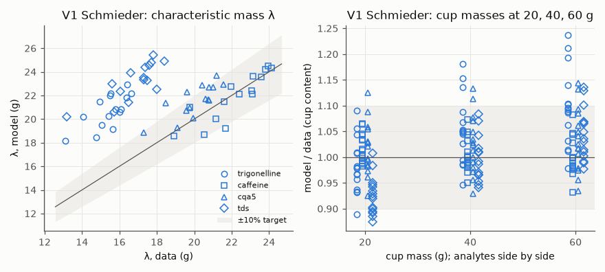
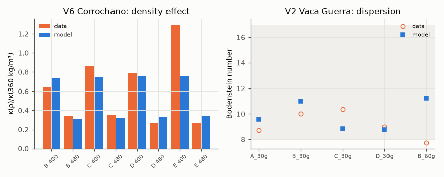
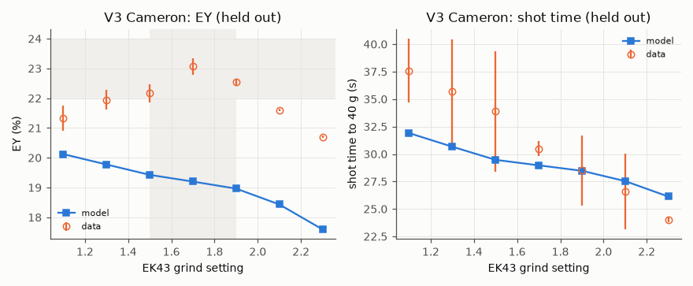
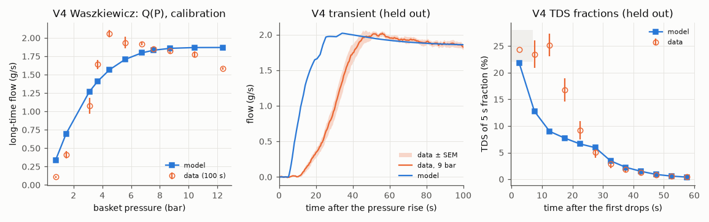
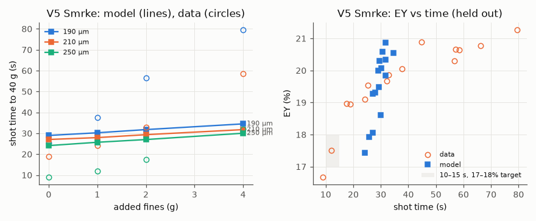

<!-- SPDX-License-Identifier: GPL-2.0-or-later -->
# M1 validation report

*Generated by `puckworks-tools validate` on 2026-10-16 · puckcore 0.6.0 · puckworks-tools 0.6.0 · tier 1, 16 size classes.*

*Solver build: extension 824fd0711db777d1 (built 2026-10-16T18:41:02-07:00); sources `crates/puckcore/src` 707212539ef8979a, `crates/puckmodel/src` 1ca89ad808e6f2f7, `crates/puckmodel/generated` 93a0ddfb588a2f4d, `crates/puckcore-py` 563a9328b2a48052. The calibration ran on sources `crates/puckcore/src` 707212539ef8979a, `crates/puckmodel/src` 1ca89ad808e6f2f7, `crates/puckmodel/generated` a0c8288a70de512e, `crates/puckcore-py` 563a9328b2a48052.*

## Known biases

- **Startup mismatch.** The V4 9-bar case has long-time flow 1.86 against 1.82 g/s and reaches 36 g at ×0.66 of the measured time. The model's flow reaches 90% of its 100 s value 13.9 s after the first drops instead of 25.5 s, and its first drops come 7.03 s after full pressure instead of 12.8 s. The held-out V3 and V5 time ratios are ×0.95 and ×0.91. Total shot times combine startup and permeability errors; they do not isolate κ_ref.
- **Pump saturation in V1.** 15 of 15 Schmieder shots reach the pump's 12 bar limit during the preinfusion-to-pour switch (for 1.9–3.9 s); the pours of experiment(s) 2, 12, 13 reach the limit (longest 32.6 s). The measured per-shot maxima are 2.5–9.3 bar (Table S3). The simplified DE1 control and startup hydraulics do not reproduce those maxima.
- **κ_ref rests on structural choices.** ×3.8 across the four estimates (the two datasets ×3.2); ×0.39 between the whole-shot and pour-phase pressure comparisons; ×1.8 between θ = 0 and θ = 0.27. Fit uncertainties describe the chosen model and do not include this structural spread.
- **Local uncertainties omit model discrepancy.** Reduced chi-square 15.4 (χ²/n by block: V1 15.3, V2 1.99, V4 12.4, V6 2.83); V1 holds 315 of 339 residuals, and its cup masses share information with c₀, λ and the first fraction (Eq. 3).
- **EY levels.** V3 and V5 EY rest on the bean's 28% extractable solids (input models), which no M1 dataset calibrates for those coffees.
- **V2.** The model's Bodenstein number is above the data in 3 of 5 cases; the held-out compound curves were not run (licence).

Datasets, case builders and the calibration harness: [case-builders.md](case-builders.md),
[calibration.md](calibration.md). Targets: [PLAN §10](../PLAN.md#10-verification-and-validation).

Parameters: calibrated values from `data/calibration/current.yaml` where present, registry defaults otherwise.

## Summary

| Check | Status | Result | Target |
|---|---|---|---|
| V1 λ within ±10% (fit) | **fail** | 25/60 experiment–analyte pairs within ±10% (trigonelline 0/15, caffeine 14/15, 5-CQA 11/15, TDS 0/15) | λ within ±10% for all 15 experiments × 4 analytes |
| V1 cup masses within ±10% (fit) | **fail** | 158/180 cup masses (20, 40, 60 g) within ±10% (trigonelline 35/45, caffeine 45/45, 5-CQA 40/45, TDS 38/45) | cup masses within ±10% |
| V1 leave-one-condition-out (±15%) | **fail** | λ 29/60, cup masses 174/180 within ±15% when predicted without their own experiment | λ and cup masses of each left-out experiment within ±15% |
| V2 Bodenstein number 8–17 | pass | model Bo = 9.6, 11.0, 8.9, 8.7, 11.2 (data 8.7, 10.0, 10.4, 9.0, 7.7; the model is above the data in 3 of 5; the held-out compound curves were not run) | Bo within 8–17 |
| V4 long-time flow vs pressure (fit) | info | RMS error 0.237 g/s over 11 pressures | calibration (no pass/fail target) |
| V6 relative change of κ with density within ×1.5 | **fail** | model/data ratio factors 1.15, 0.92, 0.87, 0.90, 0.95, 1.23, 0.59, 1.28 | κ(ρ)/κ(360 kg/m³), model within ×1.5 of data for 4 grinds × 2 densities |
| V3 EY peak at grind setting 1.5–1.9 | **fail** (not independent) | model EY peaks at GS 1.1 (at the edge of the range: no peak) | EY maximum at GS 1.5–1.9 (data: 1.7) |
| V3 peak EY 22–24% | **fail** (not independent) | model peak EY 20.12% | peak EY within 22–24% (data: 23.07%) |
| V3 shot time falls as the grind coarsens | pass | model times 31.9, 30.7, 29.5, 29.0, 28.5, 27.5, 26.1 s | shot time strictly decreasing from GS 1.1 to 2.3 |
| V4 flow rises after the first drops | **fail** | model: 90% of the 100 s flow 13.9 s after the first drops (data 25.5 s); flow ×2.92 from 2 s to 15 s and ×3.17 to 100 s (data ×6.09, ×14.05); no overshoot at the 15 s check | 90% of the 100 s flow within ×1.5 of the data's time after the first drops, and no overshoot at the 15 s check (flow 15 s after the first drops ≤ flow at 100 s) |
| V4 first drops after full pressure | **fail** | model 7.0 s, data 12.8 s after the pressure reaches its target (both on the data's clock) | delay from full pressure to the first drops (0.1 g) within ×1.5 of the data's |
| V4 first-fraction TDS 25 ± 3% | **fail** | model first 5 s fraction 21.8% TDS (data: 24.4% in the one replicate that collected liquid, 23.5% in the next window) | 22–28% TDS |
| V4 time to 36 g (9 bar) | info | model 31.3 s, data 47.7 s after the pressure rise: ×0.66; long-time flow 1.86 against 1.82 g/s | reported: time to the target mass in the case calibrated on long-time flow |
| V5 added fines lengthen shots | **fail** | 190 µm: model 29.0, 30.3, 31.8, 34.5 s (+19% with 4 g; data +215%); 210 µm: model 27.0, 27.9, 29.3, 31.8 s (+17% with 4 g; data +211%); 250 µm: model 24.1, 25.7, 27.0, 30.0 s (+25% with 4 g; data +258%) | time rises at every step of 0, 1, 2, 4 g, and by at least 50% of the measured relative increase from 0 to 4 g, at 190, 210 and 250 µm |
| V5 EY tracks shot time | pass | Spearman ρ(time, EY) = 0.83 over 15 model conditions (data: 0.96) | Spearman ρ ≥ 0.8 |
| V5 10–15 s shots reach 17–18% EY | pass | conditions measured at 10–15 s: 250 µm + 1 g (measured 12.0 s, 17.51% EY; model 25.7 s, 17.94%); model mean 17.94% | model EY 17–18% at the conditions whose measured shots took 10–15 s (data: 17.4–17.6% at 12 s); EY levels rest on the bean's 28% extractable solids (input models) |
| Held-out shot times against the data | info | V3 Cameron: model/data ×0.95 (mean error -1.9 s, RMS 3.5 s); V5 Smrke: model/data ×0.91 (mean error -8.8 s, RMS 20 s); V4 9 bar (long-time flow is a calibration observable): time to 36 g ×0.66 | reported: shot times depend on startup and permeability; κ_ref is not tuned to these times |
| Tier 0 vs tier 1 on the held-out cases | info | tier 0 vs tier 1 on 22 V3/V5 shots: time within 3.2% (RMS 2.2%), EY within 2.6 points; V4 9 bar: first-fraction TDS 26.2% vs 21.8%, flow 15 s after the first drops 1.96 vs 1.71 g/s | reported, no PLAN target (tier 0 is the reduced model) |
| Generic 18 g → 36 g, 9 bar shots near 30 s | **fail** | tier 1: mahlkoenig-ek43 25.5 s, mahlkoenig-e65s 24.7 s, generic-flat-traditional-64 25.7 s, generic-conical-50 27.5 s, generic-flat-unimodal-64 25 s, bentwood-v63 25.6 s | 25–35 s for every preset at its default setting (typical espresso; an app sanity check, not a PLAN target) |

Calibration checks measure fit quality (V1, V2, V4 Q(P), V6); accuracy is reported only from the
held-out checks (V3, V4 transient, V5), per PLAN §10.

### M1 exit criteria (PLAN §12), validation part

| Criterion | Status | Checks |
|---|---|---|
| V1 within targets | **fail** | V1 λ within ±10% (fit) (fail), V1 cup masses within ±10% (fit) (fail), V1 leave-one-condition-out (±15%) (fail) |
| V3 peak reproduced | **fail** | V3 EY peak at grind setting 1.5–1.9 (fail), V3 peak EY 22–24% (fail) |
| V4 flow rise reproduced | **fail** | V4 flow rises after the first drops (fail), V4 first drops after full pressure (fail) |
| Verification suite green; tier 1 ≤ 1 s and tier 0 ≤ 10 ms per shot | not assessed | covered by the solver's verification tests and benchmarks, not by this report |

## 1. Calibration fit quality

RMS of the normalised residuals as this report recomputes them, next to the calibration file's; they agree when the run reproduces itself. χ²/n is from the calibration file.

| Block | Dataset | Cases | Residuals | RMS (this report) | RMS (calibration file) | χ²/n | Failed shots |
|---|---|---|---|---|---|---|---|
| V1 | schmieder2023 | 15 | 315 | 3.91 | 3.91 | 15.3 | 0 |
| V2 | vacaguerra2024 | 5 | 5 | 1.41 | 1.41 | 1.99 | 0 |
| V4 | waszkiewicz2026 | 11 | 11 | 3.53 | 3.53 | 12.4 | 0 |
| V6 | corrochano2017 | 12 | 8 | 1.68 | 1.68 | 2.83 | 0 |

### Parameters

SD from the fit's Jacobian (scaled by the reduced chi-square); SD/prior is the posterior SD over the registry prior's SD in the fit's coordinates (log10 for log-scaled parameters): at 0.5 or more the data add little to the prior.

| Registry id | Value | Units | Mode | SD | SD/prior | Source |
|---|---|---|---|---|---|---|
| `model.extraction.broken_shell_thickness` | 40 | um | override | 3.6 | 0.46 (at bound) | calibration |
| `extraction.saturation.lumped` | 350 | kg/m^3 | override | 43 | 1.1 (at bound) | calibration |
| `model.species.caffeine.surface_fraction_scale` | 1 | 1 | override | — | — | registry default |
| `model.species.trigonelline.surface_fraction_scale` | 2 | 1 | override | 0.57 | 1.3 (at bound) | calibration |
| `model.species.cqa5.surface_fraction_scale` | 1.5 | 1 | override | 0.25 | 0.87 (at bound) | calibration |
| `calibration.schmieder2023.extractable_fraction` | 30.07 | % | spec | 0.92 | 0.27 | calibration |
| `calibration.schmieder2023.content.caffeine` | 1.308 | % | spec | 0.04 | 0.17 | calibration |
| `calibration.schmieder2023.content.trigonelline` | 0.7312 | % | spec | 0.024 | 0.083 | calibration |
| `calibration.schmieder2023.content.cqa5` | 0.9089 | % | spec | 0.03 | 0.087 | calibration |
| `calibration.schmieder2023.permeability.gl1_4` | 2.596e-14 | m^2 | spec | 3.9e-15 | 0.13 | calibration |
| `calibration.schmieder2023.permeability.gl1_7` | 2.627e-14 | m^2 | spec | 2.6e-15 | 0.086 | calibration |
| `calibration.schmieder2023.permeability.gl2_0` | 4.271e-14 | m^2 | spec | 6.9e-15 | 0.14 | calibration |
| `model.hydraulics.viscosity_temperature_exponent` | 0.22 | 1 | override | 0.072 | 0.66 (at bound) | calibration |
| `hydraulics.poroelastic.critical_pressure` | 12 | bar | override | — | — | registry default |
| `extraction.dispersion.axial_coefficient` | 5.329e-06 | m^2/s | override | 8.4e-07 | 0.27 | calibration |
| `calibration.waszkiewicz2026.permeability` | 1.943e-14 | m^2 | spec | 8.9e-16 | 0.039 | calibration |
| `hydraulics.kozeny_carman.density_exponent` | 0.2461 | 1 | override | 0.074 | 0.086 | calibration |
| `hydraulics.permeability.reference` | 1.238e-13 | m^2 | pooled | — | — | calibration |

**Reference permeability** `hydraulics.permeability.reference`: pooled 1.24e-13 m² (geometric mean over datasets, each dataset the geometric mean of its estimates; estimate i = fitted bare κ₀,i / builder scaling of case i, (D32_i/D32_ref)²·KC(ε)/KC(ε_ref)). By dataset: schmieder2023 6.92e-14 m²; waszkiewicz2026 2.22e-13 m²; the datasets differ by ×3.20, more than their fit uncertainties: the pooled value carries that disagreement. Spread of all estimates: log-SD 0.61, max/min 3.75.

Each estimate is the fitted bare κ₀ divided by the builder's scaling of the app's representation of that grind (the scaling basis). D32 values from different bases are not strictly comparable: Waszkiewicz's PSD is laser diffraction (Mastersizer 2000; the article does not say wet or dry dispersion), while the grinder presets' D32 comes from the input models, anchored on other measurements.

| Nuisance κ₀ | Dataset | Scaling basis | κ₀ (m²) | Builder scaling | D32/D32_ref | κ_ref (m²) |
|---|---|---|---|---|---|---|
| `calibration.schmieder2023.permeability.gl1_4` | schmieder2023 | grinder preset mahlkoenig-e65s at GL 1.4 | 2.6e-14 | 0.412 | 0.642 | 6.29e-14 |
| `calibration.schmieder2023.permeability.gl1_7` | schmieder2023 | grinder preset mahlkoenig-e65s at GL 1.7 | 2.63e-14 | 0.445 | 0.667 | 5.9e-14 |
| `calibration.schmieder2023.permeability.gl2_0` | schmieder2023 | grinder preset mahlkoenig-e65s at GL 2.0 | 4.27e-14 | 0.48 | 0.692 | 8.91e-14 |
| `calibration.waszkiewicz2026.permeability` | waszkiewicz2026 | the case's own PSD | 1.94e-14 | 0.0877 | 0.296 | 2.22e-13 |

**Tension with typical espresso grinds.** Published espresso grinds have a dry D32 of about 80–145 µm (Cameron, Corrochano ΨB–E, Smrke), while Waszkiewicz's grind measures about 49 µm (it was chosen for the SCA guideline of 37 g in 32 s at 9 bar; the article's own 9 bar shots reached 37 g at about 48 s). κ₀ scales with D32², so differences in the measured PSD affect the reference permeability inferred from each dataset. The held-out shot times come out at ×0.95 (V3 Cameron, mean error -1.9 s) and ×0.91 (V5 Smrke, -8.8 s). The V4 case, calibrated on long-time flow, reaches 36 g at ×0.66 of its measured time. These times combine startup and permeability effects. κ_ref is not tuned to them.

- *Waszkiewicz's PSD is atypical.* X50 61 µm, X90 145 µm, 63.6% of the volume below 100 µm; 3.8% of the volume sits in the 158–182 µm bin and nothing above, although the bins run to 417 µm and the Mastersizer 2000 reads to 2000 µm. A coarse tail that ends this abruptly suggests that coarse particles were under-represented (settling in a wet dispersion unit, or sample selection; the article does not say), which lowers this D32 and raises this dataset's κ_ref. The authors describe their grounds as "of typical size below 200 µm".
- *Schmieder's reference-permeability scaling uses the E65S dial mapping.* The dial's scale is disputed (the brochure's ≈5 µm per indicator read as burr movement or as a particle-size bandwidth), so the preset maps the dial to a burr gap fitted to the article's wet-laser D[4,3] at GL 1.4 and 2.0, and its D32 comes from the input models' fines relation (fitted to dry-laser and Camsizer PSDs), not from the article's wet D32 of 27–29 µm, which includes 1–10 µm debris. A 10% smaller scaling-basis D32 with fitted κ₀ and reference D32 held fixed would raise the Schmieder κ_ref estimate by about 23%.

**V1 particle input in this run:** the qualified Schmieder Fig. A1b wet CDF, with its unresolved fine tail constrained by the published D32. The E65S D32 above is only the reference-permeability scaling basis; it is not the PSD simulated in these V1 cases. D32 agreement is an input constraint, and wet-dispersed debris is not independently validated as dry-puck geometry or a particle diffusion length. The dataset sidecar's note about the historical default describes the 0.5.1 input audit; this run's explicit calibration configuration selects the wet CDF.

**Held at their registry values** (reviewed, not fitted):

The SD/prior ratios and correlations quoted in inherited reasons below come from the 2026-10-14 trial fits, not new identifiability measurements on this solver. Reasons explicitly marked as pruning in this calibration run describe the current fit.

| Parameter | Value | Reason |
|---|---|---|
| `model.hydraulics.intraparticle_water_fraction` | 1 | The full intraparticle pore-water inventory behind the front (fraction 1) is held inside the total particle loading. External mobile water occupies interparticle porosity only; front filling transfers its dissolved solute into the particle reservoir conservatively. The fixed water-volume choice and instantaneous pore filling are not fitted to shot times or independent uptake data. |
| `spec:solubles.kernel_loading_cap` | False | Disabled by the builder for total particle loading: the initial particle concentration is not an equilibrium capacity. Kernel loading follows its source partition law and may exceed its initial value during inward diffusion. This boundary restriction is not selected by fit quality. |
| `model.hydraulics.pore_air_amplitude` | 0.5 | The initial effective connectivity deficit is a grade D model assumption (0.5), separate from coffee CO2; it is not a measured gas volume fraction. None of the calibration observables identifies a transient relative-permeability law. It is held at its prior rather than fitted to the held-out V4 first-drop delay or flow rise. |
| `model.hydraulics.pore_air_permeability_exponent` | 3 | The effective connectivity-to-relative-permeability exponent is a grade D closure (3), not measured for these pucks. Held fixed; the V4 transient, V3 and V5 shot times do not select it. |
| `model.hydraulics.moisture_diffusivity` | 2.5e-11 m^2/s | The pore-air relaxation time uses (D32/2)^2/(pi^2 D), capped at 600 s, with D = 2.5e-11 m^2/s from the independent Mateus moisture-uptake range. Using moisture diffusion for air clearance is a grade D model assumption. Neither this diffusivity nor its time scale is fitted to held-out shots. |
| `model.hydraulics.wetting_uptake` | 0.5 | In M1.1 this is the fixed effective-loading normalization inherited from the extraction model, distinct from the full intraparticle water inventory. It is not fitted to startup observations. |
| `extraction.diffusivity.caffeine.particle_80c` | 1.9e-10 m^2/s | Species kernel diffusivities trade off with the coffee's contents (correlation −0.89 to −0.95): their posterior SD was 2–12× the prior's, and free fits drifted 2–5× outside the literature priors (caffeine to 8×10⁻¹¹, trigonelline to the 1×10⁻⁹ bound). The species surface-pool scales carry the species' λ instead. |
| `model.species.trigonelline.diffusivity_80c` | 2.8e-10 m^2/s | Not identified by V1 (see the caffeine diffusivity). |
| `model.species.cqa5.diffusivity_80c` | 1.55e-10 m^2/s | Not identified by V1 (see the caffeine diffusivity). |
| `extraction.diffusivity.lumped.corrochano_80c` | 1.26e-10 m^2/s | Weakly identified by V1 (posterior SD 1.15× the prior's; it trades off with the extractable fraction); fixing it did not raise the cost. |
| `extraction.surface_rate.grudeva2026` | 0.001 m/s | Not identified by V1 (posterior SD 44× the prior's once the lumped diffusivity is fixed); the surface flux is fast at any value in its range, so only the surface pool's size matters. |
| `model.hydraulics.swelling_pore_closure` | 0.1 | Not identified by V1 (posterior SD 1.6× the prior's when added at the V1 optimum); the residuals lean towards less swelling (Wald z 2.4 towards 0). |
| `model.hydraulics.gas_amplitude_max` | 0.5 | Weakly identified by V1 (posterior SD 0.4–0.7× the prior's) with no evidence against the registry value (Wald z 0.8); the CO₂ model is being re-anchored in the input models. |
| `hydraulics.dissolution_porosity_share` | 0 | θ is fixed at its mechanistic default, 0 (the insoluble cell walls hold the particle envelope), not chosen by fit quality: it is collinear with the bed permeability, whose fitted values move to absorb it. `calibrate --sensitivity` reports the θ = 0.27 case as a structural sensitivity. |
| `model.species.caffeine.surface_fraction_scale` | 1 | Pruned by the identifiability rule in the calibration run: posterior SD 1.02× the prior's (fitted value 0.9394 before pruning). |
| `hydraulics.poroelastic.critical_pressure` | 12 bar | Pruned by the identifiability rule in the calibration run: posterior SD 0.67× the prior's (fitted value 9.834 before pruning). |

### V1 Schmieder 2023

λ within ±10%: 25/60 (largest error 53.5%); cup masses within ±10%: 158/180 (largest error 23.8%). The leave-one-condition-out check (target ±15%) is in the summary table; it is mildly optimistic, because parameters shared with other blocks stay at their full-fit values in each refit. Worst λ: experiment 8, tds, 53.5%. Seconds at the pump's 12 bar limit, switch / pour, by experiment: 1: 2.7 / 0, 2: 3.9 / 28.9, 3: 3.4 / 0, 4: 2.6 / 0, 5: 3.4 / 0, 6: 3.3 / 0, 7: 3.3 / 0, 8: 2.8 / 0, 9: 2.7 / 0, 10: 2 / 0, 11: 1.9 / 0, 12: 3.9 / 32.6, 13: 3.9 / 5.7, 14: 3.4 / 0, 15: 3.2 / 0. Peak-pressure residuals of pump-capped pours are kept and flagged (they understate the misfit: the model cannot pass the set flow below 12 bar); the sensitivity table shows the fit without them.

| Exp. | Analyte | λ model (g) | λ data (g) | cup 40 g model | cup 40 g data |
|---|---|---|---|---|---|
| 1 | trigonelline | 18.4 | 14.8 | 101 | 102 |
| 1 | caffeine | 18.7 | 20.5 | 184 | 185 |
| 1 | cqa5 | 19.3 | 19.1 | 120 | 123 |
| 1 | tds | 20.6 | 15.7 | 3.9 | 4.1 |
| 2 | trigonelline | 22.9 | 16.4 | 106 | 97.1 |
| 2 | caffeine | 24.5 | 23.9 | 183 | 184 |
| 2 | cqa5 | 23.7 | 21.2 | 122 | 114 |
| 2 | tds | 25.4 | 17.8 | 3.85 | 3.81 |
| 3 | trigonelline | 21.5 | 14.9 | 105 | 91.1 |
| 3 | caffeine | 22.8 | 22 | 186 | 178 |
| 3 | cqa5 | 22.3 | 19.6 | 123 | 111 |
| 3 | tds | 23.9 | 16.6 | 3.91 | 3.65 |
| 4 | trigonelline | 20.6 | 16 | 103 | 100 |
| 4 | caffeine | 22.4 | 23.1 | 181 | 184 |
| 4 | cqa5 | 21.6 | 20.8 | 120 | 123 |
| 4 | tds | 23.5 | 17.3 | 3.79 | 3.92 |
| 5 | trigonelline | 20.3 | 15.4 | 104 | 104 |
| 5 | caffeine | 21.5 | 21.6 | 183 | 188 |
| 5 | cqa5 | 20.9 | 19.8 | 121 | 121 |
| 5 | tds | 22.5 | 18 | 3.85 | 3.96 |
| 6 | trigonelline | 20.9 | 15.8 | 106 | 101 |
| 6 | caffeine | 22.1 | 22.4 | 188 | 187 |
| 6 | cqa5 | 21.7 | 20.6 | 124 | 120 |
| 6 | tds | 23.3 | 17.3 | 3.96 | 4.01 |
| 7 | trigonelline | 20.8 | 16.1 | 105 | 98.3 |
| 7 | caffeine | 22.1 | 23.1 | 186 | 184 |
| 7 | cqa5 | 21.6 | 20.8 | 123 | 120 |
| 7 | tds | 23.3 | 17.5 | 3.91 | 3.88 |
| 8 | trigonelline | 18.1 | 13.1 | 100 | 95.3 |
| 8 | caffeine | 18.6 | 18.9 | 184 | 178 |
| 8 | cqa5 | 18.9 | 17.3 | 120 | 114 |
| 8 | tds | 20.2 | 13.2 | 3.88 | 3.84 |
| 9 | trigonelline | 19.1 | 15.6 | 101 | 102 |
| 9 | caffeine | 19.2 | 21.7 | 186 | 195 |
| 9 | cqa5 | 20.1 | 19.9 | 121 | 126 |
| 9 | tds | 21.4 | 16.5 | 3.94 | 4.18 |
| 10 | trigonelline | 20.2 | 14.1 | 101 | 96.6 |
| 10 | caffeine | 21 | 19.8 | 186 | 173 |
| 10 | cqa5 | 21.4 | 18.5 | 120 | 117 |
| 10 | tds | 23 | 15.6 | 3.88 | 3.72 |
| 11 | trigonelline | 19.5 | 15 | 100 | 106 |
| 11 | caffeine | 20 | 21.1 | 186 | 188 |
| 11 | cqa5 | 20.7 | 19.6 | 120 | 129 |
| 11 | tds | 22.3 | 16 | 3.89 | 4.11 |
| 12 | trigonelline | 22 | 15.5 | 104 | 88.3 |
| 12 | caffeine | 23.6 | 23.6 | 181 | 172 |
| 12 | cqa5 | 22.7 | 20.8 | 121 | 107 |
| 12 | tds | 24.4 | 17.4 | 3.82 | 3.53 |
| 13 | trigonelline | 22.1 | 15.5 | 106 | 93.2 |
| 13 | caffeine | 23.6 | 23.2 | 184 | 184 |
| 13 | cqa5 | 22.9 | 20.4 | 123 | 114 |
| 13 | tds | 24.6 | 17.6 | 3.89 | 3.83 |
| 14 | trigonelline | 22.2 | 16.6 | 102 | 97.8 |
| 14 | caffeine | 24.4 | 24.1 | 174 | 176 |
| 14 | cqa5 | 22.9 | 21.6 | 117 | 115 |
| 14 | tds | 24.9 | 18.4 | 3.65 | 3.68 |
| 15 | trigonelline | 21.8 | 16.4 | 104 | 98.9 |
| 15 | caffeine | 24.2 | 23.8 | 179 | 183 |
| 15 | cqa5 | 22.7 | 21 | 120 | 121 |
| 15 | tds | 24.8 | 17.7 | 3.75 | 3.88 |

### V1 sensitivity

V1 refitted under changed case assumptions; parameters shared with other blocks held at their fitted values; the pooled value keeps the other datasets' estimates. The first row is the calibration itself.

| Variant | V1 cost | κ₀ by grinding level (m²) | Schmieder κ_ref (m²) | Pooled κ_ref (m²) | Peak-pressure RMS | λ within ±10% | Cups within ±10% |
|---|---|---|---|---|---|---|---|
| as calibrated | 2412 | 2.6e-14, 2.63e-14, 4.27e-14 | 6.92e-14 | 1.24e-13 | 2.49 | 25/60 | 158/180 |
| transition ramp 1 s | 2457 | 2.49e-14, 2.74e-14, 4.4e-14 | 6.99e-14 | 1.24e-13 | 2.43 | 25/60 | 158/180 |
| transition ramp 0.3 s | 2446 | 2.57e-14, 2.69e-14, 4.41e-14 | 7.03e-14 | 1.25e-13 | 2.45 | 25/60 | 158/180 |
| upstream pressure loss 0.4 bar | 2427 | 2.75e-14, 2.86e-14, 4.37e-14 | 7.31e-14 | 1.27e-13 | 2.63 | 25/60 | 158/180 |
| whole-shot peak pressure | 6973 | 8.3e-15, 1.29e-14, 1.59e-14 | 2.68e-14 | 7.71e-14 | 25.7 | 25/60 | 159/180 |
| pressure classification margin 1 bar | 2403 | 2.6e-14, 2.63e-14, 4.27e-14 | 6.92e-14 | 1.24e-13 | 2.25 | 25/60 | 158/180 |
| pump-capped pour pressures excluded | 2383 | 2.6e-14, 2.63e-14, 4.27e-14 | 6.92e-14 | 1.24e-13 | 1.53 | 25/60 | 158/180 |
| wet PSD D32 minus 1 SD | 2293 | 2.58e-14, 2.63e-14, 4.1e-14 | 6.82e-14 | 1.23e-13 | 2.48 | 25/60 | 158/180 |
| wet PSD D32 plus 1 SD | 2555 | 2.69e-14, 2.7e-14, 4.49e-14 | 7.19e-14 | 1.26e-13 | 2.45 | 24/60 | 157/180 |

The wet-PSD rows reconstruct the unresolved finest-particle head with the published D32 shifted by ±1 SD, leaving the resolved tail CDF and parameter priors unchanged. They are input sensitivities followed by refitting, not confidence bands or additional independent observations. Each reconstruction changes the particle sizes supplied to the model, including its derived pore-air timescale.

### Structural sensitivity: dissolution share θ

A sensitivity analysis of a structural assumption, not a choice: the calibration fixes θ at its mechanistic default, 0 (the insoluble cell walls hold the particle envelope, so dissolution opens intraparticle pores). θ is collinear with the bed permeability: the grinding-level permeabilities and contents move to absorb it, so κ₀ and κ_ref change with it. The row refits V1+V2+V4+V6 at the old value: total cost 3697 against 2497 at θ = 0, peak-pressure RMS 2.02; 2 of 15 V1 pours sit at the pump's 12 bar limit. A degenerate refit like this is not evidence for or against θ. Independent evidence for θ would have to come from flow-rise data, which M1 holds out (V4 transient), or from new experiments. The rows repeat the held-out predictions at both values.

| θ | κ₀: Schmieder GL 1.4, 1.7, 2.0; Waszkiewicz (m²) | κ_ref by dataset (m²) | pooled κ_ref (m²) | V3 time model/data | V3 peak EY | V5 time model/data | V5 mean EY | V5 ρ(time, EY) |
|---|---|---|---|---|---|---|---|---|
| 0 (calibration) | 2.6e-14, 2.63e-14, 4.27e-14, 1.94e-14 | schmieder2023 6.92e-14, waszkiewicz2026 2.22e-13 | 1.24e-13 | ×0.95 | 20.1% at GS 1.1 | ×0.91 | 19.5% | 0.83 |
| 0.27 (old proportional rule; pump-capped) | 2.5e-14, 2.1e-14, 3.55e-14, 6.9e-15 | schmieder2023 5.96e-14, waszkiewicz2026 7.87e-14 | 6.85e-14 | ×1 | 15.7% at GS 1.1 | ×0.98 | 15.9% | 0.26 |

V4 9 bar at θ = 0: 90% of the 100 s flow 13.9 s after the first drops (data 25.5 s), first drops 7.03 s after full pressure (data 12.8 s). V4 9 bar at θ = 0.27: 90% of the 100 s flow 29.5 s after the first drops, first drops 11.9 s after full pressure, first 5 s fraction 27.6% TDS.

### V2 Vaca Guerra 2024: Bodenstein numbers

| Case | Model | Data |
|---|---|---|
| A_30g | 9.57 | 8.7 |
| B_30g | 11 | 10 |
| C_30g | 8.85 | 10.4 |
| D_30g | 8.74 | 8.98 |
| B_60g | 11.2 | 7.74 |

### V4 Waszkiewicz 2026: long-time flow

| Basket pressure (bar) | Model (g/s) | Data (g/s) | SEM |
|---|---|---|---|
| 0.758 | 0.339 | 0.109 | 0.0149 |
| 1.49 | 0.697 | 0.414 | 0.0498 |
| 3.1 | 1.27 | 1.08 | 0.109 |
| 3.69 | 1.41 | 1.64 | 0.0627 |
| 4.5 | 1.57 | 2.06 | 0.0495 |
| 5.59 | 1.71 | 1.94 | 0.0797 |
| 6.74 | 1.8 | 1.92 | 0.0218 |
| 7.53 | 1.83 | 1.85 | 0.0371 |
| 8.72 | 1.86 | 1.82 | 0.0389 |
| 10.4 | 1.87 | 1.78 | 0.043 |
| 12.4 | 1.87 | 1.59 | 0.0172 |

### V6 Corrochano 2017: permeability versus bed density

| Grind | Density (kg/m³) | κ/κ(360), model | κ/κ(360), data | Model/data |
|---|---|---|---|---|
| B | 400 | 0.735 | 0.636 | 1.15 |
| B | 480 | 0.311 | 0.338 | 0.92 |
| C | 400 | 0.742 | 0.857 | 0.865 |
| C | 480 | 0.317 | 0.35 | 0.905 |
| D | 400 | 0.752 | 0.792 | 0.95 |
| D | 480 | 0.329 | 0.267 | 1.23 |
| E | 400 | 0.758 | 1.29 | 0.586 |
| E | 480 | 0.339 | 0.265 | 1.28 |

## 2. Held-out checks

### V3 Cameron 2020

RMS error: EY 2.96 points, shot time 3.49 s.

| Grind setting | EY model (%) | EY data (%) | Time model (s) | Time data (s) |
|---|---|---|---|---|
| 1.1 | 20.1 | 21.3 | 31.9 | 37.6 |
| 1.3 | 19.8 | 22 | 30.7 | 35.7 |
| 1.5 | 19.4 | 22.2 | 29.5 | 33.9 |
| 1.7 | 19.2 | 23.1 | 29 | 30.5 |
| 1.9 | 19 | 22.5 | 28.5 | 28.5 |
| 2.1 | 18.4 | 21.6 | 27.5 | 26.6 |
| 2.3 | 17.6 | 20.7 | 26.1 | 24 |

### V4 Waszkiewicz 2026: transient at 9 bar

Times on the data's clock, from the end of the pressure rise (the model's clock is shifted by the moment its inlet pressure reaches 95% of the target). First drops (cup mass 0.1 g): model 7.03 s, data 12.8 s. Time to 36 g: model 31.3 s, data 47.7 s. Long-time flow: model 1.86, data 1.82 g/s.

| Fraction (s after first drops) | TDS model (%) | TDS data (%) |
|---|---|---|
| 2.5 | 21.8 | 24.4 |
| 7.5 | 12.8 | 23.5 |
| 12.5 | 8.99 | 25.2 |
| 17.5 | 7.72 | 16.7 |
| 22.5 | 6.62 | 9.2 |
| 27.5 | 5.94 | 5.11 |
| 32.5 | 3.46 | 2.92 |
| 37.5 | 2.25 | 1.81 |
| 42.5 | 1.49 | 1.23 |
| 47.5 | 0.905 | 0.816 |
| 52.5 | 0.597 | 0.549 |
| 57.5 | 0.407 | 0.479 |

### V5 Smrke 2024

RMS error: time 20.3 s, EY 0.562 points.

| Burr gap (µm) | Fines (g) | Time model (s) | Time data (s) | EY model (%) | EY data (%) |
|---|---|---|---|---|---|
| 160 | 0 | 31.7 | 66.2 | 20.9 | 20.8 |
| 170 | 0 | 30.5 | 57.2 | 20.6 | 20.7 |
| 180 | 0 | 29.5 | 44.8 | 20.3 | 20.9 |
| 190 | 0 | 29 | 25.3 | 20 | 19.5 |
| 190 | 1 | 30.3 | 37.6 | 20.1 | 20.1 |
| 190 | 2 | 31.8 | 56.6 | 20.3 | 20.3 |
| 190 | 4 | 34.5 | 79.5 | 20.5 | 21.3 |
| 210 | 0 | 27 | 18.8 | 19.3 | 19 |
| 210 | 1 | 27.9 | 24.1 | 19.3 | 19.1 |
| 210 | 2 | 29.3 | 32.9 | 19.5 | 19.9 |
| 210 | 4 | 31.8 | 58.5 | 19.8 | 20.6 |
| 250 | 0 | 24.1 | 8.95 | 17.4 | 16.7 |
| 250 | 1 | 25.7 | 12 | 17.9 | 17.5 |
| 250 | 2 | 27 | 17.5 | 18.1 | 19 |
| 250 | 4 | 30 | 32.1 | 18.6 | 19.7 |

### Tier 0 versus tier 1

The held-out cases at tier 0 with the same parameters. V3/V5 shot time: largest difference 3.2% (RMS 2.2%); EY: largest 2.6 points (RMS 1.9).

| Case | Time, tier 1 (s) | Time, tier 0 (s) | EY, tier 1 (%) | EY, tier 0 (%) |
|---|---|---|---|---|
| cameron2020/gs1_1 | 31.9 | 31.1 | 20.1 | 22.6 |
| cameron2020/gs1_3 | 30.7 | 30 | 19.8 | 22.3 |
| cameron2020/gs1_5 | 29.5 | 28.9 | 19.4 | 22 |
| cameron2020/gs1_7 | 29 | 28.4 | 19.2 | 21.7 |
| cameron2020/gs1_9 | 28.5 | 28 | 19 | 21.5 |
| cameron2020/gs2_1 | 27.5 | 27.1 | 18.4 | 20.5 |
| cameron2020/gs2_3 | 26.1 | 25.8 | 17.6 | 19.6 |
| smrke2024/s160_f0 | 31.7 | 30.9 | 20.9 | 22.6 |
| smrke2024/s170_f0 | 30.5 | 29.8 | 20.6 | 22.3 |
| smrke2024/s180_f0 | 29.5 | 28.9 | 20.3 | 22 |
| smrke2024/s190_f0 | 29 | 28.3 | 20 | 21.7 |
| smrke2024/s190_f1 | 30.3 | 29.5 | 20.1 | 21.8 |
| smrke2024/s190_f2 | 31.8 | 30.9 | 20.3 | 22.1 |
| smrke2024/s190_f4 | 34.5 | 33.4 | 20.5 | 22.3 |
| smrke2024/s210_f0 | 27 | 26.6 | 19.3 | 20.8 |
| smrke2024/s210_f1 | 27.9 | 27.4 | 19.3 | 20.9 |
| smrke2024/s210_f2 | 29.3 | 28.7 | 19.5 | 21.1 |
| smrke2024/s210_f4 | 31.8 | 30.9 | 19.8 | 21.6 |
| smrke2024/s250_f0 | 24.1 | 23.9 | 17.4 | 18.9 |
| smrke2024/s250_f1 | 25.7 | 25.4 | 17.9 | 19.5 |
| smrke2024/s250_f2 | 27 | 26.6 | 18.1 | 19.8 |
| smrke2024/s250_f4 | 30 | 29.3 | 18.6 | 20.2 |

waszkiewicz2026/p9 (9 bar): first drops 7.03 s (tier 1) and 7.84 s (tier 0) after the pressure reaches its target; flow 15 s later 1.71 and 1.96 g/s; first 5 s fraction 21.8% and 26.2% TDS.

### Generic app shots

18 g dose with a 36 g pump-stop target at a flat 9 bar (medium washed arabica, 58 mm precision basket) with the calibrated parameters, one per grinder preset: a sanity check of the reference permeability the app uses. Time ends when the pump stops at 36 g. EY includes subsequent drip into the cup, so it describes a larger final beverage rather than a 36 g cup.

| Grinder preset | Setting | κ₀ (m²) | Pump-stop time (s) | EY after drip (%) | Stop |
|---|---|---|---|---|---|
| mahlkoenig-ek43 | 1.7 | 4.98e-14 | 25.5 | 18.9 | beverage_mass |
| mahlkoenig-e65s | 1.7 | 5.53e-14 | 24.7 | 18.5 | beverage_mass |
| generic-flat-traditional-64 | 190.0 | 4.87e-14 | 25.7 | 19 | beverage_mass |
| generic-conical-50 | 190.0 | 3.94e-14 | 27.5 | 18.1 | beverage_mass |
| generic-flat-unimodal-64 | 170.0 | 5.45e-14 | 25 | 20.6 | beverage_mass |
| bentwood-v63 | 190.0 | 4.97e-14 | 25.6 | 19 | beverage_mass |

## Figures

## Solver warnings

- a large run: up to 6.36e3 steps × 1.73e5 values = 1.10e9 (expect several seconds or more)
- a large run: up to 6.77e3 steps × 1.73e5 values = 1.17e9 (expect several seconds or more)
- solubles.kernel_loading_cap is off and K·s₀ = 104 kg/m³ is below c_sat = 350 kg/m³: kernels re-absorb solute from liquid above 104 kg/m³ beyond their initial content
- solubles.kernel_loading_cap is off and K·s₀ = 112 kg/m³ is below c_sat = 350 kg/m³: kernels re-absorb solute from liquid above 112 kg/m³ beyond their initial content
- solubles.kernel_loading_cap is off and K·s₀ = 98 kg/m³ is below c_sat = 350 kg/m³: kernels re-absorb solute from liquid above 98 kg/m³ beyond their initial content

## Solver robustness

Over the 117 shots simulated for this report (0 failed): hydraulic_volume_balance_error worst 1.24e-13, mass_balance_error worst 7.4e-14, max_regime_solves worst 5, min_concentration_kg_m3 worst 0, outflow_integral_error worst 0.00783, rejected_steps worst 1, steps worst 1.22e+04.

*117 simulations. Raw numbers: [m1-validation.json](m1-validation.json).*
