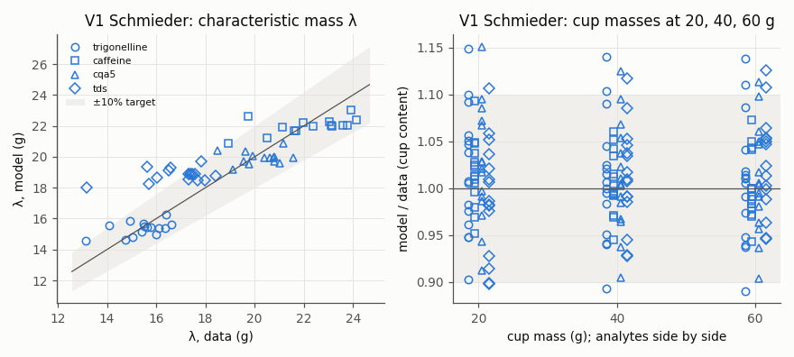
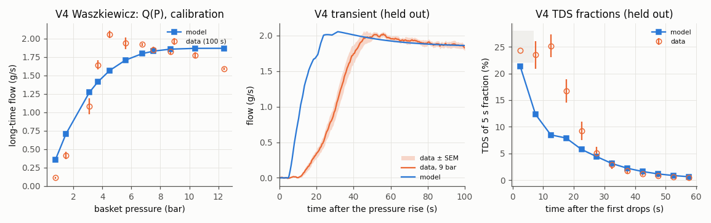
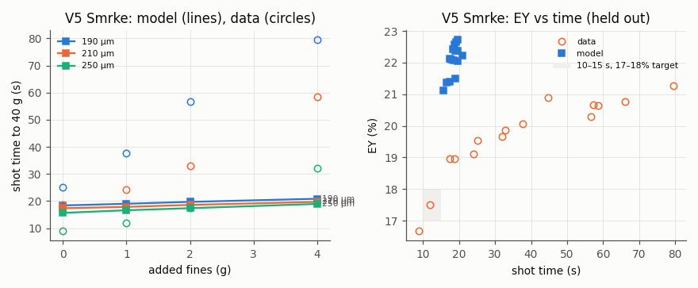

<!-- SPDX-License-Identifier: GPL-2.0-or-later -->
# M1 validation report

*Generated by `puckworks-tools validate` on 2026-10-18 · puckcore 0.7.0 · puckworks-tools 0.7.0 · tier 1, 16 size classes.*

*Solver build: extension 0dcf8cf05c149050 (built 2026-10-18T03:52:07-03:00); sources `crates/puckcore/src` 786578c5e04bb35e, `crates/puckmodel/src` 150b0b7fdd56cdd3, `crates/puckmodel/generated` bfda72656ff6ad56, `crates/puckcore-py` d3b7d64063e12e34, `data/chemistry` 6dd11d8f1a08ce38. The calibration ran on sources `crates/puckcore/src` 2bc3b20936480bae, `crates/puckmodel/src` 6d9ebc09c7f9b2d2, `crates/puckmodel/generated` b2d7edb685fec19f, `crates/puckcore-py` 563a9328b2a48052.*

Cached calibration statistics are historical for this run: core version changed; solver/model sources changed or lack an identity; solver build inputs changed; numeric registry defaults changed or lack an identity; preset inputs changed or lack an identity; Python calibration/case sources changed or lack an identity. The parameters are evaluated below, but the calibration file's uncertainties and sensitivity refits belong to its recorded solver/configuration. Its leave-one-out scores are not reused.

## Known biases

- **Startup mismatch.** The V4 9-bar case has long-time flow 1.86 against 1.82 g/s and reaches 36 g at ×0.64 of the measured time. The model's flow reaches 90% of its 100 s value 12.1 s after the first drops instead of 25.5 s, and its first drops come 6.83 s after full pressure instead of 12.8 s. The held-out V3 and V5 time ratios are ×0.6 and ×0.58. Total shot times combine startup and permeability errors; they do not isolate κ_ref.
- **Pump saturation in V1.** 15 of 15 Schmieder shots reach the pump's 12 bar limit during the preinfusion-to-pour switch (for 0.7–3.4 s). The measured per-shot maxima are 2.5–9.3 bar (Table S3). The simplified DE1 control and startup hydraulics do not reproduce those maxima.
- **κ_ref rests on structural choices.** ×1.8 across the four estimates (the two datasets ×1.6); ×3 between the whole-shot and pour-phase pressure comparisons; ×1.6 between θ = 0 and θ = 0.27. Fit uncertainties describe the chosen model and do not include this structural spread.
- **Uncertainties are lower bounds.** Reduced chi-square 6.12 (χ²/n by block: V1 5.22, V2 33.9, V4 12.8, V6 2.82); V1 holds 315 of 339 residuals, and its cup masses share information with c₀, λ and the first fraction (Eq. 3).
- **EY levels.** V3 and V5 EY rest on the bean's 28% extractable solids (input models), which no M1 dataset calibrates for those coffees.
- **V2.** The model's Bodenstein number is above the data in 5 of 5 cases; the held-out compound curves were not run (licence).

Datasets, case builders and the calibration harness: [case-builders.md](case-builders.md),
[calibration.md](calibration.md). Targets: [PLAN §10](../PLAN.md#10-verification-and-validation).

Parameters: calibrated values from `data/calibration/current.yaml` where present, registry defaults otherwise.

## Summary

| Check | Status | Result | Target |
|---|---|---|---|
| V1 λ within ±10% (fit) | **fail** | 48/60 experiment–analyte pairs within ±10% (trigonelline 13/15, caffeine 13/15, 5-CQA 14/15, TDS 8/15) | λ within ±10% for all 15 experiments × 4 analytes |
| V1 cup masses within ±10% (fit) | **fail** | 163/180 cup masses (20, 40, 60 g) within ±10% (trigonelline 37/45, caffeine 45/45, 5-CQA 42/45, TDS 39/45) | cup masses within ±10% |
| V1 leave-one-condition-out (±15%) | not run | not run for this model/configuration; the calibration file's cached refits are historical (core version changed; solver/model sources changed or lack an identity; solver build inputs changed; numeric registry defaults changed or lack an identity; preset inputs changed or lack an identity; Python calibration/case sources changed or lack an identity) | λ and cup masses of each left-out experiment within ±15% |
| V2 Bodenstein number 8–17 | **fail** | model Bo = 15.8, 18.2, 14.6, 14.5, 18.6 (data 8.7, 10.0, 10.4, 9.0, 7.7; the model is above the data in 5 of 5; the held-out compound curves were not run) | Bo within 8–17 |
| V4 long-time flow vs pressure (fit) | info | RMS error 0.240 g/s over 11 pressures | calibration (no pass/fail target) |
| V6 relative change of κ with density within ×1.5 | **fail** | model/data ratio factors 1.15, 0.93, 0.86, 0.90, 0.95, 1.23, 0.59, 1.28 | κ(ρ)/κ(360 kg/m³), model within ×1.5 of data for 4 grinds × 2 densities |
| V3 EY peak at grind setting 1.5–1.9 | **fail** (not independent) | model EY peaks at GS 1.1 (at the edge of the range: no peak) | EY maximum at GS 1.5–1.9 (data: 1.7) |
| V3 peak EY 22–24% | pass (not independent) | model peak EY 22.09% | peak EY within 22–24% (data: 23.07%) |
| V3 shot time falls as the grind coarsens | pass | model times 19.9, 19.3, 18.7, 18.4, 18.2, 17.6, 16.8 s | shot time strictly decreasing from GS 1.1 to 2.3 |
| V4 flow rises after the first drops | **fail** | model: 90% of the 100 s flow 12.1 s after the first drops (data 25.5 s); flow ×3.03 from 2 s to 15 s and ×3.06 to 100 s (data ×6.09, ×14.05); no overshoot at the 15 s check | 90% of the 100 s flow within ×1.5 of the data's time after the first drops, and no overshoot at the 15 s check (flow 15 s after the first drops ≤ flow at 100 s) |
| V4 first drops after full pressure | **fail** | model 6.8 s, data 12.8 s after the pressure reaches its target (both on the data's clock) | delay from full pressure to the first drops (0.1 g) within ×1.5 of the data's |
| V4 first-fraction TDS 25 ± 3% | **fail** | model first 5 s fraction 21.4% TDS (data: 24.4% in the one replicate that collected liquid, 23.5% in the next window) | 22–28% TDS |
| V4 time to 36 g (9 bar) | info | model 30.5 s, data 47.7 s after the pressure rise: ×0.64; long-time flow 1.86 against 1.82 g/s | reported: time to the target mass in the case calibrated on long-time flow |
| V5 added fines lengthen shots | **fail** | 190 µm: model 18.4, 19.0, 19.7, 20.9 s (+13% with 4 g; data +215%); 210 µm: model 17.4, 17.9, 18.6, 19.7 s (+14% with 4 g; data +211%); 250 µm: model 15.7, 16.6, 17.4, 19.0 s (+21% with 4 g; data +258%) | time rises at every step of 0, 1, 2, 4 g, and by at least 50% of the measured relative increase from 0 to 4 g, at 190, 210 and 250 µm |
| V5 EY tracks shot time | **fail** | Spearman ρ(time, EY) = 0.54 over 15 model conditions (data: 0.96) | Spearman ρ ≥ 0.8 |
| V5 10–15 s shots reach 17–18% EY | **fail** | conditions measured at 10–15 s: 250 µm + 1 g (measured 12.0 s, 17.51% EY; model 16.6 s, 21.37%); model mean 21.37% | model EY 17–18% at the conditions whose measured shots took 10–15 s (data: 17.4–17.6% at 12 s); EY levels rest on the bean's 28% extractable solids (input models) |
| Held-out shot times against the data | info | V3 Cameron: model/data ×0.6 (mean error -13 s, RMS 13 s); V5 Smrke: model/data ×0.58 (mean error -20 s, RMS 28 s); V4 9 bar (long-time flow is a calibration observable): time to 36 g ×0.64 | reported: shot times depend on startup and permeability; κ_ref is not tuned to these times |
| Tier 0 vs tier 1 on the held-out cases | info | tier 0 vs tier 1 on 22 V3/V5 shots: time within 2.7% (RMS 1.9%), EY within 0.83 points; V4 9 bar: first-fraction TDS 22.4% vs 21.4%, flow 15 s after the first drops 2.08 vs 1.84 g/s | reported, no PLAN target (tier 0 is the reduced model) |
| Generic 18 g → 36 g, 9 bar shots near 30 s | **fail** | tier 1: mahlkoenig-ek43 16.1 s, mahlkoenig-e65s 15.6 s, generic-flat-traditional-64 16.2 s, generic-conical-50 17 s, generic-flat-unimodal-64 15.7 s, bentwood-v63 16.1 s | 25–35 s for every preset at its default setting (typical espresso; an app sanity check, not a PLAN target) |

Calibration checks measure fit quality (V1, V2, V4 Q(P), V6); accuracy is reported only from the
held-out checks (V3, V4 transient, V5), per PLAN §10.

### M1 exit criteria (PLAN §12), validation part

| Criterion | Status | Checks |
|---|---|---|
| V1 within targets | **fail** | V1 λ within ±10% (fit) (fail), V1 cup masses within ±10% (fit) (fail), V1 leave-one-condition-out (±15%) (not run) |
| V3 peak reproduced | **partial** | V3 EY peak at grind setting 1.5–1.9 (fail), V3 peak EY 22–24% (pass) |
| V4 flow rise reproduced | **fail** | V4 flow rises after the first drops (fail), V4 first drops after full pressure (fail) |
| Verification suite green; tier 1 ≤ 1 s and tier 0 ≤ 10 ms per shot | not assessed | covered by the solver's verification tests and benchmarks, not by this report |

## 1. Calibration fit quality

RMS of the normalised residuals as this report recomputes them, next to the calibration file's; they agree when the run reproduces itself. χ²/n is from the calibration file.

| Block | Dataset | Cases | Residuals | RMS (this report) | RMS (calibration file) | χ²/n | Failed shots |
|---|---|---|---|---|---|---|---|
| V1 | schmieder2023 | 15 | 315 | 2.28 | 2.28 | 5.22 | 0 |
| V2 | vacaguerra2024 | 5 | 5 | 5.82 | 5.82 | 33.9 | 0 |
| V4 | waszkiewicz2026 | 11 | 11 | 3.57 | 3.57 | 12.8 | 0 |
| V6 | corrochano2017 | 12 | 8 | 1.68 | 1.68 | 2.82 | 0 |

### Parameters

SD from the fit's Jacobian (scaled by the reduced chi-square); SD/prior is the posterior SD over the registry prior's SD in the fit's coordinates (log10 for log-scaled parameters): at 0.5 or more the data add little to the prior.

| Registry id | Value | Units | Mode | SD | SD/prior | Source |
|---|---|---|---|---|---|---|
| `model.extraction.broken_shell_thickness` | 40 | um | override | 4.5 | 0.56 (at bound) | calibration |
| `extraction.saturation.lumped` | 350 | kg/m^3 | override | 20 | 0.5 (at bound) | calibration |
| `model.species.caffeine.surface_fraction_scale` | 0.6943 | 1 | override | 0.064 | 0.22 | calibration |
| `model.species.trigonelline.surface_fraction_scale` | 1.441 | 1 | override | 0.064 | 0.15 | calibration |
| `model.species.cqa5.surface_fraction_scale` | 0.9151 | 1 | override | 0.044 | 0.15 | calibration |
| `calibration.schmieder2023.extractable_fraction` | 29.07 | % | spec | 0.53 | 0.15 | calibration |
| `calibration.schmieder2023.content.caffeine` | 1.31 | % | spec | 0.017 | 0.075 | calibration |
| `calibration.schmieder2023.content.trigonelline` | 0.6871 | % | spec | 0.013 | 0.045 | calibration |
| `calibration.schmieder2023.content.cqa5` | 0.8843 | % | spec | 0.015 | 0.043 | calibration |
| `calibration.schmieder2023.permeability.gl1_4` | 1.297e-13 | m^2 | spec | 1.5e-14 | 0.1 | calibration |
| `calibration.schmieder2023.permeability.gl1_7` | 1.545e-13 | m^2 | spec | 2.6e-14 | 0.14 | calibration |
| `calibration.schmieder2023.permeability.gl2_0` | 1.895e-13 | m^2 | spec | 1.6e-14 | 0.071 | calibration |
| `model.hydraulics.viscosity_temperature_exponent` | 0.22 | 1 | override | 0.031 | 0.28 (at bound) | calibration |
| `hydraulics.poroelastic.critical_pressure` | 12 | bar | override | — | — | registry default |
| `extraction.dispersion.axial_coefficient` | 3.224e-06 | m^2/s | override | 2.5e-07 | 0.13 | calibration |
| `calibration.waszkiewicz2026.permeability` | 1.941e-14 | m^2 | spec | 5.6e-16 | 0.025 | calibration |
| `hydraulics.kozeny_carman.density_exponent` | 0.2465 | 1 | override | 0.047 | 0.054 | calibration |
| `hydraulics.permeability.reference` | 2.78e-13 | m^2 | pooled | — | — | calibration |

**Reference permeability** `hydraulics.permeability.reference`: pooled 2.78e-13 m² (geometric mean over datasets, each dataset the geometric mean of its estimates; estimate i = fitted bare κ₀,i / builder scaling of case i, (D32_i/D32_ref)²·KC(ε)/KC(ε_ref)). By dataset: schmieder2023 3.49e-13 m²; waszkiewicz2026 2.21e-13 m²; the datasets differ by ×1.58, more than their fit uncertainties: the pooled value carries that disagreement. Spread of all estimates: log-SD 0.25, max/min 1.78.

Each estimate is the fitted bare κ₀ divided by the builder's scaling of the app's representation of that grind (the scaling basis). D32 values from different bases are not strictly comparable: Waszkiewicz's PSD is laser diffraction (Mastersizer 2000; the article does not say wet or dry dispersion), while the grinder presets' D32 comes from the input models, anchored on other measurements.

| Nuisance κ₀ | Dataset | Scaling basis | κ₀ (m²) | Builder scaling | D32/D32_ref | κ_ref (m²) |
|---|---|---|---|---|---|---|
| `calibration.schmieder2023.permeability.gl1_4` | schmieder2023 | grinder preset mahlkoenig-e65s at GL 1.4 | 1.3e-13 | 0.414 | 0.644 | 3.13e-13 |
| `calibration.schmieder2023.permeability.gl1_7` | schmieder2023 | grinder preset mahlkoenig-e65s at GL 1.7 | 1.55e-13 | 0.447 | 0.669 | 3.46e-13 |
| `calibration.schmieder2023.permeability.gl2_0` | schmieder2023 | grinder preset mahlkoenig-e65s at GL 2.0 | 1.9e-13 | 0.482 | 0.694 | 3.93e-13 |
| `calibration.waszkiewicz2026.permeability` | waszkiewicz2026 | the case's own PSD | 1.94e-14 | 0.0877 | 0.296 | 2.21e-13 |

**Tension with typical espresso grinds.** Published espresso grinds have a dry D32 of about 80–145 µm (Cameron, Corrochano ΨB–E, Smrke), while Waszkiewicz's grind measures about 49 µm (it was chosen for the SCA guideline of 37 g in 32 s at 9 bar; the article's own 9 bar shots reached 37 g at about 48 s). κ₀ scales with D32², so differences in the measured PSD affect the reference permeability inferred from each dataset. The held-out shot times come out at ×0.6 (V3 Cameron, mean error -13 s) and ×0.58 (V5 Smrke, -20 s). The V4 case, calibrated on long-time flow, reaches 36 g at ×0.64 of its measured time. These times combine startup and permeability effects. κ_ref is not tuned to them.

- *Waszkiewicz's PSD is atypical.* X50 61 µm, X90 145 µm, 63.6% of the volume below 100 µm; 3.8% of the volume sits in the 158–182 µm bin and nothing above, although the bins run to 417 µm and the Mastersizer 2000 reads to 2000 µm. A coarse tail that ends this abruptly suggests that coarse particles were under-represented (settling in a wet dispersion unit, or sample selection; the article does not say), which lowers this D32 and raises this dataset's κ_ref. The authors describe their grounds as "of typical size below 200 µm".
- *Schmieder's D32 rests on the E65S dial mapping.* The dial's scale is disputed (the brochure's ≈5 µm per indicator read as burr movement or as a particle-size bandwidth), so the preset maps the dial to a burr gap fitted to the article's wet-laser D[4,3] at GL 1.4 and 2.0, and its D32 comes from the input models' fines relation (fitted to dry-laser and Camsizer PSDs), not from the article's wet D32 of 27–29 µm, which includes 1–10 µm debris. A 10% smaller D32 at the same settings would raise the Schmieder estimate by about 23%.

**Held at their registry values** (reviewed, not fitted):

| Parameter | Value | Reason |
|---|---|---|
| `model.hydraulics.intraparticle_water_fraction` | 1 | M1.1 fills the complete intraparticle pore-water inventory behind the front (fraction 1), rather than counting only the mobile share. This is a water-volume accounting choice, not a fit to shot times. The effective-loading approximation is documented in the startup model and remains subject to validation against independent uptake measurements. |
| `model.hydraulics.pore_air_amplitude` | 0.5 | The initial effective connectivity deficit is a grade D model assumption (0.5), separate from coffee CO2; it is not a measured gas volume fraction. None of the calibration observables identifies a transient relative-permeability law. It is held at its prior rather than fitted to the held-out V4 first-drop delay or flow rise. |
| `model.hydraulics.pore_air_permeability_exponent` | 3 | The effective connectivity-to-relative-permeability exponent is a grade D closure (3), not measured for these pucks. Held fixed; the V4 transient, V3 and V5 shot times do not select it. |
| `model.hydraulics.moisture_diffusivity` | 2.5e-11 m^2/s | The pore-air relaxation time uses (D32/2)^2/(pi^2 D), capped at 600 s, with D = 2.5e-11 m^2/s from the independent Mateus moisture-uptake range. Using moisture diffusion for air clearance is a grade D model assumption. Neither this diffusivity nor its time scale is fitted to held-out shots. |
| `model.hydraulics.wetting_uptake` | 0.5 | In M1.1 this is the fixed effective-loading normalization inherited from the extraction model, distinct from the full intraparticle water inventory. It is not fitted to startup observations. |
| `extraction.diffusivity.caffeine.particle_80c` | 1.9e-10 m^2/s | Species kernel diffusivities trade off with the coffee's contents (correlation −0.89 to −0.95): their posterior SD was 2–12× the prior's, and free fits drifted 2–5× outside the literature priors (caffeine to 8×10⁻¹¹, trigonelline to the 1×10⁻⁹ bound). The species surface-pool scales carry the species' λ instead. |
| `model.species.trigonelline.diffusivity_80c` | 2.8e-10 m^2/s | Not identified by V1 (see the caffeine diffusivity). |
| `model.species.cqa5.diffusivity_80c` | 1.55e-10 m^2/s | Not identified by V1 (see the caffeine diffusivity). |
| `extraction.diffusivity.lumped.corrochano_80c` | 1.26e-10 m^2/s | Weakly identified by V1 (posterior SD 1.15× the prior's; it trades off with the extractable fraction); fixing it did not raise the cost. |
| `extraction.surface_rate.grudeva2026` | 0.001 m/s | Not identified by V1 (posterior SD 44× the prior's once the lumped diffusivity is fixed); the surface flux is fast at any value in its range, so only the surface pool's size matters. |
| `model.hydraulics.swelling_pore_closure` | 0.1 | Not identified by V1 (posterior SD 1.6× the prior's when added at the V1 optimum); the residuals lean towards less swelling (Wald z 2.4 towards 0). |
| `model.hydraulics.gas_amplitude_max` | 0.5 | Weakly identified by V1 (posterior SD 0.4–0.7× the prior's) with no evidence against the registry value (Wald z 0.8); the CO₂ model is being re-anchored in the input models. |
| `hydraulics.dissolution_porosity_share` | 0 | θ is fixed at its mechanistic default, 0 (the insoluble cell walls hold the particle envelope), not chosen by fit quality: it is collinear with the bed permeability, whose fitted values move to absorb it. `calibrate --sensitivity` reports the θ = 0.27 case as a structural sensitivity. |
| `hydraulics.poroelastic.critical_pressure` | 12 bar | Pruned by the identifiability rule in the calibration run: posterior SD 0.59× the prior's (fitted value 13.46 before pruning). |

### V1 Schmieder 2023

λ within ±10%: 48/60 (largest error 37%); cup masses within ±10%: 163/180 (largest error 15.1%). The leave-one-condition-out check (target ±15%) is in the summary table; it is mildly optimistic, because parameters shared with other blocks stay at their full-fit values in each refit. Worst λ: experiment 8, tds, 37%. Seconds at the pump's 12 bar limit, switch / pour, by experiment: 1: 1.7 / 0, 2: 2.9 / 0, 3: 2.7 / 0, 4: 1.6 / 0, 5: 2.4 / 0, 6: 2.2 / 0, 7: 2.3 / 0, 8: 2.2 / 0, 9: 2 / 0, 10: 1.1 / 0, 11: 0.7 / 0, 12: 3.4 / 0, 13: 3.2 / 0, 14: 2.5 / 0, 15: 2.1 / 0. Peak-pressure residuals of pump-capped pours are kept and flagged (they understate the misfit: the model cannot pass the set flow below 12 bar); the sensitivity table shows the fit without them.

| Exp. | Analyte | λ model (g) | λ data (g) | cup 40 g model | cup 40 g data |
|---|---|---|---|---|---|
| 1 | trigonelline | 14.6 | 14.8 | 96.1 | 102 |
| 1 | caffeine | 21.2 | 20.5 | 184 | 185 |
| 1 | cqa5 | 19.2 | 19.1 | 118 | 123 |
| 1 | tds | 18.2 | 15.7 | 3.87 | 4.1 |
| 2 | trigonelline | 16.2 | 16.4 | 101 | 97.1 |
| 2 | caffeine | 23 | 23.9 | 183 | 184 |
| 2 | cqa5 | 20.9 | 21.2 | 121 | 114 |
| 2 | tds | 19.7 | 17.8 | 3.95 | 3.81 |
| 3 | trigonelline | 15.9 | 14.9 | 100 | 91.1 |
| 3 | caffeine | 22.2 | 22 | 185 | 178 |
| 3 | cqa5 | 20.3 | 19.6 | 121 | 111 |
| 3 | tds | 19.3 | 16.6 | 3.97 | 3.65 |
| 4 | trigonelline | 15 | 16 | 98.7 | 100 |
| 4 | caffeine | 22.2 | 23.1 | 182 | 184 |
| 4 | cqa5 | 19.7 | 20.8 | 119 | 123 |
| 4 | tds | 18.5 | 17.3 | 3.89 | 3.92 |
| 5 | trigonelline | 15.1 | 15.4 | 99.2 | 104 |
| 5 | caffeine | 21.7 | 21.6 | 183 | 188 |
| 5 | cqa5 | 19.5 | 19.8 | 119 | 121 |
| 5 | tds | 18.5 | 18 | 3.91 | 3.96 |
| 6 | trigonelline | 15.4 | 15.8 | 101 | 101 |
| 6 | caffeine | 22 | 22.4 | 186 | 187 |
| 6 | cqa5 | 19.9 | 20.6 | 121 | 120 |
| 6 | tds | 18.9 | 17.3 | 3.98 | 4.01 |
| 7 | trigonelline | 15.4 | 16.1 | 99.7 | 98.3 |
| 7 | caffeine | 22.1 | 23.1 | 184 | 184 |
| 7 | cqa5 | 20 | 20.8 | 120 | 120 |
| 7 | tds | 18.9 | 17.5 | 3.94 | 3.88 |
| 8 | trigonelline | 14.6 | 13.1 | 95.9 | 95.3 |
| 8 | caffeine | 20.9 | 18.9 | 184 | 178 |
| 8 | cqa5 | 19 | 17.3 | 118 | 114 |
| 8 | tds | 18 | 13.2 | 3.87 | 3.84 |
| 9 | trigonelline | 15.4 | 15.6 | 96.1 | 102 |
| 9 | caffeine | 21.7 | 21.7 | 184 | 195 |
| 9 | cqa5 | 20.1 | 19.9 | 118 | 126 |
| 9 | tds | 19.1 | 16.5 | 3.88 | 4.18 |
| 10 | trigonelline | 15.6 | 14.1 | 96.5 | 96.6 |
| 10 | caffeine | 22.6 | 19.8 | 182 | 173 |
| 10 | cqa5 | 20.4 | 18.5 | 117 | 117 |
| 10 | tds | 19.3 | 15.6 | 3.85 | 3.72 |
| 11 | trigonelline | 14.8 | 15 | 94.7 | 106 |
| 11 | caffeine | 21.9 | 21.1 | 182 | 188 |
| 11 | cqa5 | 19.7 | 19.6 | 117 | 129 |
| 11 | tds | 18.7 | 16 | 3.82 | 4.11 |
| 12 | trigonelline | 15.7 | 15.5 | 101 | 88.3 |
| 12 | caffeine | 22 | 23.6 | 183 | 172 |
| 12 | cqa5 | 20 | 20.8 | 120 | 107 |
| 12 | tds | 18.9 | 17.4 | 3.94 | 3.53 |
| 13 | trigonelline | 15.5 | 15.5 | 102 | 93.2 |
| 13 | caffeine | 22 | 23.2 | 186 | 184 |
| 13 | cqa5 | 20 | 20.4 | 122 | 114 |
| 13 | tds | 18.9 | 17.6 | 4 | 3.83 |
| 14 | trigonelline | 15.6 | 16.6 | 100 | 97.8 |
| 14 | caffeine | 22.4 | 24.1 | 179 | 176 |
| 14 | cqa5 | 19.9 | 21.6 | 118 | 115 |
| 14 | tds | 18.8 | 18.4 | 3.87 | 3.68 |
| 15 | trigonelline | 15.4 | 16.4 | 101 | 98.9 |
| 15 | caffeine | 22 | 23.8 | 182 | 183 |
| 15 | cqa5 | 19.6 | 21 | 120 | 121 |
| 15 | tds | 18.5 | 17.7 | 3.92 | 3.88 |

### V1 sensitivity

V1 refitted under changed case assumptions; parameters shared with other blocks held at their fitted values; the pooled value keeps the other datasets' estimates. The first row is the calibration itself.

| Variant | V1 cost | κ₀ by grinding level (m²) | Schmieder κ_ref (m²) | Pooled κ_ref (m²) | Peak-pressure RMS | λ within ±10% | Cups within ±10% |
|---|---|---|---|---|---|---|---|
| as calibrated | 821.5 | 1.3e-13, 1.55e-13, 1.9e-13 | 3.49e-13 | 2.78e-13 | 2.97 | 48/60 | 163/180 |
| transition ramp 1 s | 1442 | 7.3e-14, 8.44e-14, 1.63e-13 | 2.24e-13 | 2.23e-13 | 2.62 | 36/60 | 159/180 |
| transition ramp 0.3 s | 1477 | 7.24e-14, 8.35e-14, 1.94e-13 | 2.36e-13 | 2.29e-13 | 2.41 | 36/60 | 158/180 |
| upstream pressure loss 0.4 bar | 786.6 | 1.36e-13, 1.67e-13, 2.07e-13 | 3.76e-13 | 2.88e-13 | 2.77 | 50/60 | 164/180 |
| whole-shot peak pressure | 572.5 | 3.32e-13, 5.34e-13, 5.91e-13 | 1.05e-12 | 4.83e-13 | 2.42 | 56/60 | 170/180 |
| pressure classification margin 1 bar | 747.6 | 1.4e-13, 2.05e-13, 4.54e-13 | 5.26e-13 | 3.41e-13 | 3.79 | 52/60 | 168/180 |
| pump-capped pour pressures excluded | 821.5 | 1.3e-13, 1.55e-13, 1.9e-13 | 3.49e-13 | 2.78e-13 | 2.97 | 48/60 | 163/180 |

### Structural sensitivity: dissolution share θ

A sensitivity analysis of a structural assumption, not a choice: the calibration fixes θ at its mechanistic default, 0 (the insoluble cell walls hold the particle envelope, so dissolution opens intraparticle pores). θ is collinear with the bed permeability: the grinding-level permeabilities and contents move to absorb it, so κ₀ and κ_ref change with it. The row refits V1+V2+V4+V6 at the old value: total cost 1153 against 987.7 at θ = 0, peak-pressure RMS 4.02. The cost difference is within one model and is not evidence for θ. Independent evidence for θ would have to come from flow-rise data, which M1 holds out (V4 transient), or from new experiments. The rows repeat the held-out predictions at both values.

| θ | κ₀: Schmieder GL 1.4, 1.7, 2.0; Waszkiewicz (m²) | κ_ref by dataset (m²) | pooled κ_ref (m²) | V3 time model/data | V3 peak EY | V5 time model/data | V5 mean EY | V5 ρ(time, EY) |
|---|---|---|---|---|---|---|---|---|
| 0 (calibration) | 1.3e-13, 1.55e-13, 1.9e-13, 1.94e-14 | schmieder2023 3.49e-13, waszkiewicz2026 2.21e-13 | 2.78e-13 | ×0.6 | 22.1% at GS 1.1 | ×0.58 | 22.1% | 0.54 |
| 0.27 (old proportional rule) | 8.83e-14, 1.38e-13, 3.89e-13, 6.82e-15 | schmieder2023 3.76e-13, waszkiewicz2026 7.78e-14 | 1.71e-13 | ×0.54 | 19.8% at GS 1.1 | ×0.52 | 19.6% | 0.34 |

V4 9 bar at θ = 0: 90% of the 100 s flow 12.1 s after the first drops (data 25.5 s), first drops 6.83 s after full pressure (data 12.8 s). V4 9 bar at θ = 0.27: 90% of the 100 s flow 16.9 s after the first drops, first drops 9.59 s after full pressure, first 5 s fraction 21.1% TDS.

### V2 Vaca Guerra 2024: Bodenstein numbers

| Case | Model | Data |
|---|---|---|
| A_30g | 15.8 | 8.7 |
| B_30g | 18.2 | 10 |
| C_30g | 14.6 | 10.4 |
| D_30g | 14.5 | 8.98 |
| B_60g | 18.6 | 7.74 |

### V4 Waszkiewicz 2026: long-time flow

| Basket pressure (bar) | Model (g/s) | Data (g/s) | SEM |
|---|---|---|---|
| 0.758 | 0.354 | 0.109 | 0.0149 |
| 1.49 | 0.706 | 0.414 | 0.0498 |
| 3.1 | 1.27 | 1.08 | 0.109 |
| 3.69 | 1.41 | 1.64 | 0.0627 |
| 4.5 | 1.57 | 2.06 | 0.0495 |
| 5.59 | 1.71 | 1.94 | 0.0797 |
| 6.74 | 1.8 | 1.92 | 0.0218 |
| 7.53 | 1.83 | 1.85 | 0.0371 |
| 8.72 | 1.86 | 1.82 | 0.0389 |
| 10.4 | 1.87 | 1.78 | 0.043 |
| 12.4 | 1.87 | 1.59 | 0.0172 |

### V6 Corrochano 2017: permeability versus bed density

| Grind | Density (kg/m³) | κ/κ(360), model | κ/κ(360), data | Model/data |
|---|---|---|---|---|
| B | 400 | 0.734 | 0.636 | 1.15 |
| B | 480 | 0.313 | 0.338 | 0.926 |
| C | 400 | 0.741 | 0.857 | 0.865 |
| C | 480 | 0.316 | 0.35 | 0.904 |
| D | 400 | 0.752 | 0.792 | 0.95 |
| D | 480 | 0.328 | 0.267 | 1.23 |
| E | 400 | 0.758 | 1.29 | 0.586 |
| E | 480 | 0.339 | 0.265 | 1.28 |

## 2. Held-out checks

### V3 Cameron 2020

RMS error: EY 0.658 points, shot time 13.1 s.

| Grind setting | EY model (%) | EY data (%) | Time model (s) | Time data (s) |
|---|---|---|---|---|
| 1.1 | 22.1 | 21.3 | 19.9 | 37.6 |
| 1.3 | 22 | 22 | 19.3 | 35.7 |
| 1.5 | 21.9 | 22.2 | 18.7 | 33.9 |
| 1.7 | 21.8 | 23.1 | 18.4 | 30.5 |
| 1.9 | 21.7 | 22.5 | 18.2 | 28.5 |
| 2.1 | 21.5 | 21.6 | 17.6 | 26.6 |
| 2.3 | 21 | 20.7 | 16.8 | 24 |

### V4 Waszkiewicz 2026: transient at 9 bar

Times on the data's clock, from the end of the pressure rise (the model's clock is shifted by the moment its inlet pressure reaches 95% of the target). First drops (cup mass 0.1 g): model 6.83 s, data 12.8 s. Time to 36 g: model 30.5 s, data 47.7 s. Long-time flow: model 1.86, data 1.82 g/s.

| Fraction (s after first drops) | TDS model (%) | TDS data (%) |
|---|---|---|
| 2.5 | 21.4 | 24.4 |
| 7.5 | 12.3 | 23.5 |
| 12.5 | 8.48 | 25.2 |
| 17.5 | 7.9 | 16.7 |
| 22.5 | 5.76 | 9.2 |
| 27.5 | 4.4 | 5.11 |
| 32.5 | 3.1 | 2.92 |
| 37.5 | 2.22 | 1.81 |
| 42.5 | 1.61 | 1.23 |
| 47.5 | 1.17 | 0.816 |
| 52.5 | 0.86 | 0.549 |
| 57.5 | 0.64 | 0.479 |

### V5 Smrke 2024

RMS error: time 27.6 s, EY 2.57 points.

| Burr gap (µm) | Fines (g) | Time model (s) | Time data (s) | EY model (%) | EY data (%) |
|---|---|---|---|---|---|
| 160 | 0 | 19.7 | 66.2 | 22.7 | 20.8 |
| 170 | 0 | 19.2 | 57.2 | 22.7 | 20.7 |
| 180 | 0 | 18.7 | 44.8 | 22.6 | 20.9 |
| 190 | 0 | 18.4 | 25.3 | 22.4 | 19.5 |
| 190 | 1 | 19 | 37.6 | 22.4 | 20.1 |
| 190 | 2 | 19.7 | 56.6 | 22.4 | 20.3 |
| 190 | 4 | 20.9 | 79.5 | 22.2 | 21.3 |
| 210 | 0 | 17.4 | 18.8 | 22.1 | 19 |
| 210 | 1 | 17.9 | 24.1 | 22.1 | 19.1 |
| 210 | 2 | 18.6 | 32.9 | 22.1 | 19.9 |
| 210 | 4 | 19.7 | 58.5 | 22.1 | 20.6 |
| 250 | 0 | 15.7 | 8.95 | 21.1 | 16.7 |
| 250 | 1 | 16.6 | 12 | 21.4 | 17.5 |
| 250 | 2 | 17.4 | 17.5 | 21.4 | 19 |
| 250 | 4 | 19 | 32.1 | 21.5 | 19.7 |

### Tier 0 versus tier 1

The held-out cases at tier 0 with the same parameters. V3/V5 shot time: largest difference 2.7% (RMS 1.9%); EY: largest 0.83 points (RMS 0.44).

| Case | Time, tier 1 (s) | Time, tier 0 (s) | EY, tier 1 (%) | EY, tier 0 (%) |
|---|---|---|---|---|
| cameron2020/gs1_1 | 19.9 | 19.4 | 22.1 | 22.9 |
| cameron2020/gs1_3 | 19.3 | 18.9 | 22 | 22.8 |
| cameron2020/gs1_5 | 18.7 | 18.4 | 21.9 | 22.6 |
| cameron2020/gs1_7 | 18.4 | 18.1 | 21.8 | 22.5 |
| cameron2020/gs1_9 | 18.2 | 17.9 | 21.7 | 22.3 |
| cameron2020/gs2_1 | 17.6 | 17.4 | 21.5 | 21.8 |
| cameron2020/gs2_3 | 16.8 | 16.6 | 21 | 21.2 |
| smrke2024/s160_f0 | 19.7 | 19.2 | 22.7 | 23.2 |
| smrke2024/s170_f0 | 19.2 | 18.8 | 22.7 | 23 |
| smrke2024/s180_f0 | 18.7 | 18.3 | 22.6 | 22.9 |
| smrke2024/s190_f0 | 18.4 | 18.1 | 22.4 | 22.7 |
| smrke2024/s190_f1 | 19 | 18.6 | 22.4 | 22.7 |
| smrke2024/s190_f2 | 19.7 | 19.3 | 22.4 | 22.8 |
| smrke2024/s190_f4 | 20.9 | 20.3 | 22.2 | 22.8 |
| smrke2024/s210_f0 | 17.4 | 17.1 | 22.1 | 22.2 |
| smrke2024/s210_f1 | 17.9 | 17.6 | 22.1 | 22.2 |
| smrke2024/s210_f2 | 18.6 | 18.3 | 22.1 | 22.3 |
| smrke2024/s210_f4 | 19.7 | 19.3 | 22.1 | 22.5 |
| smrke2024/s250_f0 | 15.7 | 15.5 | 21.1 | 21 |
| smrke2024/s250_f1 | 16.6 | 16.4 | 21.4 | 21.4 |
| smrke2024/s250_f2 | 17.4 | 17.1 | 21.4 | 21.6 |
| smrke2024/s250_f4 | 19 | 18.6 | 21.5 | 21.7 |

waszkiewicz2026/p9 (9 bar): first drops 6.83 s (tier 1) and 7.49 s (tier 0) after the pressure reaches its target; flow 15 s later 1.84 and 2.08 g/s; first 5 s fraction 21.4% and 22.4% TDS.

### Generic app shots

18 g dose with a 36 g pump-stop target at a flat 9 bar (medium washed arabica, 58 mm precision basket) with the calibrated parameters, one per grinder preset: a sanity check of the reference permeability the app uses. Time ends when the pump stops at 36 g. EY includes subsequent drip into the cup, so it describes a larger final beverage rather than a 36 g cup.

| Grinder preset | Setting | κ₀ (m²) | Pump-stop time (s) | EY after drip (%) | Stop |
|---|---|---|---|---|---|
| mahlkoenig-ek43 | 1.7 | 1.12e-13 | 16.1 | 21.7 | beverage_mass |
| mahlkoenig-e65s | 1.7 | 1.24e-13 | 15.6 | 21.6 | beverage_mass |
| generic-flat-traditional-64 | 190.0 | 1.09e-13 | 16.2 | 21.7 | beverage_mass |
| generic-conical-50 | 190.0 | 8.85e-14 | 17 | 21 | beverage_mass |
| generic-flat-unimodal-64 | 170.0 | 1.22e-13 | 15.7 | 22.8 | beverage_mass |
| bentwood-v63 | 190.0 | 1.12e-13 | 16.1 | 21.8 | beverage_mass |

## Figures

## Solver warnings

- M2 pH/TA use ideal 25 °C speciation and an estimated intrinsic-pH/background-buffer charge closure; Ca/Mg do not multiply extraction
- a large run: up to 2.64e3 steps × 3.37e6 values = 8.90e9 (expect several seconds or more)
- a large run: up to 6.36e3 steps × 1.73e5 values = 1.10e9 (expect several seconds or more)
- a large run: up to 6.77e3 steps × 1.73e5 values = 1.17e9 (expect several seconds or more)

## Solver robustness

Over the 117 shots simulated for this report (0 failed): hydraulic_volume_balance_error worst 1.06e-13, mass_balance_error worst 3.04e-14, max_regime_solves worst 8, min_concentration_kg_m3 worst 0, outflow_integral_error worst 0.011, rejected_steps worst 1, steps worst 1.22e+04.

*117 simulations. Raw numbers: [m1-validation.json](m1-validation.json).*
