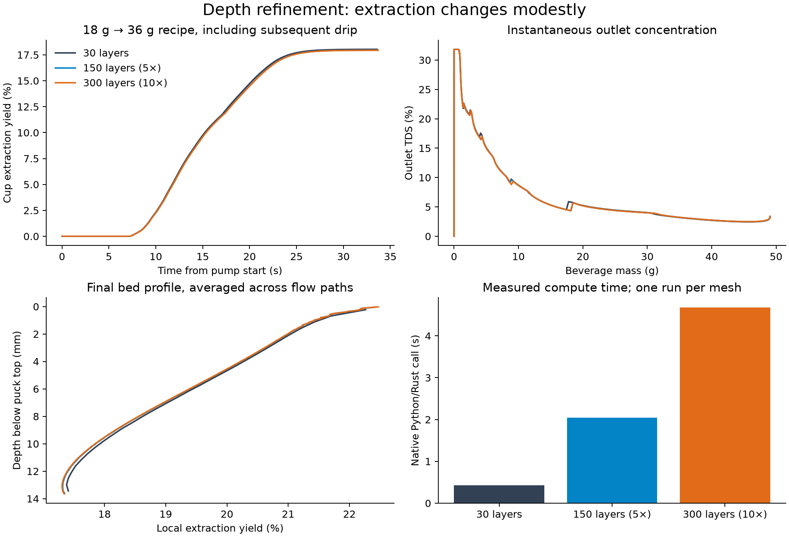
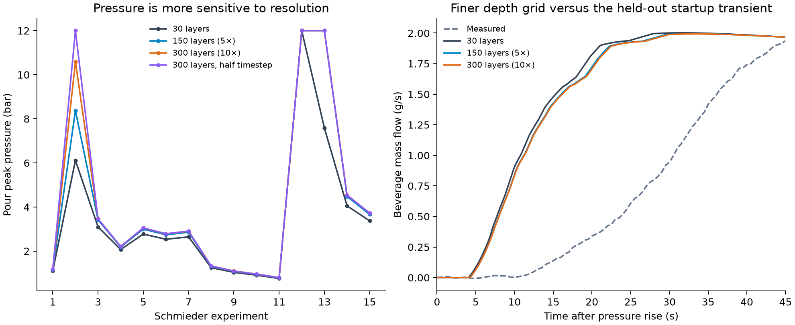
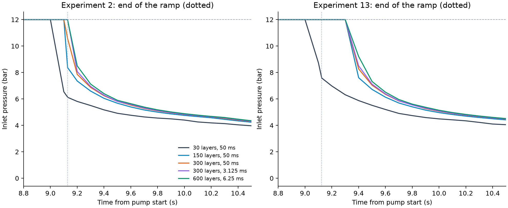

<!-- SPDX-License-Identifier: GPL-2.0-or-later -->
# Fixed-v5 mesh refinement

The recorded solver is puckcore 0.6.3. All 240 runs complete: 24 conditions on each of ten grids/timestep combinations. The conditions are all 15 Schmieder calibration shots, seven held-out Cameron grind settings, the Waszkiewicz 9-bar long shot (whose startup transient is held out), and one generic EK43 18 g → 36 g recipe. The v5 parameters and physical inputs stay fixed; there is no refit.

## Findings

The 10× depth grid changes final cup extraction by at most 0.1696 percentage points across the 24 conditions. The additional change from 150 to 300 layers is at most 0.0293 points and 0.0544 s of shot time. Bulk extraction is comparatively insensitive in this tested range.

Pressure is materially grid-sensitive. Experiment 13's pour peak moves from 7.582 bar to the 12-bar pump cap on both finer depth grids. Halving the 300-layer timestep retains that cap; across all conditions it changes EY by at most 0.0061 points and shot time by 0.0403 s. Its largest pour-peak change elsewhere is 1.4075 bar. The frozen fit's pressure residuals therefore need reevaluation on a chosen refined grid.

Finer depth resolution moves the held-out startup transient toward the measurements, but leaves a large timing discrepancy. It also leaves the Cameron extraction maximum at the finest tested grind rather than the observed interior peak. These experiments do not close the scientific validation gates or select new fitted parameters. The application default remains unchanged; the finer grids are reproducible through the study script and raw shot numerical settings.

## Resolution and overall changes

Differences below are maxima over the same 24 conditions, relative to the 30-layer baseline. EY and TDS changes are percentage points, not relative percentages. Runtime ratios are medians of paired serial native Python/Rust calls, including JSON conversion; these are single-run measurements, not browser benchmarks.

| Variant | Layers × columns | Particle shells | Max timestep (s) | Max absolute ΔEY (pp) | Max absolute ΔTDS (pp) | Max absolute Δshot time (s) | Max absolute Δfirst drops (s) | Runtime ratio |
|---|---:|---:|---:|---:|---:|---:|---:|---:|
| 30 layers | 30 × 8 | 8 | 0.05 | 0.0000 | 0.0000 | 0.0000 | 0.0000 | 1.00× |
| 150 layers (5×) | 150 × 8 | 8 | 0.05 | 0.1426 | 0.0484 | 0.4237 | 0.1522 | 4.78× |
| 300 layers (10×) | 300 × 8 | 8 | 0.05 | 0.1696 | 0.0543 | 0.4782 | 0.1673 | 9.89× |
| 30 layers, half timestep | 30 × 8 | 8 | 0.025 | 0.0139 | 0.0055 | 0.0173 | 0.0078 | 1.94× |
| 300 layers, half timestep | 300 × 8 | 8 | 0.025 | 0.1709 | 0.0521 | 0.5185 | 0.1892 | 19.76× |
| 40 columns (5×) | 30 × 40 | 8 | 0.05 | 0.1132 | 0.0444 | 0.0222 | 1.6581 | 5.59× |
| 64 columns (8×) | 30 × 64 | 8 | 0.05 | 0.1165 | 0.0458 | 0.0261 | 1.9850 | 9.30× |
| 40 shells (5×) | 30 × 8 | 40 | 0.05 | 0.0215 | 0.0079 | 0.0033 | 0.0019 | 2.26× |
| 64 shells (8×) | 30 × 8 | 64 | 0.05 | 0.0276 | 0.0104 | 0.0043 | 0.0027 | 3.21× |
| 150 layers, 16 columns, 16 shells | 150 × 16 | 16 | 0.05 | 0.2119 | 0.0812 | 0.4212 | 0.7494 | 15.72× |

The exact 5× and 10× refinements increase depth from 30 to 150 and 300 layers (240 → 1,200 → 2,400 bed cells). Column and particle-shell counts are separately tested at 40 and 64, the latter being the existing solver limit. Particle-size quadrature remains 16 groups for the datasets and 30 for the generic recipe. Increasing columns samples the permeability distribution more finely; it does not introduce lateral flow or resolved pores.

## Generic 18 g → 36 g shot

| Depth layers | Cell height (mm) | Pump-stop time (s) | First drops (s) | Final cup EY (%) | Final cup TDS (%) | Native call (s) |
|---|---:|---:|---:|---:|---:|---:|
| 30 | 0.4557 | 21.5829 | 7.2761 | 18.0313 | 6.6121 | 0.426 |
| 150 | 0.0911 | 21.7004 | 7.2901 | 17.9466 | 6.5844 | 2.044 |
| 300 | 0.0456 | 21.7124 | 7.2894 | 17.9365 | 6.5811 | 4.681 |

Final EY/TDS include the modeled drip; the 36 g stop applies at pump stop.



## Calibration observables

| Variant | Rates within ±10% | Eq.3 cups within ±10% | V1 data cost | Largest relative rate change | Largest relative Eq.3 cup change | Largest pour-peak change (bar) |
|---|---:|---:|---:|---:|---:|---:|
| 30 layers | 51/60 | 174/180 | 478.520 | 0.000% | 0.000% | 0.0000 |
| 150 layers (5×) | 50/60 | 177/180 | 540.526 | 3.455% | 2.529% | 4.4180 |
| 300 layers (10×) | 51/60 | 179/180 | 561.310 | 3.196% | 3.075% | 4.4762 |
| 30 layers, half timestep | 51/60 | 174/180 | 480.117 | 0.390% | 0.144% | 0.0242 |
| 300 layers, half timestep | 51/60 | 179/180 | 566.964 | 3.237% | 3.147% | 5.8837 |
| 40 columns (5×) | 51/60 | 174/180 | 503.534 | 4.248% | 1.085% | 0.2890 |
| 64 columns (8×) | 51/60 | 174/180 | 506.013 | 4.151% | 1.132% | 0.3134 |
| 40 shells (5×) | 51/60 | 174/180 | 474.887 | 0.700% | 0.243% | 0.0410 |
| 64 shells (8×) | 51/60 | 174/180 | 474.824 | 0.732% | 0.279% | 0.0349 |
| 150 layers, 16 columns, 16 shells | 49/60 | 178/180 | 583.581 | 4.084% | 2.831% | 4.4180 |

These are fixed-coefficient sensitivity scores on calibration data. They are not new leave-one-out results or evidence that a particular grid is more physically accurate.

## Pressure and startup

| Variant | Experiment 13 pour peak (bar) | V4 first drops after pressure rise (s) | V4 rise to 90% after drops (s) | V4 long-time flow (g/s) | Cameron peak setting | Cameron peak EY (%) |
|---|---:|---:|---:|---:|---:|---:|
| 30 layers | 7.5820 | 6.0240 | 12.3170 | 1.8607 | 1.1 | 19.6333 |
| 150 layers (5×) | 12.0000 | 6.1871 | 13.2771 | 1.8608 | 1.1 | 19.5053 |
| 300 layers (10×) | 12.0000 | 6.2041 | 13.4301 | 1.8608 | 1.1 | 19.4894 |
| 30 layers, half timestep | 7.5578 | 6.0266 | 12.3013 | 1.8607 | 1.1 | 19.6463 |
| 300 layers, half timestep | 12.0000 | 6.2250 | 13.4250 | 1.8609 | 1.1 | 19.4952 |
| 40 columns (5×) | 7.2930 | 5.2348 | 13.0896 | 1.8602 | 1.1 | 19.5201 |
| 64 columns (8×) | 7.2687 | 5.1715 | 13.1500 | 1.8602 | 1.1 | 19.5168 |
| 40 shells (5×) | 7.6230 | 6.0241 | 12.3170 | 1.8607 | 1.1 | 19.6258 |
| 64 shells (8×) | 7.6170 | 6.0241 | 12.3170 | 1.8607 | 1.1 | 19.6232 |
| 150 layers, 16 columns, 16 shells | 12.0000 | 5.5679 | 13.9138 | 1.8606 | 1.1 | 19.4214 |

V4 measured values: first drops 12.7620 s after the pressure rise, then 25.4753 s to 90% flow; long-time flow 1.8249 g/s. The Cameron peak target is GS 1.5–1.9 and EY 22–24%.



## Focused pressure-window refinement

Experiments 2 and 13 receive 16 additional runs of their first 15 s, with the full species set retained. The stop is moved to 15 s and post-stop drip disabled to keep the finer timesteps inside the existing work bound. Eight comparisons against the available full-shot grids require exact equality of time, pressure, outlet flow, beverage mass and EY samples before 14.8 s. Those eight reference windows also reproduce their full-shot pour peaks. These short runs are pressure diagnostics only.

| Experiment | Layers | Timestep (ms) | Pour peak (bar) | Maximum trace difference from 300 layers / 3.125 ms (bar) |
|---|---:|---:|---:|---:|
| 2 | 30 | 50 | 6.116265 | 5.858200 |
| 2 | 150 | 50 | 8.371365 | 3.599423 |
| 2 | 300 | 50 | 10.592458 | 1.421649 |
| 2 | 300 | 25 | 12.000000 | 0.107761 |
| 2 | 300 | 12.5 | 12.000000 | 0.050728 |
| 2 | 300 | 6.25 | 12.000000 | 0.010294 |
| 2 | 300 | 3.125 | 12.000000 | 0.000000 |
| 2 | 600 | 6.25 | 12.000000 | 0.427286 |
| 13 | 30 | 50 | 7.582032 | 5.683657 |
| 13 | 150 | 50 | 12.000000 | 0.899931 |
| 13 | 300 | 50 | 12.000000 | 0.233637 |
| 13 | 300 | 25 | 12.000000 | 0.144098 |
| 13 | 300 | 12.5 | 12.000000 | 0.056633 |
| 13 | 300 | 6.25 | 12.000000 | 0.005021 |
| 13 | 300 | 3.125 | 12.000000 | 0.000000 |
| 13 | 600 | 6.25 | 12.000000 | 0.704095 |

At the same 6.25 ms timestep, increasing 300 → 600 layers changes the reported pressure trace by up to 0.4305 bar in experiment 2 and 0.7091 bar in experiment 13. The capped peak is stable while the transient shape still changes.

Trace differences use linear interpolation of the same 0.1 s output cadence, including event-boundary samples, on a common absolute-time grid from 8.5 to 12.5 s. They describe those reported curves; unsampled narrow transients remain outside this check. The 600-layer case is an additional spatial check at 6.25 ms, not a claim of asymptotic convergence.



## Reproduction and interpretation

```bash
.venv/bin/python python/scripts/m11-mesh-refinement.py --calibration data/calibration/v5.yaml --output-dir .local/mesh-refinement
.venv/bin/python python/scripts/m11-mesh-pressure.py --study .local/mesh-refinement/mesh-refinement.json
.venv/bin/python python/scripts/m11-mesh-report.py --input .local/mesh-refinement/mesh-refinement.json --pressure-input .local/mesh-refinement/mesh-pressure-window.json
```

The study first runs every original baseline, then reduces unused hard-stop headroom uniformly across all variants of each case to stay inside the solver's existing work bound. It requires the baseline's numerical results and diagnostics to be identical after that change (only size-related warning strings may differ). Every refined shot must reach its requested mass/time stop; a truncated run cannot count as completed. The actual output mesh is checked.

The JSON preserves original and revised numerical settings, complete base specs, case metadata, variant patches, all scored predictions, differences, timings and build/input hashes. Complete raw solver results are cached as compressed JSON by exact input/build hash in the local output directory. The compact JSON regenerates these tables and figures without rerunning shots.

Refinement measures numerical sensitivity within the current model. It does not add cross-flow, explicit particles, a saturation field or new experimental evidence. The 12-bar pump limit can conceal changes in a pressure demand above the cap; equal capped peaks alone do not demonstrate pressure convergence. Column refinement changes the fastest permeability stratum and therefore the mathematical first-drop time.
