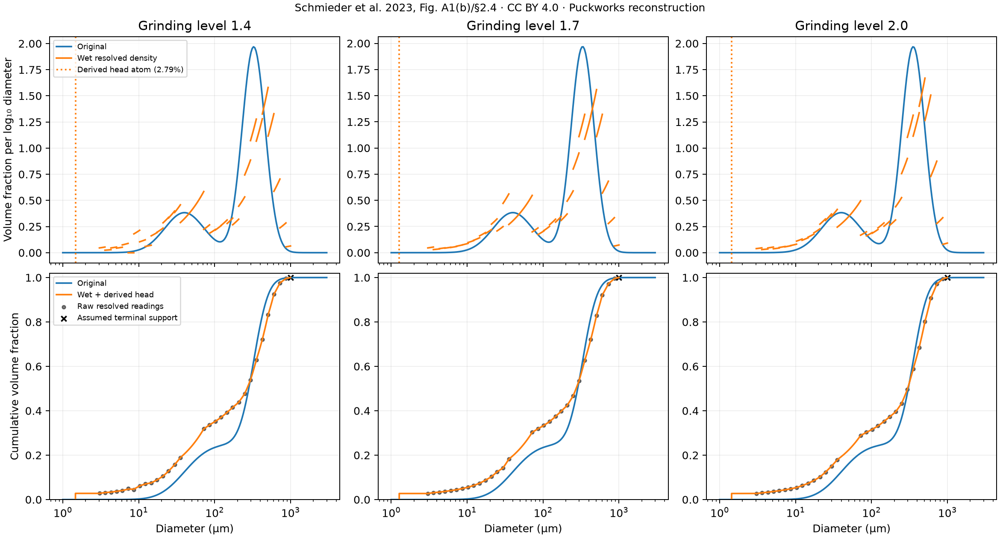
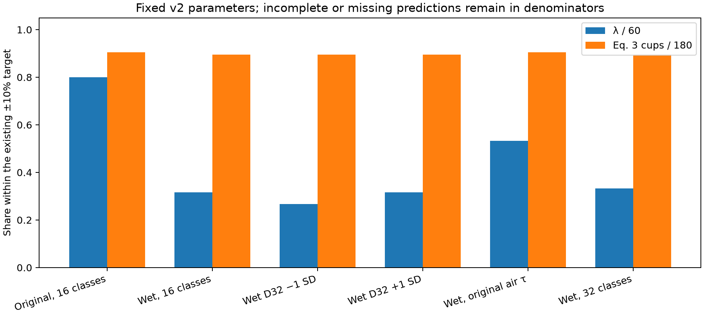

<!-- SPDX-License-Identifier: GPL-2.0-or-later -->
# Fixed-parameter particle-input audit

Generated 2026-10-17T00:32:27+00:00; tools 0.5.1; puckcore 0.5.1. 91 requested shots, 91 solver evaluations, 3 workers.

All six variants were declared before this run. Every shared and nuisance fit parameter stays fixed at v2; no variant is selected for promotion.

Source: [Schmieder B.K.L., Pannusch V.B., Vannieuwenhuyse L., Briesen H., Minceva M. (2023). Influence of Flow Rate, Particle Size, and Temperature on Espresso Extraction Kinetics. Foods 12(15):2871. Figure A1(b) and section 2.4. Digitisation and unresolved-head reconstruction by Puckworks; these are not the authors' raw instrument files.](https://pmc.ncbi.nlm.nih.gov/articles/PMC10418593/) (CC-BY-4.0).

The wet input uses the resolved cumulative volume distribution Q3 from Schmieder et al. (2023), Fig. A1(b), and the wet D32/D43 means and SDs in section 2.4. It is a digitisation of the published figure, not the authors' raw instrument data. Each resolved interval has uniform volume density in diameter; midpoint quadrature preserves its volume and D43 and approximates D32 within 1e-7.

The unresolved fraction below the first resolved coordinate is placed at one effective diameter to impose the reported D32. This head diameter is derived, not a measured fine-particle shape. D32 agreement is a constraint, while D43 is an unfitted cross-check. Applying a mean D32 to a mean CDF does not recover the replicate distributions.

The sub-3.04 µm head and three density/CDF crossings are omitted from the digitisation. Interpolation over those crossings, within-bin shape, an assumed terminal support at 1000 µm, occlusion and the monotonic projection remain uncertain. Raw readings and the projection are retained in the dataset. These runs do not sample all those uncertainties.

The ±1 SD variants move the reported D32 target and only the derived head diameter; the resolved CDF and head fraction stay fixed. They are fixed input sensitivities, not a confidence band or independent replicate predictions.

All shared and nuisance values remain at the preserved v2 calibration, including each grinding level's bare permeability κ₀. There is no refit or rescaling of κ₀ for the new particle input. Registry values for unfitted parameters and the existing V1 conditions also remain fixed.

The builder's pore-air relaxation time follows wet D32 through its moisture-diffusion closure; this use of a wet equivalent-sphere diameter is not independently validated as a gas-relaxation radius or intact-cell diffusion distance. One variant copies the original case's air τ per experiment to expose this coupling. The builder also changes preparation heterogeneity σ through the volume share below 100 µm. Holding only air τ fixed therefore still mixes particle transport with the changed permeability spread. Wet and dry particle geometry need not coincide.

The 32-class numerical check replaces only bed.size_classes in the nominal wet16 final spec. All non-class fields, including air τ and preparation heterogeneity, remain exactly fixed. Its case metadata comes from the normally built 32-class recipe, but that recipe alone would also change the builder's class-interpolated fines share and derived heterogeneity.

Scores use the existing V1 absolute relative-error rule ≤10%, with the authors' Eq. 3 cup masses. Every scenario retains denominators of 60 λ values and 180 cup masses; failed, incomplete, missing and nonfinite predictions cannot count as successes. First drops and shot times use the solver's summary convention, and their ranges include completed shots only.

This is a conditional input audit on the V1 calibration data, not independent validation. It selects no best variant, promotes no input automatically, and changes no calibration defaults or scientific acceptance gates.

## Particle inputs

Original and reconstructed wet distributions before size-class reduction. Diameters are in µm. Head diameters are derived; the head share is a volume fraction.

| GL | Original D32 | Wet D32 | Original D43 | Wet D43 | Reported wet D43 ± SD | Head share | Head diameter |
|---:|---:|---:|---:|---:|---:|---:|---:|
| 1.4 | 100.8 | 28.3 | 273 | 274 | 273 ± 7.6 | 0.02786 | 1.469 |
| 1.7 | 101.2 | 26.9 | 277 | 279.3 | 277 ± 17 | 0.02735 | 1.276 |
| 2.0 | 102.8 | 29.2 | 295 | 296.2 | 295 ± 18 | 0.02735 | 1.438 |

Derived startup and preparation inputs also change in the nominal comparison:

| GL | Original air τ (s) | Wet air τ (s) | Original σ(ln κ) | Wet σ(ln κ) |
|---:|---:|---:|---:|---:|
| 1.4 | 10.3 | 0.8115 | 0.3732 | 0.4571 |
| 1.7 | 10.38 | 0.7332 | 0.3738 | 0.4441 |
| 2.0 | 10.7 | 0.8639 | 0.3733 | 0.4317 |

The JSON also records each distribution's and each finite class set's D32, D43 and volume share below 100 µm, along with every final spec. Class labels give the requested maximum; empty size intervals need no class.

## Fixed-parameter results

Ranges are over completed shots. Balance residuals are the solver's relative diagnostics; their maxima include all returned shots. Missing values remain in the score denominators.

| Variant | Complete | λ within 10% | Cups within 10% | Missing λ / cups | First drops (s) | Shot time (s) | Max mass residual | Max carrier residual |
|---|---:|---:|---:|---:|---:|---:|---:|---:|
| Original, 16 classes | 15/15 | 48/60 | 163/180 | 0 / 0 | 7.871–8.808 | 32.08–87.18 | 1.7e-14 | 6.37e-14 |
| Wet, 16 classes | 15/15 | 19/60 | 161/180 | 0 / 0 | 7.357–7.562 | 29.92–81.65 | 4.07e-14 | 6.62e-14 |
| Wet D32 −1 SD | 15/15 | 16/60 | 161/180 | 0 / 0 | 7.348–7.521 | 29.63–80.98 | 3.82e-14 | 4.7e-14 |
| Wet D32 +1 SD | 15/15 | 19/60 | 161/180 | 0 / 0 | 7.368–7.611 | 30.13–82.33 | 3.57e-14 | 6.28e-14 |
| Wet, original air τ | 15/15 | 32/60 | 163/180 | 0 / 0 | 7.758–8.494 | 32.11–87.36 | 4.03e-14 | 5.37e-14 |
| Wet, 32 classes | 15/15 | 20/60 | 161/180 | 0 / 0 | 7.357–7.562 | 29.92–81.66 | 2.91e-14 | 6.48e-14 |

The original-input reference of λ 48/60 and cups 163/180 was reproduced.

## Experiment 7 timestep check

Wet, 16 classes: max dt 0.05 → 0.025 s; both shots completed: True.

| Metric | Nominal dt | Half dt | Difference |
|---|---:|---:|---:|
| first_drops_s | 7.400724 | 7.403468 | 0.00274 |
| shot_time_s | 43.39595 | 43.39534 | -0.000604 |
| tds | 0.07030144 | 0.07034162 | 4.02e-05 |
| ey | 0.2400036 | 0.2401399 | 0.000136 |
| mass_balance_error | 5.222069e-15 | 1.372658e-14 | 8.5e-15 |
| carrier_balance_error | 1.112737e-14 | 2.99958e-14 | 1.89e-14 |

Maximum absolute relative change: λ 0.00661, Eq. 3 cups 0.00264. This single check does not establish convergence for all conditions or unresolved particle shapes.

## Failures and missing observations

None. All requested shots completed and all scored predictions were finite.

## Reproduction and identity

```sh
python -m puckworks_tools.particle_inputs --jobs 3 --output-dir .local/particle-inputs-v0.5.1
```

The adjacent JSON contains the source sidecar, final specs, observations, diagnostics, parameter values, solver identity and input hashes. All NaN/Infinity observations are stored as null. It can regenerate this report using `--from-json m11-particle-inputs.json --output-dir PATH`.

Compiled extension SHA-256 prefix: `526693a7ee034491`. Audit source SHA-256 prefix: `17bc48ed982b0be2`.




