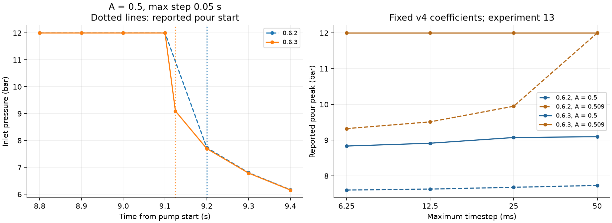

<!-- SPDX-License-Identifier: GPL-2.0-or-later -->
# Pressure-event resolution and calibration v5

*Numerical correction and training-only recalibration, 2026-10-17.*

The [startup-identification review](m11-startup-identification.md) found a timestep-sensitive
pressure transition in Schmieder experiment 13. The follow-up identifies two numerical effects:
pressure-triggered phases waited until the end of a step, and the reported pour window began at
the first regular pressure sample above the threshold plus the assumed four-second ramp.
That sample could arrive after the actual phase transition and miss the pour's highest pressure.

Version 0.6.3 localizes pressure crossings and retains phase changes and ramp ends in the output
series. It changes no constitutive law, physical prior, experimental observation or validation
threshold. The four-second ramp remains a setup assumption, with its existing sensitivity refits.
It is not a newly measured machine history.

## Independent event verification

For one isothermal cylindrical Darcy column under constant flow, before breakthrough,

$$P(t)=\frac{\mu Q^2}{\kappa A^2\phi}(t-t_\mathrm{fill}),\qquad
t_\mathrm{exit}=t_\mathrm{fill}+\frac{\kappa A^2\phi P_\mathrm{exit}}{\mu Q^2}.$$

The test stops delivery at a pressure threshold and recovers its switch time from total inlet
volume divided by flow. At 20 °C, a 2 mL/s command and a 2.5 bar threshold, the reference switch
is 23.9318039184 s. The previous solver gives 24.0500000000 s for the coarse case, 118 ms late.
The corrected solver agrees within one microsecond for maximum timesteps 0.5, 0.07 and 0.025 s,
with an independent 0.37 s output grid. It also retains the crossing in the pressure series.

Overshooting steps restart from the full saved state, including transport history and cell
resistances. End pressure is recomputed after transport, so the test includes viscosity changes
and optional pressure storage. Smooth crossings limit pressure overshoot to 10⁻⁸ of the target,
using a 1 Pa scale floor. For a discontinuous or extremely stiff crossing, the enclosing step can
instead be reduced to 10⁻¹⁰ max(1 s, |t|). This is event-location accuracy, not a bound on the
integration error of the physical state. A test with storage of 10⁻²⁴ m³/Pa checks this limiting case.

The output schema is unchanged. Series timestamps now include phase transitions and ramp ends
between regular samples. A transition retains the operating point immediately before the
control switches. Consumers already use the supplied timestamps for interpolation and integration.

## Fixed-coefficient pressure probe

The [numerical record](m11-pressure-events.json) uses the exact recorded v4 experiment-13 input.
It contains 12 baseline and 12 corrected shots: amplitudes 0.5, 0.509 and 0.511 at four timesteps.
The corrected 12 complete results reproduce exactly in a separate run. No coefficient is fitted
or selected by this probe, and no held-out observation enters it.

| Maximum timestep | Old reported pour peak, A = 0.5 | Corrected pour peak | Corrected result resampled to the old grid |
|---|---:|---:|---:|
| 0.05000 s | 7.73185 bar | 9.09605 bar | 7.69751 bar |
| 0.02500 s | 7.67948 bar | 9.07254 bar | 7.67955 bar |
| 0.01250 s | 7.62945 bar | 8.91320 bar | 7.62949 bar |
| 0.00625 s | 7.60264 bar | 8.83380 bar | 7.60240 bar |

At the default step, the actual switch is 5.124918 s; the old observation selects 5.2 s.
Consequently, the corrected pour window starts at 9.124918 s instead of 9.2 s. Resampling the
corrected result to the old grid nearly recovers the old peak, separating the reporting effect
from the smaller change to the simulated trajectory.

At A = 0.509, the corrected pour reaches the 12 bar pump cap at every tested timestep.
Previously its reported peak fell from 12 to 9.32 bar under refinement. The baseline A = 0.5
still changes by 0.26 bar between the coarsest and finest steps. Neither event localization nor
these four timesteps establish asymptotic convergence of the pressure derivative or identify
a physical pore-air law.



The lines connect recorded simulator samples. The figure contains no new experimental data.
The old solver and corrected solver retain separate identities in the numerical record.

## Calibration protocol

V5 starts from preserved v4 values and the original 23-parameter pre-pruning configuration.
All 339 residuals in V1, V2, V4 long-time flow and V6 retain their definitions, weights and floors.
The finite-difference step remains 0.01 and bounds remain the existing priors. Guarded pruning
uses the same two 1% cost ceilings. The campaign refits all selected blocks in 15 leave-one-condition-out
folds and retains all nine declared sensitivity variants. V3, V4 transients and TDS, and V5 remain
excluded from fitting and selection; previously inspected holdouts are not newly blinded tests.

The old v4 objective and the objective on corrected output samples are not interchangeable.
The relevant optimization comparison starts by re-evaluating v4 on the corrected solver.
The [0.6.2 validation report](baseline-v0.6.2/) and the complete historical v4 calibration remain
unchanged. Numerical completion does not by itself satisfy the scientific validation gates.

## Main fit and numerical sensitivity

Re-evaluating v4 on 0.6.3 gives training cost **573.232**. The 23-parameter fit reduces it
to **569.569**. Guarded pruning fixes 5-CQA partitioning at **0.61**, leaving **22 fitted
parameters** at cost **570.523** and reduced chi-square **3.59951**. Fixing lumped diffusivity
or the 5-CQA surface scale exceeds the original cost ceilings, so both remain fitted.
The main fit and three pruning trials complete **15,438 simulations without failure**.

The retained optimizer stops at `xtol` after 19 evaluations and nine Jacobian evaluations,
with first-order optimality **124.382**. Seven coefficients reach or approach their existing
bounds. These results establish neither stationarity nor a global minimum or independent
physical identification. The [calibration record](calibration.md) retains the coefficients,
pruning decisions and predictive checks alongside the historical v4 results.

The final saved coefficients give **51/60 rates and 174/180 cup masses within ±10%**.
All 15 training conditions are repeated with maximum timesteps of 0.05 and 0.025 s, with
every other input fixed. All **30 simulations** complete and retain these score counts.
The [resolution record](m11-pressure-v5-resolution.md) and its
[540 comparisons](m11-pressure-v5-resolution.json) include pressure and switch time as well
as extraction observables:

| Observable | Largest absolute relative change on halving the timestep |
|---|---:|
| λ | 0.3899% |
| c₀ | 0.3029% |
| Eq. 3 cup masses | 0.1436% |
| Directly integrated cup masses | 0.1287% |
| Whole-shot peak pressure | 0% |
| Pour peak pressure | 0.3619% |
| Preinfusion switch time | 0.0203% |

The whole-shot peaks reach the pump cap, so their equality is not evidence of resolved
pressure derivatives. V1 cost changes from 478.520 to 480.117 at the saved six-significant-digit
values. Worst soluble-mass and carrier-volume residuals are 3.19×10⁻¹⁴ and 6.40×10⁻¹⁴;
minimum concentration is zero. This is a local timestep check at the retained coefficients,
not an asymptotic convergence study.

## Predictive refits

All **15 leave-one-condition-out refits** terminate successfully with complete predictions,
re-estimating all 22 retained coefficients against all four training blocks. Recounting the
saved errors gives **58/60 rates and 180/180 cup masses within ±15%**. The rate misses are
experiment 8 TDS (+21.11%) and experiment 9 caffeine (−17.30%), so the all-targets gate
still fails. V4's full-block result was 57/60 and 180/180. Both checks condition on the
structure and pruning choices selected using the full training data.

All **nine sensitivity refits** also terminate successfully with complete predictions.
Both reported-D32 variants retain 51/60 rates and 174/180 cups within ±10%. Whole-shot
pressure gives lower V1 cost but changes the observable and more than doubles pooled
permeability. The alternative dissolution rule has higher full training cost, **641.678**,
and gives 49/60 rates and 173/180 cups. These checks do not replace the selected assumptions
or provide a predictive confidence interval; the [full sensitivity table](calibration.md#sensitivity-refits)
records their scope and optimizer limits.

## Held-out accuracy

All **117 validation shots** complete without numerical failure. The existing scientific
failures remain: V4 first drops occur at **6.02 s** against **12.76 s** measured, and flow
rise takes **12.32 s** against **25.48 s**. First-fraction TDS passes at **24.22%**, while
the flow still overshoots its long-time endpoint. Cameron's peak EY is **19.63%** at the
wrong grind setting; model/data shot-time ratios are **0.802** for Cameron and **0.771**
for Smrke. Generic pump-stop times are **20.91–23.08 s**, outside 25–35 s.

The [calibration comparison](calibration.md#held-out-validation) records the small timing
regressions as well as the cross-validation improvement. No complete M1 scientific gate
passes, and M2 remains deferred. This numerical correction does not identify the missing
startup mechanism or validate the physical model.

## Export verification

The rebuilt native engine reproduces the candidate on **all 4,698 compared prediction
values**, with no changed prediction structure or scientific-check outcome. All 13
exported defaults match v5, setup nuisances remain outside the application defaults,
and the recorded predictive refits remain valid under the unchanged identity checks.
All **67 protected historical files** retain their original hashes.

The [v5 startup ablations](m11-startup-sensitivity-v5.json) reproduce the baseline and
confirm that fixing water admission at 0.5 makes no change. Their eight fixed-coefficient
simulations are closure-response checks, not a fit or identification of separate mechanisms.

The [release audit](m11-pressure-release-check.json) records **226 Rust tests passing**
(one existing exhaustive test ignored), **519 Python tests**, **448 web tests** and
**55 browser checks**. Seven shot fixtures match exactly across native and WebAssembly,
covering 85,288 spec/result values through both recipe and direct-spec paths
(170,576 numeric comparisons). All 4,218 sphere-fixture numbers remain unchanged.
The independent analytic sphere check differs by at most 5.47×10⁻¹⁶.
Formatting, lint, type, build, licence, registry, export, fixture, version and report checks pass.

The browser's default tier-1 run takes 692 ms for 22 s of simulated time. Preview times
are 30.8 ms on the first run and 13.4 ms after an edit; the warm preview still misses
the 10 ms target. These measurements apply to this machine and recipe.

## Reproduction

Use each recorded solver build with the same fixed input. The pressure probe writes local
results without changing the current calibration:

```bash
.venv/bin/python python/scripts/m11-pressure-events.py \
  --output-dir .local/pressure-events --jobs 6
.venv/bin/python python/scripts/m11-pressure-events-plot.py
.venv/bin/python python/scripts/m11-v1-resolution.py \
  --calibration data/calibration/v5.yaml --jobs 4 \
  --output .local/pressure-events/v1-resolution.json
```

The plotter reads the committed comparison record and runs no simulations. The v5 campaign uses:

```bash
.venv/bin/puckworks-tools calibrate \
  --config data/calibration/config.yaml --start-from data/calibration/v4.yaml \
  --label v5 --out-dir .local/pressure-resolution/calibration \
  --checkpoint-dir .local/pressure-resolution/checkpoints --no-current \
  --jobs 6 --loo-jobs 3 --max-nfev 120 --fd-step 0.01 --prune --loo --sensitivity
```

The [complete pipeline](../../python/scripts/m1-pipeline.sh) checks numerical completion,
source/input identity and historical hashes before exporting a candidate and rebuilding it.
