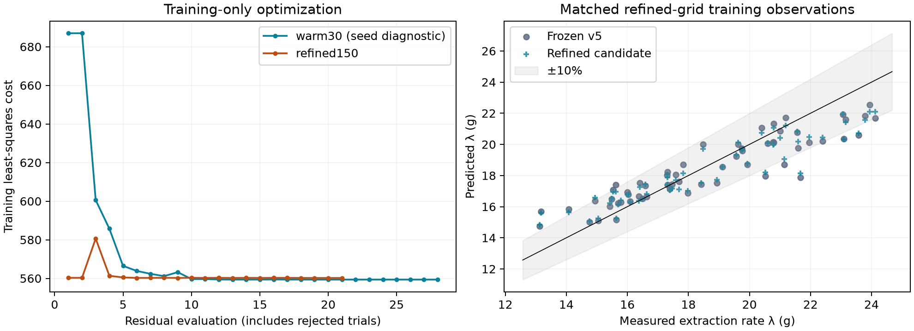

<!-- SPDX-License-Identifier: GPL-2.0-or-later -->
# M1.1: tuning after the wetting-age correction

On the matched 150-layer / 25 ms grid, training cost changes from **694.431** with frozen v5 coefficients to **560.217** with the candidate (**19.33% lower**). This is a training comparison, not a held-out accuracy claim.



## Protocol

The [wetting-age correction](m11-wet-age.md) addresses a numerical bias in the existing pore-air closure. The tuning round retains v5's effective 22 parameters, fixed 5-CQA partition, original bounds, residual weights and V1/V2/V4/V6 training blocks. V3, V4 startup/TDS and V5 remain held out. No holdout result chooses a restart or parameter.

A four-point common permeability profile supplies a training-selected seed. A 30-layer fit supplies a warm start for the 150-layer fit; V1 and V4 use 25 ms maximum timesteps. V2/V6 retain their existing tier and discretization. The optimizer works in [0,1] coordinates relative to parameter bounds, preventing the step stopping rule from depending on units. Finite differences and exported Jacobians retain the original physical/log coordinates. Optimizer termination is recorded separately from stationarity.

V1/V4 use explicit 130/131 s hard-stop budgets to remain within the existing work guard. The requested stop and every source fraction must complete; unavailable fractions or truncated shots receive failure residuals. All stages retain exact specs, observations, build/input hashes, progress and robustness statistics in the companion JSON.

## Training and frozen-candidate checks

| Stage | Layers / maximum step | Cost | Rates within ±10% | Cups within ±10% | Failures |
|---|---|---:|---:|---:|---:|
| profile150 (seed diagnostic) | 150 / 25 ms | 684.185 | 51/60 | 180/180 | 0 |
| warm30 (seed diagnostic) | 30 / 25 ms | 559.358 | 52/60 | 174/180 | 0 |
| baseline150 | 150 / 25 ms | 694.431 | 50/60 | 180/180 | 0 |
| refined150 | 150 / 25 ms | 560.217 | 52/60 | 174/180 | 0 |
| score300 | 300 / 25 ms | 560.629 | 52/60 | 174/180 | 0 |
| score150half | 150 / 12.5 ms | 560.478 | 52/60 | 174/180 | 0 |
| scoredefault | 30 / 50 ms | 558.912 | 52/60 | 174/180 | 0 |

| Training block | Frozen v5 cost | Candidate cost |
|---|---:|---:|
| V1 | 602.6896 | 467.5278 |
| V2 | 12.8715 | 9.0429 |
| V4 | 67.4527 | 72.2285 |
| V6 | 11.4171 | 11.4176 |

Historical v5 cost 570.523 belongs to its original core and grid and is not the baseline for this comparison. A stage's exact solver identity is retained even when an earlier build supplies only starting parameters. Seed diagnostics may use earlier builds and are not matched comparisons.

## Resolution with frozen candidate coefficients

The table compares each scored candidate against the selected refined fit, over all 15 V1 conditions. Maxima include 60 rates, 180 Eq. 3 cup masses, 15 pour peaks and 15 pressure-switch times. Peak agreement alone cannot establish pressure-trajectory convergence near the pump cap.

| Check | Max rate change (%) | Max cup change (%) | Max pour-peak change (bar) | Max switch change (s) |
|---|---:|---:|---:|---:|
| score300 | 0.2083 | 0.0617 | 0.04489 | 0.000203 |
| score150half | 0.1551 | 0.0543 | 0.04222 | 0.001138 |
| scoredefault | 0.7172 | 0.3048 | 0.36922 | 0.004743 |

## Optimizer diagnostics

| Fit | Termination | Evaluations / Jacobians | First-order optimality | Shots / failures |
|---|---|---:|---:|---:|
| warm30 | `ftol` termination condition is satisfied. | 26 / 15 | 11.969 | 6726 / 0 |
| refined150 | Both `ftol` and `xtol` termination conditions are satisfied. | 19 / 7 | 215.54 | 3485 / 0 |

Finite-difference and mesh sensitivity, active bounds and nonzero first-order optimality limit any identifiability or optimum claim. The original training observations include correlated quantities derived from the same fractions; the unchanged least-squares cost is not independent-sample evidence.

## Disposition and validation

Retain the exact frozen v6 candidate for research; the active v5 coefficients and application defaults remain unchanged. The 19.33% training-cost improvement trades six cup-mass targets for two additional rate targets and does not improve the matched held-out checks. At 150 layers, V3 shot-time RMS changes from 6.9560 to 7.2815 s, V5 from 22.8657 to 23.2532 s, and V4 first drops from 6.2606 to 6.0936 s against 12.762 s measured. The V3 peak and V4 flow rise also move slightly farther from their observations. These are adverse shifts within longstanding structural failures, not newly caused scientific gate failures; held-out pass/fail statuses are unchanged.

The derivative audit does not justify another local polish under the predeclared work rule. It does not introduce a scientific acceptance gate, prove that further improvement is impossible, or establish stationarity. Fresh full-block leave-one-condition-out and sensitivity refits were not run for this research candidate and remain required for promotion. Historical v5 predictive statistics do not certify the corrected solver either. The frozen coefficients, matched comparisons and limitations are preserved so that later work can address the extraction derivative sensitivity and structural startup/grind-response errors without selecting parameters from these holdouts.

### Derivative audit

All parameter directions are re-evaluated with half and quarter finite-difference steps; 4 of 4 diagonally scaled descent trials have valid training predictions. The largest relative Jacobian-column change is 0.7011 for `extraction.saturation.lumped`. The quarter-step projected-gradient maximum is 376.12 in bound-normalized coordinates. The best valid tested descent step changes cost by +0.0270113. These diagnostics do not establish a global optimum.

Half/quarter projected-gradient cosine is 0.57719, with relative difference 0.81686. The predeclared operational rule permits one additional bounded polish only at cosine ≥0.95, relative difference ≤0.25, and cost reductions ≥0.01 at two adjacent descent steps. Rule satisfied: **no**. This work threshold does not change the model's scientific acceptance criteria.

Differences below use Jacobians in bound-normalized coordinates. They locate sensitivity to the derivative step; they do not identify which solver branch caused it.

| Residual group | Fitted vs quarter-step difference norm | Half vs quarter-step difference norm | Quarter-step Jacobian norm |
|---|---:|---:|---:|
| V1/extraction | 241.56 | 191.07 | 860.62 |
| V1/pressure | 77.746 | 73.599 | 810.33 |
| V2 | 0.038639 | 0.012885 | 44.779 |
| V4 | 0.48856 | 0.16692 | 595.24 |
| V6 | 0.055744 | 0.018709 | 158.97 |

### Holdouts with frozen coefficients at three grids

Both coefficient sets are frozen before these checks. The original source conditions, clocks and acceptance thresholds are retained. These previously inspected holdouts are not new independent data. Every requested stop must complete, and the actual output mesh is checked against the requested depth.

| Coefficients | Layers / step | V3 peak EY (%) | V3 time RMS (s) | V4 drops (s) | V4 rise to 90% (s) | V5 time RMS (s) |
|---|---|---:|---:|---:|---:|---:|
| frozen_v5 | 30 / 50 ms | 19.4490 | 6.9217 | 6.2813 | 13.6367 | 22.8426 |
| frozen_v5 | 150 / 25 ms | 19.4729 | 6.9560 | 6.2606 | 13.6020 | 22.8657 |
| frozen_v5 | 300 / 25 ms | 19.4744 | 6.9599 | 6.2526 | 13.6018 | 22.8687 |
| candidate | 30 / 50 ms | 19.3584 | 7.2495 | 6.1132 | 13.1041 | 23.2311 |
| candidate | 150 / 25 ms | 19.3807 | 7.2815 | 6.0936 | 13.0726 | 23.2532 |
| candidate | 300 / 25 ms | 19.3823 | 7.2854 | 6.0869 | 13.0719 | 23.2560 |

V3's measured peak is 23.07%, with the original acceptance interval 22–24%. V4 measured first drops and flow rise are 12.762 and 25.475 s on the source clocks. The JSON retains every held-out check, including first-fraction TDS and the grind/fines trends, plus exact specs, summaries and numerical diagnostics.

### candidate_full

Full validation uses its own configuration (content hash `ca9c964911d159ed`), tier 1 and 16 particle classes. Its configuration is shown below; omitted numerical fields use this solver's case defaults.

<details><summary>Full-validation configuration</summary>

```yaml
schema: puckworks.calibration-config/1
tier: 1
n_classes: 16
parameters:
- id: model.extraction.broken_shell_thickness
  mode: override
  blocks:
  - V1
  scale: linear
- id: extraction.saturation.lumped
  mode: override
  blocks:
  - V1
  scale: linear
- id: extraction.diffusivity.lumped.corrochano_80c
  mode: override
  blocks:
  - V1
  - V4
  scale: log
- id: model.species.trigonelline.partition
  mode: override
  blocks:
  - V1
  scale: linear
- id: model.species.caffeine.surface_fraction_scale
  mode: override
  blocks:
  - V1
  scale: linear
- id: model.species.trigonelline.surface_fraction_scale
  mode: override
  blocks:
  - V1
  scale: linear
- id: model.species.cqa5.surface_fraction_scale
  mode: override
  blocks:
  - V1
  scale: linear
- id: calibration.schmieder2023.extractable_fraction
  mode: spec
  target: solubles.extractable_fraction
  applies_to: schmieder2023
  blocks:
  - V1
  scale: linear
- id: calibration.schmieder2023.content.caffeine
  mode: spec
  target: solubles.species[id=caffeine].mass_fraction
  applies_to: schmieder2023
  blocks:
  - V1
  scale: linear
- id: calibration.schmieder2023.content.trigonelline
  mode: spec
  target: solubles.species[id=trigonelline].mass_fraction
  applies_to: schmieder2023
  blocks:
  - V1
  scale: linear
- id: calibration.schmieder2023.content.cqa5
  mode: spec
  target: solubles.species[id=cqa5].mass_fraction
  applies_to: schmieder2023
  blocks:
  - V1
  scale: linear
- id: calibration.schmieder2023.permeability.gl1_4
  mode: spec
  target: hydraulics.permeability_m2
  applies_to: schmieder2023:gl1_4
  blocks:
  - V1
  scale: log
  start: 3.0e-14
- id: calibration.schmieder2023.permeability.gl1_7
  mode: spec
  target: hydraulics.permeability_m2
  applies_to: schmieder2023:gl1_7
  blocks:
  - V1
  scale: log
  start: 3.0e-14
- id: calibration.schmieder2023.permeability.gl2_0
  mode: spec
  target: hydraulics.permeability_m2
  applies_to: schmieder2023:gl2_0
  blocks:
  - V1
  scale: log
  start: 3.0e-14
- id: calibration.schmieder2023.sigma_ln_permeability
  mode: spec
  target: bed.heterogeneity.sigma_ln_permeability
  applies_to: schmieder2023
  blocks:
  - V1
  scale: linear
  start: 0.44411746110851036
- id: calibration.schmieder2023.edge_multiplier
  mode: spec
  target: bed.heterogeneity.edge_multiplier
  applies_to: schmieder2023
  blocks:
  - V1
  scale: linear
  start: 0.40083078719773324
- id: model.hydraulics.viscosity_temperature_exponent
  mode: override
  blocks:
  - V1
  - V4
  scale: linear
- id: hydraulics.poroelastic.critical_pressure
  mode: override
  blocks:
  - V1
  - V4
  - V6
  scale: linear
- id: extraction.dispersion.axial_coefficient
  mode: override
  blocks:
  - V1
  - V2
  scale: log
- id: model.hydraulics.intraparticle_water_fraction
  mode: override
  blocks:
  - V1
  - V2
  - V4
  - V6
  scale: linear
  start: 0.75
- id: calibration.waszkiewicz2026.permeability
  mode: spec
  target: hydraulics.permeability_m2
  applies_to: waszkiewicz2026
  blocks:
  - V4
  scale: log
  start: 1.0e-14
- id: hydraulics.kozeny_carman.density_exponent
  mode: override
  blocks:
  - V6
  scale: linear
fixed:
- field: solubles.kernel_loading_cap
  value: false
  reason: 'Disabled by the builder for total particle loading: the initial particle
    concentration is not an equilibrium capacity. Kernel loading follows its source
    partition law and may exceed its initial value during inward diffusion. This boundary
    restriction is not selected by fit quality.'
- id: model.hydraulics.pore_air_amplitude
  reason: The initial effective connectivity deficit is a grade D model assumption
    (0.5), separate from coffee CO2; it is not a measured gas volume fraction. None
    of the calibration observables identifies a transient relative-permeability law.
    It is held at its prior rather than fitted to the held-out V4 first-drop delay
    or flow rise.
- id: model.hydraulics.pore_air_permeability_exponent
  reason: The effective connectivity-to-relative-permeability exponent is a grade
    D closure (3), not measured for these pucks. Held fixed; the V4 transient, V3
    and V5 shot times do not select it.
- id: model.hydraulics.moisture_diffusivity
  reason: The pore-air relaxation time uses (D32/2)^2/(pi^2 D), capped at 600 s, with
    D = 2.5e-11 m^2/s from the independent Mateus moisture-uptake range. Using moisture
    diffusion for air clearance is a grade D model assumption. Neither this diffusivity
    nor its time scale is fitted to held-out shots.
- id: model.hydraulics.wetting_uptake
  reason: In M1.1 this is the fixed effective-loading normalization inherited from
    the extraction model, distinct from the full intraparticle water inventory. It
    is not fitted to startup observations.
- id: extraction.diffusivity.caffeine.particle_80c
  reason: 'Species kernel diffusivities trade off with the coffee''s contents (correlation
    −0.89 to −0.95): their posterior SD was 2–12× the prior''s, and free fits drifted
    2–5× outside the literature priors (caffeine to 8×10⁻¹¹, trigonelline to the 1×10⁻⁹
    bound). The species surface-pool scales carry the species'' λ instead.'
- id: model.species.trigonelline.diffusivity_80c
  reason: Not identified by V1 (see the caffeine diffusivity).
- id: model.species.cqa5.diffusivity_80c
  reason: Not identified by V1 (see the caffeine diffusivity).
- id: extraction.surface_rate.grudeva2026
  reason: Not identified by V1 (posterior SD 44× the prior's once the lumped diffusivity
    is fixed); the surface flux is fast at any value in its range, so only the surface
    pool's size matters.
- id: model.hydraulics.swelling_pore_closure
  reason: Not identified by V1 (posterior SD 1.6× the prior's when added at the V1
    optimum); the residuals lean towards less swelling (Wald z 2.4 towards 0).
- id: model.hydraulics.gas_amplitude_max
  reason: Weakly identified by V1 (posterior SD 0.4–0.7× the prior's) with no evidence
    against the registry value (Wald z 0.8); the CO₂ model is being re-anchored in
    the input models.
- id: hydraulics.dissolution_porosity_share
  reason: 'θ is fixed at its mechanistic default, 0 (the insoluble cell walls hold
    the particle envelope), not chosen by fit quality: it is collinear with the bed
    permeability, whose fitted values move to absorb it. `calibrate --sensitivity`
    reports the θ = 0.27 case as a structural sensitivity.'
- id: model.species.cqa5.partition
  reason: 'Pruned by the identifiability rule after a bounded registry-value refit:
    local marginal SD 0.85× the prior''s (fitted value 0.6424); training cost stayed
    within 1% of both the initial pre-prune and current accepted fits.'
blocks:
  V1:
    dataset: schmieder2023
    weight: 1.0
    cup: eq3
    relative_floor:
      lambda: 0.03
      c0: 0.03
      cup: 0.02
    pressure_floor_bar: 0.3
    pressure: pour
    exit_margin_bar: 0.5
    case_options:
      transition_ramp_s: 4.0
      psd_source: wet_cdf
      sauter_offset_sd: 0.0
    spec_fields:
      numerics.depth_cells: 150
      numerics.max_dt_s: 0.025
      numerics.max_duration_s: 130
  V2:
    dataset: vacaguerra2024
    weight: 1.0
    bodenstein_floor: 1.0
  V4:
    dataset: waszkiewicz2026
    weight: 1.0
    flow_floor_g_s: 0.05
    spec_fields:
      numerics.depth_cells: 150
      numerics.max_dt_s: 0.025
      numerics.max_duration_s: 131
  V6:
    dataset: corrochano2017
    weight: 1.0
    log_ratio_floor: 0.1
```

</details>

| Held-out check | Result | Evidence |
|---|---|---|
| V3 EY peak at grind setting 1.5–1.9 | fail | model EY peaks at GS 1.1 (at the edge of the range: no peak) |
| V3 peak EY 22–24% | fail | model peak EY 19.36% |
| V3 shot time falls as the grind coarsens | pass | model times 26.8, 25.8, 24.9, 24.5, 24.0, 23.3, 22.1 s |
| V4 flow rises after the first drops | fail | model: 90% of the 100 s flow 13.1 s after the first drops (data 25.5 s); flow ×3.35 from 2 s to 15 s and ×3.39 to 100 s (data ×6.09, ×14.05); no overshoot at the 15 s check |
| V4 first drops after full pressure | fail | model 6.1 s, data 12.8 s after the pressure reaches its target (both on the data's clock) |
| V4 first-fraction TDS 25 ± 3% | pass | model first 5 s fraction 23.8% TDS (data: 24.4% in the one replicate that collected liquid, 23.5% in the next window) |
| V4 time to 36 g (9 bar) | info | model 30.2 s, data 47.7 s after the pressure rise: ×0.63; long-time flow 1.87 against 1.82 g/s |
| V5 added fines lengthen shots | fail | 190 µm: model 24.2, 25.2, 26.4, 28.4 s (+17% with 4 g; data +215%); 210 µm: model 22.7, 23.4, 24.5, 26.4 s (+16% with 4 g; data +211%); 250 µm: model 20.3, 21.6, 22.7, 25.0 s (+24% with 4 g; data +258%) |
| V5 EY tracks shot time | pass | Spearman ρ(time, EY) = 0.84 over 15 model conditions (data: 0.96) |
| V5 10–15 s shots reach 17–18% EY | fail | conditions measured at 10–15 s: 250 µm + 1 g (measured 12.0 s, 17.51% EY; model 21.6 s, 16.28%); model mean 16.28% |
| Held-out shot times against the data | info | V3 Cameron: model/data ×0.8 (mean error -6.5 s, RMS 7.2 s); V5 Smrke: model/data ×0.76 (mean error -14 s, RMS 23 s); V4 9 bar (long-time flow is a calibration observable): time to 36 g ×0.63 |
| Tier 0 vs tier 1 on the held-out cases | info | tier 0 vs tier 1 on 22 V3/V5 shots: time within 0.6% (RMS 0.54%), EY within 0.98 points; V4 9 bar: first-fraction TDS 29% vs 23.8%, flow 15 s after the first drops 1.92 vs 1.85 g/s |
| Generic 18 g → 36 g, 9 bar shots near 30 s | fail | tier 1: mahlkoenig-ek43 21.3 s, mahlkoenig-e65s 20.6 s, generic-flat-traditional-64 21.4 s, generic-conical-50 22.8 s, generic-flat-unimodal-64 20.9 s, bentwood-v63 21.3 s |

## Reproduction

See [the tooling commands](../../python/README.md#wetting-age-correction-and-refined-tuning). Each simulation stage checks that its solver and calibration inputs remain unchanged. To regenerate this document and figure without simulating:

```sh
.venv/bin/python python/scripts/m11-refined-tuning-report.py --from-json docs/validation/m11-refined-tuning.json
```
