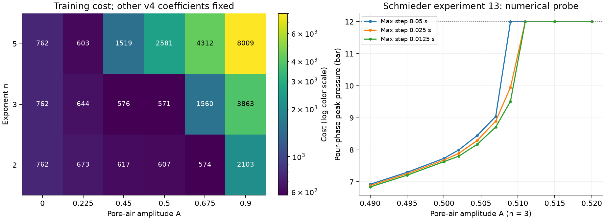

<!-- SPDX-License-Identifier: GPL-2.0-or-later -->
# Startup parameter identification after calibration v4

*Training-only investigation, 2026-10-16. Baseline: the preserved v4 coefficients and native 0.6.1.*

The remaining timing failures do not by themselves identify a pore-air law. This review tests
whether the original training observations justify changing its amplitude or exponent before
evaluating another candidate on the held-out shots. It preserves all 339 residuals, their weights,
uncertainty floors, physical priors and the V1/V2/V4/V6 training split. V3, V4 transients and TDS,
and V5 do not enter the objective, parameter grid or restart selection. Their previously reported
failures motivate this review; they are not newly blinded independent tests.

## Local sensitivity is conditional on the control regime

The existing mobility factor is $(1-A\exp(-t_w/\tau))^n$, where $t_w$ is local wet age and
$\tau=(D_{32}/2)^2/(\pi^2D_m)$, capped at 600 s. The registry specifies $A=0.5$, $n=3$, and
$D_m=2.5\times10^{-11}\,\mathrm{m^2/s}$. The diagnostic temporarily frees all three alongside
the 22 retained v4 coefficients. Its bounds remain $A\in[0,0.9]$, $n\in[2,5]$, and
$D_m\in[2,3]\times10^{-11}\,\mathrm{m^2/s}$.

Two forward-difference sizes give the following local marginal SD divided by prior SD:

| Parameter | Step 0.01 | Step 0.005 |
|---|---:|---:|
| Amplitude A | 0.1064 | 0.4024 |
| Exponent n | 0.6727 | 0.6648 |
| Moisture diffusivity | 2.8142 | 2.2076 |

Steps are fractions of the bound span for linear parameters and log10 increments for diffusivity.
The covariance is a local linear approximation, scaled by reduced chi-square, allowing all fitted
directions to move even when their compensating changes would cross bounds. These are not posterior
uncertainties or evidence that the physical saturation law has been measured. Moisture diffusivity
remains fixed in the subsequent connectivity refits; its independent source does not measure
air-clearance kinetics.

Most of the step-size discrepancy comes from the pour-phase pressure of Schmieder experiment 13.
The model approaches the pump limit near the perturbed amplitude. Smaller timesteps move this
transition substantially:

| Maximum timestep | Pour peak at A = 0.500 | Pour peak at A = 0.509 | Pour peak at A = 0.511 |
|---|---:|---:|---:|
| 0.0500 s | 7.7318 bar | 12.0000 bar | 12.0000 bar |
| 0.0250 s | 7.6795 bar | 9.9483 bar | 12.0000 bar |
| 0.0125 s | 7.6294 bar | 9.5111 bar | 12.0000 bar |

The 30-shot probe changes only amplitude and maximum timestep. It does not establish an asymptotic
convergence order. The small extraction differences in the earlier
[v4 timestep check](m11-transport-resolution.json) therefore cannot establish convergence of this
pressure derivative or its covariance. At step 0.005, the amplitude Jacobian norm is 244.68 in V1,
0 in V2, 0.509 in V4 long-time flow, and 0.0758 in V6. The apparent local constraint comes mainly
from this specific extraction/control setup, not independent startup measurements.
The original calibration's pour-phase pressure convention and assumed four-second control ramp
remain unchanged. The published shot maxima do not independently establish that transition's
time history; the inferred amplitude sensitivity is conditional on those assumptions as well.

## Conditional grid and bounded refits

A fixed grid uses amplitudes 0, 0.225, 0.45, 0.5, 0.675 and 0.9 with exponents 2, 3 and 5.
All other v4 coefficients stay fixed. These are conditional costs, not profile likelihoods.
The baseline pair (0.5, 3) gives cost 570.703; (0.675, 2) gives 573.563 and (0.45, 3) gives
575.742. The strongest mobility restrictions worsen training agreement. This motivates a
separate restart from the best nonbaseline grid point, without choosing any value from held-out
timing.

The bounded refits compare the original 22-parameter model against the 24-parameter connectivity
extension from the same v4 starting values. A further connectivity restart starts at (0.675, 2).
The existing 0.01 finite difference and bounded trust-region least squares are retained. The first
two runs also apply the existing guarded pruning rule; every trial and termination is retained in
the numerical evidence. `xtol` termination is not a stationary or global optimum.

**Retain calibration v4.** The additional amplitude parameter changes the training objective
negligibly and does not improve the accuracy counts. No candidate is exported or evaluated to
select a value from held-out timing. These exploratory refits do not include a new 15-fold LOO or
nine-variant sensitivity campaign; their missing predictive checks are explicit in the
[refit evidence](m11-startup-refits.json). The completed v4 campaign remains the current calibration.

| Run | Fitted parameters | Cost | Evaluations / Jacobians | First-order optimality | Rates / cups within 10% |
|---|---:|---:|---:|---:|---:|
| Original v4 structure, restarted | 22 | 570.698 | 13 / 2 | 56.30 | 51/60; 174/180 |
| Connectivity extension, before pruning | 24 | 570.684 | 13 / 2 | 142.87 | — |
| Connectivity extension, after pruning | 23 | 570.693 | 13 / 3 | 144.26 | 51/60; 174/180 |
| Connectivity restart at (0.675, 2) | 24 | 573.504 | 14 / 6 | 402.15 | 51/60; 174/180 |

All four listed optimizers terminate by `xtol`, with the nonzero optimalities shown. The
post-pruning extension has A = 0.499954 and n fixed back at 3; the registry amplitude is 0.5.
Its cost improvement over the matched control is about 0.001%, far below the existing 1%
pruning tolerance. This is a decision to retain the existing model, not proof that other starting
points or constitutive laws could not improve it.

| Coefficient fixed at registry value in a trial | Control trial cost | Connectivity trial cost | Outcome |
|---|---:|---:|---|
| Lumped diffusivity | 698.107 | 692.729 | Both removals rejected |
| 5-CQA surface fraction scale | 576.720 | 576.618 | Both removals rejected |
| Viscosity exponent, 0.45 | — | 584.483 | Removal rejected |
| Pore-air exponent, 3 | — | 570.693 | Removal accepted |

Every rejected removal exceeds both training-cost ceilings. The accepted exponent removal raises
cost by only 0.009 relative to the preceding fit. All six pruning trials and the three main runs
have complete predictions and successful optimizer terminations. Their recorded runners execute
37,357 simulations without solver failures; the separate fixed diagnostics execute 1,862. These
counts exclude the additional reproduction and final-score checks. Numerical completion and
parameter parsimony do not close the failed scientific validation targets.

## Release verification

The 0.6.2 build reruns all 117 validation simulations successfully. Its
[comparison with 0.6.1](m11-startup-release-check.json) finds no numerical change among 4,696
comparable prediction values. All 4,218 sphere-fixture and 85,388 shot-fixture numbers are also
unchanged, and 55 calibration/historical files retain their hashes.

The strict report identity guard still treats the old LOO and sensitivity results as historical
after a version/build-metadata change. Consequently, the current LOO check reads **not run**
instead of re-scoring the old failed check; the V1 exit criterion remains failed. Both old refit
records are unchanged and remain available in the [preserved 0.6.1 report](baseline-v0.6.1/).
The release comparison records these two cache-status differences explicitly. No identity guard
or scientific target was relaxed, and no new timing or extraction-peak target passes.

Software checks pass: 224 Rust tests (one existing ignored test), 518 Python tests,
448 web tests, and 55 browser checks, alongside formatting, lint, types, builds, registry,
version, export and fixture checks. The browser measures 711 ms for the default tier-1 shot
and 13.3 ms for the warm tier-0 preview. That preview still exceeds the 10 ms target;
passing the browser checks does not establish the performance exit criterion.



Both panels are simulator diagnostics. The left panel holds all other coefficients fixed; the
right panel is the single-condition numerical probe above. Neither panel contains a new
experimental observation or a fitted confidence region.

## Independent evidence and its limits

The [water/inventory source review](../research/05-water-and-particle-inventory.md) already records
Foster's observed concurrent ponding and infiltration, and distinguishes its fitted quantities
from direct measurements. Mateus's swelling-derived diffusivity is not a measured pore-air
relaxation coefficient. These sources do not determine the three coefficients of this closure.

[Wadsworth et al. (2026)](https://strathprints.strath.ac.uk/95930/),
[published paper](https://strathprints.strath.ac.uk/95930/1/Wadsworth-etal-RSOS-2026-A-model-for-the-permeability-of-coffee-pucks-validated.pdf),
DOI 10.1098/rsos.252031, adds independent dry-puck geometry and low-Reynolds-number
lattice-Boltzmann permeability calculations for two coffees and eleven grind settings each.
Its percolation model relates permeability to connected porosity and interfacial area. Its
inertial-flow discussion uses correlations from other porous materials. These are not measured
espresso startup pressure/flow histories or a coffee-specific identification of inertial
resistance. The article is CC BY 4.0; its data statement mentions a ZIP, but a direct processed-data
download was not established during this review. No new dataset or fitted coefficient is imported.

The original Schmieder supplement was also inspected through
[Europe PMC's public supplementary file service](https://www.ebi.ac.uk/europepmc/webservices/rest/PMC10418593/supplementaryFiles).
Its companion OriginPro summary documents response-surface fits of extracted cup
mass. It does not supply synchronized inlet/outlet and pressure histories. The binary OriginPro
project remains undecoded; this review does not assert that those channels are absent from it.

## Reproduction

Use the recorded baseline build for exact historical reproduction. A later build must be reported
with its own solver/input hashes. The script writes configurations and evidence locally and does
not modify the default calibration:

```bash
.venv/bin/python python/scripts/m11-startup-identification.py \
  --calibration data/calibration/v4.yaml \
  --output-dir .local/startup-identification --jobs 8

.venv/bin/puckworks-tools calibrate \
  --config .local/startup-identification/baseline-config.yaml \
  --start-from data/calibration/v4.yaml --label v4-restart \
  --out-dir .local/startup-identification/control \
  --checkpoint-dir .local/startup-identification/control-checkpoints \
  --no-current --jobs 4 --max-nfev 80 --prune

.venv/bin/puckworks-tools calibrate \
  --config .local/startup-identification/connectivity-config.yaml \
  --start-from data/calibration/v4.yaml --label connectivity-trial \
  --out-dir .local/startup-identification/fit \
  --checkpoint-dir .local/startup-identification/checkpoints \
  --no-current --jobs 8 --max-nfev 80 --prune

.venv/bin/puckworks-tools calibrate \
  --config .local/startup-identification/connectivity-grid-start-config.yaml \
  --start-from data/calibration/v4.yaml --label connectivity-grid-start \
  --out-dir .local/startup-identification/grid-start \
  --checkpoint-dir .local/startup-identification/grid-start-checkpoints \
  --no-current --jobs 8 --max-nfev 80
```

The script retains both Jacobians and residual vectors as compressed NumPy arrays, alongside
JSON summaries, configuration, solver identity and input hashes. Stored calibration values are
decimal-rounded; their recomputed starting cost need not exactly equal the optimizer's saved
unrounded cost.

The [recorded numerical diagnostics](m11-startup-identification.json) contain 1,862 simulation
executions: 1,058 for the Jacobian checks, 30 for the timestep probe and 774 for the training grid.
Every simulation and required training observation is available. Both Jacobians and all 18 grid
costs were independently rerun with identical numerical results. Render the figure from this
record without another simulation:

```bash
.venv/bin/python python/scripts/m11-startup-identification-plot.py
```
