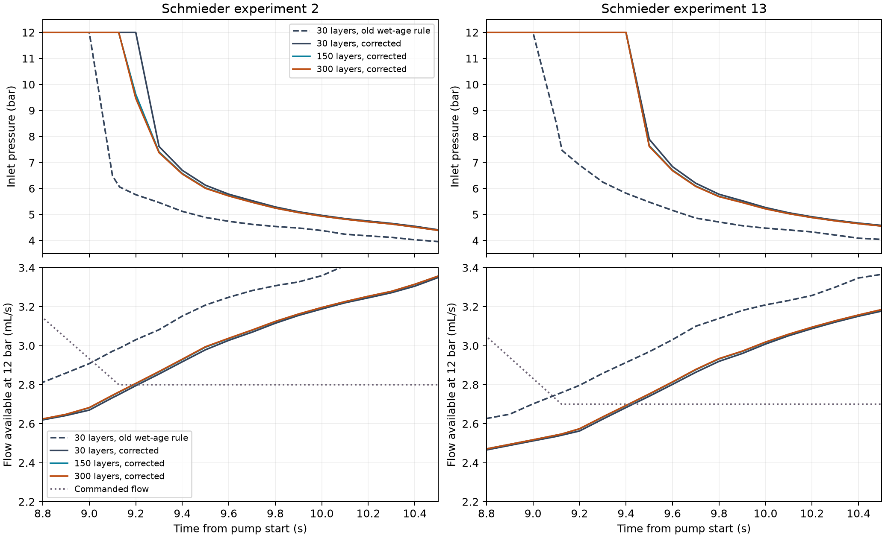

<!-- SPDX-License-Identifier: GPL-2.0-or-later -->
# Wet-age resistance integration and model tuning

The mesh experiment exposed a spatial averaging bias in the existing wetting closure. A cell used the arrival time at its top for all its wetted material. That made the younger material near its bottom artificially old and its hydraulic resistance too low.

These **48 frozen-v5 pressure windows** isolate that numerical effect before refitting. The original and corrected builds each run experiments 2 and 13 on 30, 150 and 300 layers, with four mechanism settings. Timesteps are 6.25, 12.5 and 6.25 ms respectively; all use the complete species set, a 15 s time stop, no drip, and 0.1 s output spacing. The ablations disabling viscosity feedback or pore-air relaxation are diagnostics, not proposed parameter values or new calibration candidates.

## Diagnosis

Maximum differences below compare interpolated sampled curves at identical pump times from 8.5 to 12.5 s. Conductance is reconstructed from the recorded inlet/outlet flows with the exact existing poroelastic and outlet laws; no compliance is present.

| Build | Experiment | Mesh compared with 300 | Max pressure difference (bar) | Max relative conductance difference |
|---|---:|---:|---:|---:|
| before | 2 | 30 | 5.9098 | 7.1492% |
| before | 2 | 150 | 3.3299 | 1.0550% |
| before | 13 | 30 | 5.7558 | 7.5074% |
| before | 13 | 150 | 0.7767 | 1.0605% |
| after | 2 | 30 | 2.5349 | 0.5228% |
| after | 2 | 150 | 0.1498 | 0.0743% |
| after | 13 | 30 | 0.2753 | 0.5126% |
| after | 13 | 150 | 0.0268 | 0.0600% |

With the old rule, disabling pore-air relaxation reduces the 30-to-300-layer conductance discrepancy from 7.15–7.51% to 0.18%. Disabling concentration-dependent viscosity alone leaves 3.81–4.41%. This identifies wet-age averaging as the dominant spatial error in these cases, with viscosity feedback and the poroelastic plateau amplifying it.

The inverse pressure problem is ill-conditioned near its capacity: $Q=G\Phi(P)$ has $\Phi'(P)=(1-P/P_c)^3$ below $P_c$. Thus small conductance errors can produce multi-bar pressure changes. A stable 12 bar capped peak is not a convergence test.



## Numerical correction

The solver records cell entry and exit times and interpolates arrival time in bed-volume coordinates. It integrates **inverse mobility** over the wetted depth using positive Gaussian weights, normalized against the exact geometric Darcy integral. Steep relaxations trigger adaptive subdivision with a relative comparison tolerance of $10^{-8}$; an endpoint variation bound also prevents both rules from missing the same narrow layer. Exhausting 40 subdivision levels produces a diagnostic warning.

Partial cells retain their actual last-advance time during a soak. Explicit arrival-time breakpoints preserve material wetted before a pause when flow resumes, including in the hydraulic predictor. All timing history is restored when a step is retried. Arrival time within each uninterrupted segment is still reconstructed linearly; transport still mixes each wetted cell and uses its existing exchange discretization.

Independent tests cover the analytic constant-speed-front resistance integral, a paused partial cell, continuity under an infinitesimal restart, subsequent breakthrough, rollback, and steep $A=0.9,n=5$ and $A=0.95,n=10$ closures, including a 0.1 ms relaxation. A separate sub-resolution case verifies the warning. All 48 diagnostic shots complete with nonnegative concentrations and conserved water/solute. None reaches the adaptive quadrature limit.

## Calibration protocol

The subsequent tuning retains v5's effective 22-parameter configuration, observations, weights and physical bounds. It first profiles a common V1 permeability shift using training data, then uses a 30-layer optimization only as a warm start for a 150-layer fit. Finer-grid and timestep checks are required before promotion. V3, V4 startup and V5 remain outside the training objective; previously inspected holdouts are not newly independent validation.

Optimizer coordinates are normalized to each parameter's bounds. This removes the dependence of the step termination test on mixed physical/log units; returned parameters and uncertainty Jacobians retain their original units. Incomplete source fractions or failure to reach a requested stop now produce failure residuals.

This diagnosis alone does not establish a new calibrated model, a converged pressure waveform at every input, or a resolution of the held-out startup and extraction-peak failures.

## Reproduction

```bash
.venv/bin/python python/scripts/m11-wet-age-report.py \
  --from-json docs/validation/m11-wet-age.json
```

The [JSON companion](m11-wet-age.json) retains exact specifications, solver identities, sampled curves, diagnostics and source hashes. Original full solver records remain in the ablation run caches. Native timings were collected during development and are not controlled performance benchmarks.
