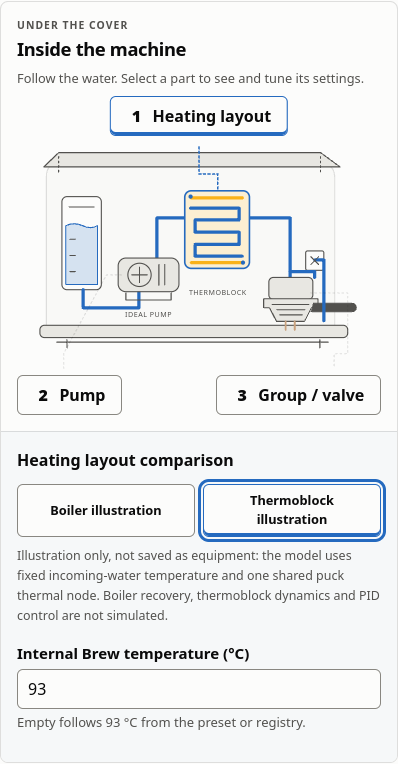
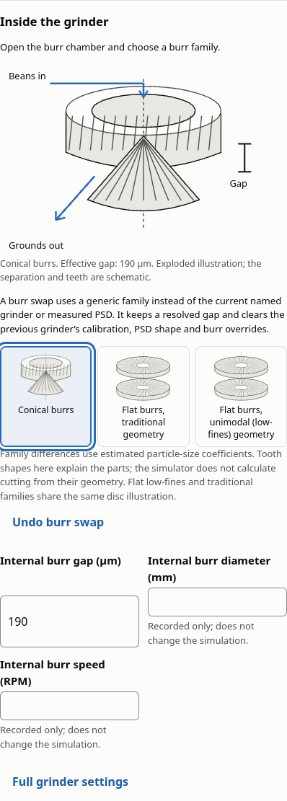
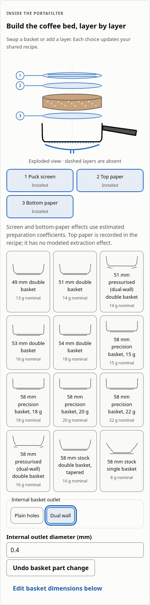
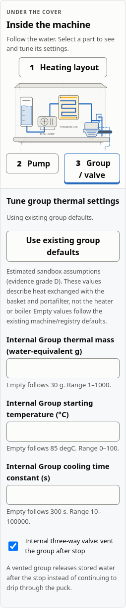

# Detailed equipment parts verification

Reference build: 0.11.1, 2026-10-21. Chrome 131 on Linux; 1280 px desktop and
320 px phone layouts. Phone viewport emulation is not physical touch-device proof.

The machine, grinder and portafilter drawings use the existing recipe and solver.
No heater/PID equations, geometry-driven grinding or new physical coefficients
were introduced. Boiler/thermoblock comparisons are temporary illustrations;
actual changes use existing pump, valve, thermal, burr-family, basket and
preparation inputs.

## Interface and browser checks

- All 829 web tests pass, including 7 machine, 10 grinder and 4 portafilter parts
  tests and 8 overview/integration tests. Native WASM builder checks verify real
  thermal and pump inputs and calibrated/clamped gap preservation.
- Lint, formatting, TypeScript, production build and dependency licence checks
  pass. No production dependencies or third-party assets were added.
- Production accessibility covers 36 rendered states and 38 workflow checks,
  including every internal machine callout, both heater layouts, all three burr
  families, installed preparation layers, the dual-wall outlet, dark mode and
  320 px layout. No detected violations; incomplete/manual-review items remain
  in the browser report.
- Repeated overview Open actions reveal each cutaway and focus its beginning.
  Tests preserve each native button's visible label, expanded state, unique IDs,
  error linkage and keyboard behavior. Reset/Undo restores thermal inputs without
  removing unrelated overrides; replacing burrs or baskets retains their full
  previous configuration for Undo.
- Production offline/update checks pass under root and repository paths, including
  disconnected engine/Explore/journal workflows and returning setup. No page
  errors or foreign-origin requests were observed.

The browser regression reads the actual pinned run label after additional part
edits, instead of assuming that the first run is always named Run 1.

## Numerical preservation

All 218,221 golden values remain unchanged. Both release versions replay the same
464 frozen scalar coordinates with identical complete builder and solver outputs
after removing only `result.core_version`: 13,036,890 numeric values, zero changes.
Scalar weights, targets, splits, scales, training records and failed qualification
remain unchanged. Exact current-teacher checks remain enabled. No retraining or
test-set tuning occurred.

The M3 current cross-language fixture was regenerated at 0.11.1. All scientific
fields match its previous report exactly, including 58,804 numeric values;
creation date, version, solver identity and measured timing are refreshed.
All 19 M3 checks, 33 cross-language tests and 24 Python M3 tests pass.

The [version replay receipt](m6-parts-version-replay.json) records hashes and
methodology. This establishes release parity; scientific accuracy and the
surrogate's original accuracy gate remain open.

## Visual review

The machine shows the reservoir, water path, pump, heater and group. Burrs use
exploded flat-disc or ring-and-cone drawings. The portafilter separates layers
while basket thumbnails retain their wall-profile proportions.

Manual screen-reader, speech-input, image/contrast and physical touch-device
review are still required. Automated audits do not establish full accessibility
conformance. The main plan's scientific and hardware performance gates are
unaffected.
