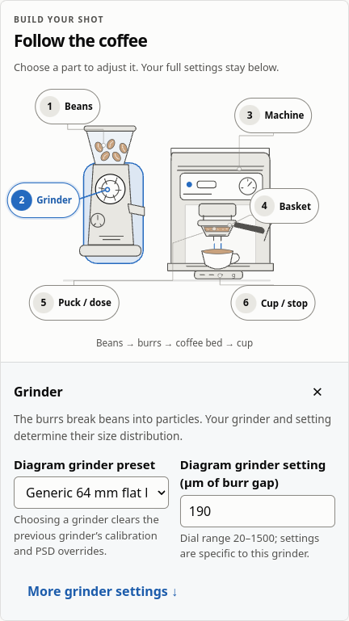
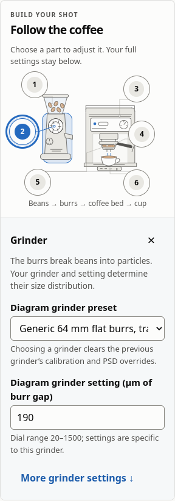

# M6 equipment workspace verification

Reference build: 0.11.0, 2026-10-19. Browser: Chrome 131 on Linux.

This change adds the SVG equipment editor, required initial equipment setup and
local persistence. It does not change Rust physics, preset definitions,
calibration, golden fixtures or the frozen scalar-model experiment.

## Automated checks

- All 807 web tests pass, including 7 equipment-diagram, 45 setup-storage and
  14 setup-interface tests. Lint, formatting, TypeScript, production build and
  dependency licence checks pass.
- Production accessibility checks cover 26 rendered states and 32 workflow
  assertions with no detected violations: all setup steps, every expanded bubble,
  dark mode and 320 px layouts. The report retains incomplete/manual-review items.
- Production offline/update checks pass for root and repository-path deployments,
  including initial online setup, returning offline navigation, computation,
  journal import/export, installation failure and explicit multi-tab updates.
  No page errors or foreign-origin requests were observed.
- Browser workflows cover required choices, Escape protection, the fixed and
  path-scoped completion cookie, returning visits, six connected bubbles,
  shared-recipe edits, full-editor focus and Escape focus restoration alongside
  the existing simulator smoke checks.
- A separate real-browser check clears only the cookie and confirms that a valid
  local equipment record restores the next visit without requiring setup again.
- Shared versions agree at 0.11.0. The existing scalar-model structure, scientific
  digest, current teacher identity and frozen-dataset replay checks still pass;
  the unqualified model remains outside the browser.

## Persistence and recovery

Storage tests cover bounded finite JSON, corruption, expiry, blocked and silently
failing writes, deployment-path isolation and preservation of journals. A draft is
written and verified before completion metadata; failed persistence cannot claim
that a new setup was saved. The browser explains when only the session can retain
the confirmed setup.

The native builder also rejects incompatible advanced inputs during setup. A
regression test uses individually permitted saturation and apparent-density values
of 1000 and 800 that fail together. **Start with a clean recipe** recovers through
the actual WASM builder while keeping the original recipe until confirmation.

The first-party cookie contains only the shared value `done`, with app-relative
Path, SameSite=Strict, Secure on HTTPS and a one-year maximum age. Equipment values
remain in localStorage; a cookie alone cannot bypass setup.

## Visual review

The desktop illustration clearly separates the grinder, machine, handled
portafilter, puck and cup. Expanded controls remain below the drawing. At 320 px,
compact numbered bubbles retain their accessible labels and touch targets, and the
expanded panel fits without horizontal overflow.

Manual screen-reader, speech-input, physical touch-device and image/contrast review
remain necessary. Automated success does not establish full accessibility
conformance. The scientific accuracy, physical-device performance and launch gates
in the main plan remain open.
